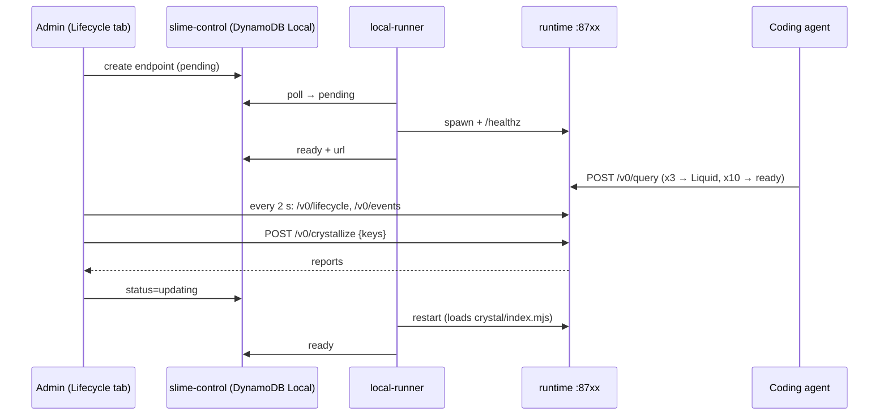

# Endpoint Lifecycle tab (local first test): design

* **Status:** Built locally on `feat/local-admin` (2026-11-21)
* **Date:** 2026-11-21
* **Author:** @Tony (with an agent)
* **Base:** PR #18 (`feat/slimecloud-admin`): admin, provisioner, runtime

## 1. Goal

**One endpoint is a dispatch buffer.** Every request goes to one URL
(`POST /v0/query`); each distinct request becomes a handler keyed by its
handler key. Gas → Liquid happens by itself: 3 successful runs, then the
review approves (or review is off). Liquid → Crystal is the operator's choice:
a picked request becomes **its own endpoint** (`POST /v0/e/<crystal key>` with
only `input` in the body). The Lifecycle tab is where
the operator sees what matters and promotes it.

One minimal flow inside an endpoint, runnable on a laptop:

1. Create an endpoint on a local Postgres.
2. Copy a snippet into the coding agent that builds the app.
3. Watch its requests appear as handlers, turn Liquid, and get crystallized
   with one button.

Mockup ([mockups/2026-11-21-endpoint-lifecycle.html](mockups/2026-11-21-endpoint-lifecycle.html), approved 2026-11-21): a new **Lifecycle** tab with a stage rail
(Connected → Agent linked → Liquid → Crystal) and three cards: *Give this
endpoint to your agent*, *Requests taking shape* (handler table + live feed),
*Crystallize*.

## 2. Scope

In:

* a **local runner** that turns a `pending` endpoint into a running runtime
  process on localhost, in place of the AWS provisioner;
* runtime additions: a Node server entry, a recent-requests feed, a local-only
  crystallize route;
* the admin **Lifecycle** tab, wired to a real endpoint.

Out (later): AWS deployment of this flow, a GitHub PR for Crystal, an MCP
endpoint (`/mcp`), multi-user concurrency, persistence of the feed.

## 3. Decisions

| # | Decision | Why |
|---|---|---|
| L1 | Crystallize writes modules into the endpoint's own folder and restarts it. No PR. | The whole cycle is visible without GitHub; a PR is the next step. |
| L2 | A separate `local-runner` process supervises runtimes; admin and runner talk only through `slime-control`, like the AWS provisioner. | Next.js dev reloads must not kill or orphan child processes. Same state machine as AWS (`pending → ready`, `updating → ready`). |
| L3 | Crystallize runs inside the endpoint's runtime (`POST /v0/crystallize`, only in the local entry `src/local.ts` when `SLIME_CRYSTAL_DIR` is set; the Lambda entry never mounts it). | The runtime already holds the store and connector that `crystallize()` needs. |
| L4 | After crystallizing, the admin sets `status=updating`; the runner restarts the runtime, which loads the new `index.mjs`. | Reuses the existing reconfigure flow; Crystal is read at startup. |
| L5 | The tab polls the runtime every 2 s through server code (token from the secret store). | No token in the browser; same polling pattern as `StatusPoller`. |
| L6 | Snippet tabs v1: **Prompt** and **HTTP** only. The MCP tab returns when `/mcp` exists. | Never show a command that does not work. |
| L7 | Lifecycle is the first tab and where an endpoint opens (list link, after create). | The tab is the endpoint's main view: the dispatch buffer. |
| L8 | A Crystal gets its own route `POST /v0/e/<key>`: intent and output come from the Crystal, the body carries `input`. | "Pick a request, it becomes an endpoint" without changing the core's key scheme. |
| L9 | The runner lives in `platform/admin/scripts/local-runner.ts`, not in the provisioner package. | It reuses the admin's DynamoDB client and secret store. |
| L10 | The runner acts only on endpoints it runs a child for or whose token is in this admin's secret store; no shared marker in the control table counts as proof. | DynamoDB Local may be shared with another checkout; never touch its endpoints. A boolean marker let a second runner fail or delete the first runner's endpoints. |
| L11 | Each Crystal gets its own token (`slc_…`), issued on Crystallize (or with *Issue token* for older Crystals). It opens only `POST /v0/e/<its key>`: not `/v0/query`, not another Crystal, not the admin views. Stored as one secret `CRYSTAL_TOKENS` `{key: token}`; the runner passes it as env, in AWS it arrives through the endpoint's SSM prefix like `SLIME_API_KEY`. | A Crystal can be handed to a frontend or partner without the endpoint key, which can generate new handlers. |
| L12 | The runtime copies live Liquid run counts to the store: before Crystallize (local) and at most once a minute per instance on flush (Lambda, `SLIME_RUNS_SYNC_MS`). | The core saves a handler only when it turns Liquid; Crystallize reads runs from the store. Chosen over a core change for now. |
| L13 | Each endpoint keeps its port across restarts (runner restart included). | Two simultaneous restarts used to swap ports, so an agent's URL pointed at another endpoint. |
| L14 | A busy own port fails the endpoint with a reason instead of moving it; the runner kills its runtimes on exit or crash; one endpoint's error never stops the runner; the file secret store writes atomically, queues changes within a process and holds a lock file across the admin and runner processes. | Five parallel deletes raced on the secrets file, crashed the runner, left orphan runtimes on their ports, and the next runner silently moved two endpoints to new URLs. |
| L15 | Endpoint tabs are Lifecycle · Usage · Settings (Overview and Connector redirect: Overview folded into Lifecycle and Usage, the connection moved to Settings). Crystallize is a button in the ready row; a Crystal's URL, token and curl open under its row. The endpoint list shows name, status, URL and requests; the whole row is a link. | Fewer screens repeating the same numbers; the whole flow fits one list. |
| L16 | The local runtime writes the same usage counters as Lambda (`USAGE#<id>` in the control table, `SLIME_USAGE_TABLE` set by the runner). | Locally, Usage, Billing and the list showed zeros next to a Lifecycle tab full of traffic. |
| L17 | The Crystal route refuses missing **and unknown** input names, by own properties only (`toString`, `constructor`, `__proto__` count as unknown), and the same 16 KB body limit as `/v0/query`. | The key hashes the input names; an unknown name would miss the Crystal and generate. The route is the one a public page calls. |
| L18 | In explore mode, saved handlers with another provenance are marked stale, rank below live Gas, and `crystallize()` refuses them. Locked mode does neither: it serves them as is and has no generator, so its provenance never matches a saved record. | Stale code must not be frozen. |
| L19 | Engine `warning` events are logged by both runtimes and shown in the Lifecycle tab. | The Crystal schema warning was dropped. |

## 4. Components

### 4.1 Runtime (`platform/runtime`)

* `src/local.ts`: Node HTTP entry. Reads the same env as Lambda (`config.ts`)
  plus `PORT`; checks `x-api-key` against `SLIME_API_KEY` like the Lambda entry,
  and before answering a POST waits for store writes like the Lambda entry,
  capped by `SLIME_FLUSH_LIMIT_MS` (a running review can take tens of seconds;
  the tab polls with a 3 s timeout). GETs skip the wait. Crystallize itself
  waits for every write, so `runs` and fixtures are current when it reads them.
* **Recent requests:** a ring buffer of the last 50 answered queries
  (`{at, handlerKey, tier, cache, ms}`), fed by the existing `onQuery` hook.
  `GET /v0/events` returns it. Memory only.
* **`POST /v0/crystallize`** `{ keys?: string[] }` (local entry only, when `SLIME_CRYSTAL_DIR` is set):
  runs `crystallize({ connector, store, dir: SLIME_CRYSTAL_DIR, minRuns, provenance })`
  without an optimizer (the unchanged Liquid code is the candidate). `keys`
  limits the job through a read-only store view whose `list()` returns only
  those handlers (`crystallize()` has no key filter; no core change). The
  recorded inputs it compares against are already kept by the core
  (`fixtures`, up to `fixturesPerHandler`). Returns the core's
  `CrystalReport[]`.
* **Live runs are copied to the store first.** The core saves a handler once,
  when it turns Liquid (`core/src/engine/lifecycle.ts`); later runs count only
  in memory, while `crystallize()` reads runs from the store. Without the copy
  no handler ever reaches `minRuns` from live traffic (`syncLiveRuns`).
* **`GET /v0/lifecycle`** merges saved, live and Crystal handlers (one row per
  key, most mature tier wins; a stale saved row ranks below live Gas, L18) and
  returns the thresholds (`gasToLiquidRuns`, `CRYSTAL_MIN_RUNS`) and the
  engine's startup warnings (L19).
* **`POST /v0/e/<crystal key>`**: a Crystal's own route (L8); refuses missing
  and unknown input names (L17).

### 4.2 Local runner (`platform/admin/scripts/local-runner.ts`, `npm run local`)

* Polls `slime-control` every 2 s for endpoints in `pending`, `updating`,
  `deleting`, plus `ready` endpoints whose process is not running (after a
  runner restart).
* **Start:** picks a free port from 8700 up (claimed before it is probed, so
  two endpoints started in one tick never share it); spawns
  `node --import tsx src/local.ts` in `platform/runtime` with
  * `DATABASE_URL` and `SLIME_API_KEY` from the admin's secret file;
  * `SLIME_TENANT_ID=<endpointId>`, `SLIME_HANDLERS_TABLE=slime-handlers`
    (DynamoDB Local);
  * `SLIME_CRYSTAL_DIR=.data/endpoints/<id>/crystal`;
  * `SLIME_PROVIDER` from the endpoint, and the provider key inherited from
    the runner's own environment (the operator exports it; nothing reads
    `.env`).
* Waits for `GET /healthz` 200, then writes `url=http://localhost:<port>/`,
  `status=ready`. A failed health check writes `failed` with the last stderr
  lines.
* **Updating:** stop, start, health check, `ready`.
* **Deleting:** stop the process, delete the item (folder kept).
* **One command:** `npm run local` in `platform/admin` starts `next dev` and
  the runner together, so the operator still runs a single process.

### 4.3 Admin (`platform/admin`)

* `tabs.tsx`: add **Lifecycle** at `/endpoints/[id]/lifecycle`.
* `lib/lifecycle.ts` (pure, unit-tested): from `/v0/lifecycle` + `/v0/events`
  derive
  * per handler: stage, progress label (`n/3 to Liquid`, `n/10 to Crystal`,
    `ready to crystallize`), review label;
  * the rail: Connected (endpoint `ready`), Agent linked (any handler),
    Liquid (any Liquid or Crystal), Crystal (any Crystal).
  * Review label comes from the engine (`HandlerSummary.review`, saved records,
    Crystal manifest); no inference from runs. `pending` → `reviewing…`; a
    non-Gas handler with `none` → `no reviewer`; Gas with `none` → `—`.
  * A stale saved handler shows `stale · regenerates on next request` and has
    no Crystallize checkbox (L18).
* `lifecycle/page.tsx`: the three cards from the mockup; snippets filled with
  the endpoint URL and the token hint (full token via the existing Reveal).
* Server action `crystallize(endpointId, keys)`: calls the runtime, shows
  per-handler outcomes (`crystallized`, `not-ready`, `failed` + reasons), then
  sets `status=updating` if anything was crystallized.

## 5. Data flow

## 6. Errors

* Runtime unreachable while `ready`: the tab shows "Endpoint is not running —
  is `npm run local` up?" instead of empty tables.
* No provider key: the first Gas request fails with `GENERATION_FAILED`; the
  feed shows the error code, and the card says which variable to export.
* Crystallize outcome `not-ready` or `failed`: shown per handler with the
  core's reasons; status is not changed when nothing was crystallized.

## 7. Testing

* Runtime: events buffer (cap, order), crystallize route off by default and
  limited to `keys`.
* Runner: start/updating/deleting against fake spawn and fake table;
  failed health check → `failed` with stderr.
* Admin: `lib/lifecycle.ts` stage and label derivation.
* Manual E2E: demo Postgres → create endpoint → 3 identical queries → Liquid →
  10 → Crystallize → after restart the feed shows `crystal`.

## 8. Limits

* Needs a real model key (Anthropic or Groq) in the runner's environment;
  `offline` only answers its canned intents.
* Feed, request count and Gas handlers reset on runtime restart (Gas is in
  memory by design), so after a Crystallize the Gas rows and the counter start
  over.
* Core gap found while building: Liquid run counts are not persisted after
  promotion. Worked around in both runtimes (L12). In Lambda each warm
  instance counts its own runs, so the saved count is the busiest instance's,
  not the sum: it under-counts with several instances until the core gets an
  atomic increment.
* Crystal tokens cannot be rotated or revoked one by one yet; deleting the
  endpoint removes them.
* Single machine, single operator.
* An approved revision turns Liquid after 1 run: a rejection resets runs to 1,
  and the revised code is reviewed at once.
* Crystals are served as is after a migration: a breaking migration gives a
  database error at call time, a semantic one a silently wrong answer. The
  Lifecycle tab shows the startup warning, but re-crystallizing in place is not
  built: `crystallize()` answers `already` for a key in the manifest, and the
  saved Liquid record behind a Crystal keeps its old provenance (the engine
  serves the key from the Crystal, so it never regenerates). Today: delete the
  endpoint and create a new one, which also changes its URL, `slm_` key and
  every `slc_` token (agents and pages holding them break). The core warning text ("run
  crystallize again") overstates this.
* Crystal code runs without the QuickJS sandbox (allowlist and equivalence
  test only), and Crystallize is local-only (L3).
* With `SLIME_REVIEW=off` a Crystal can ship unreviewed.
* DynamoDB Local runs `-inMemory`: restarting its container drops Liquid
  handlers and endpoints.

## 9. Review ledger (plan gate)

* **Answered:** *a separate runner is one more thing to run.* Next dev reloads
  would orphan children spawned by the admin; the runner keeps the AWS state
  machine. `npm run local` starts both, so it is still one command.
* **Answered:** *checkboxes cannot work, `crystallize()` takes no keys.* A
  filtered store view does it without touching the core.
* **Answered:** *crystallize may see stale `runs`.* The crystallize route
  waits for every store write (`slime.flush()`) and copies live runs first.
* **Answered:** *review state in `HandlerSummary`.* A one-field core change;
  the admin no longer derives the label.
* **Survived (limit):** the first real test needs a model key in the runner's
  environment.
* **Deferred:** MCP endpoint, GitHub PR for Crystal.

## 10. Relation to product frame v0.2

Frame: [product_frame_v0_2.md](../product/product_frame_v0_2.md).

The Lifecycle tab implements the v0 main flow and vocabulary of the frame
(calibrated 2026-11-21).

| Frame term | Here |
|---|---|
| Gas | A new request on `POST /v0/query` generates a handler; shown as a Gas row with `n/3 to Liquid`. |
| Liquid | Automatic promotion after 3 runs and the review; the saved row survives restarts. |
| Crystallize | The Crystallize button → `POST /v0/crystallize` (local entry only, L3), then a restart. |
| Crystal | Its own route `POST /v0/e/<crystal key>` with an `slc_` token. |

Not here yet: `catalog`, slime-client, `/mcp`, `slime uncrystallize`, origin
allowlist, CORS.
