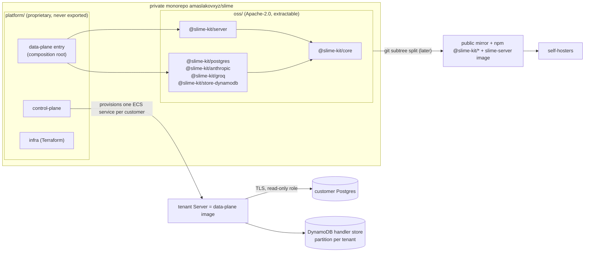

# Slime OSS / Slime Cloud split — architecture design

* **Status:** Proposed — awaiting Anton's review
* **Date:** 2026-11-20
* **Base:** `origin/main` @ `402feb5` (code: `sandbox/` only)
* **Inputs:** two research reports and one quality-gate validation (see
  [§12](#12-research-and-quality-gate-ledger)); two decision quizzes answered by
  Anton (decisions D1–D10).

## 1. Context

Slime answers frontend data requests `{intent, input, output}` with
model-generated, read-only SQL plus an optional sandboxed shaping function, and
caches the result through Gas → Liquid tiers (`concepts_brief.md:12-22`,
`sandbox/docs/ARCHITECTURE_AND_PITCH.md:6-31`). The only code is the prototype
in `sandbox/`: one Node 22 process where engine, HTTP server, environment
config and Postgres wiring are interleaved (`sandbox/src/index.ts:9-10`,
`sandbox/src/config.ts:35`, `sandbox/src/engine.ts:160`).

We are building two products on that code:

1. **Slime OSS** — an Apache-2.0 package anyone installs and self-hosts.
2. **Slime Cloud** — our SaaS that runs the same self-hostable Slime on our
   infrastructure, plus the services needed to sell and operate it.

This document defines the seam between them: what is public, what is private,
the contracts between them, and the order of work. It does not design the
individual phases; each phase in [§9](#9-migration-phases) gets its own spec and
plan.

### Vocabulary

| Term | Meaning |
|---|---|
| **Core** | Engine library: request parsing, cache key, generation loop, lint, `EXPLAIN` check, sandboxed shaping, tiers, review, fixtures. |
| **Server** | Self-hostable HTTP runtime that composes Core with adapters and serves `POST /v0/query` plus admin routes. |
| **Ports** | Interfaces Core (or, for `AuthContext`, Server) depends on; adapters implement them. |
| **Data plane** | Where Slime executes requests against customer data. In Slime Cloud: one Server per customer. |
| **Control plane** | Slime Cloud–only services: accounts, API keys, provisioning, billing, dashboard, audit. |

## 2. Decisions

| # | Decision | Source |
|---|---|---|
| D1 | OSS license **Apache-2.0**. | Quiz 1 |
| D2 | **One private monorepo now** (GitHub `amaslakovxyz/slime` is private). OSS is extracted to a public mirror later. | Quiz 1 |
| D3 | Slime Cloud data plane is **silo**: one Slime Server per customer. | Quiz 1 |
| D4 | LLM keys: **managed by default, BYOK optional**. | Quiz 1 |
| D5 | Core base = **`main`/`sandbox/` + Ports**. The write path (effects, gatekeeper, invariants from the closed PRs #2/#4, unmerged `origin/chore/gas-v0-plan`) comes later as an `EffectSink` Port. | Quiz 1 |
| D6 | Slime Cloud stores handlers in a **KV store** (DynamoDB or equivalent), not relational. Supersedes the Postgres handler table (`concepts_brief.md:278-279`) for Slime Cloud only; the OSS default stays Postgres. | Quiz 2 (Anton's note) |
| D7 | Customer DB connectivity in v1: **TLS + IP allowlist from a static egress IP**. | Quiz 2 |
| D8 | Open-core line: **the whole engine is OSS**; we charge for operations and enterprise features. | Quiz 2 |
| D9 | Inbound contributions under a **CLA that grants a license (no assignment)**. | Quiz 2 |
| D10 | npm scope **`@slime-kit/*`**. Supersedes the `@slime/core` / `@slime/server` names in `concepts_brief.md:25`, `:169`, `:277`. `@slime` is owned by a third party (`@slime/stopwatch`, maintainer `slime`, checked with `npm view` on 2026-11-20). `slime-kit`, `@slime-kit/core` and `@slime-kit/server` returned 404, so they are unpublished. Whether the org name is free is checked only when we claim it. | Quiz 2 |

## 3. Target architecture



Dependency rules (a lower layer never imports an upper one):

1. **Core** imports only its own Port interfaces and its bundled defaults
   (Memory `HandlerStore`, QuickJS `SandboxRunner`, offline `Generator`, stdout
   `Telemetry`). It does not read environment variables, construct external
   adapters, or import HTTP, `pg` or model SDKs.
2. **Adapters** import Core types and one external SDK each.
3. **Server** composes Core and adapters. It owns env/config parsing, HTTP and
   authentication of callers.
4. **`platform/`** may import any `oss/` package through its public entrypoint
   (`exports`). **`oss/` never imports `platform/`.**

Silo means the platform's data plane runs the same code a self-hoster runs. The
only difference is the composition root (`platform/data-plane`), which plugs
platform adapters into the same `createServer` the OSS CLI uses.

## 4. Repository layout and the extraction boundary

The approach was settled by D2. Three options were considered:

| Option | Verdict |
|---|---|
| **A. One private monorepo with `oss/` and `platform/` top-level dirs; mirror `oss/` later** | **Chosen (D2).** One CI, atomic cross-boundary changes, no publishing until we go public. Risk: private imports can leak into `oss/`, mitigated by the checks below. |
| B. Public repo with an `ee/` dir under another license (PostHog model: MIT except `ee/`, <https://github.com/PostHog/posthog/blob/master/LICENSE>) | Rejected: the repo is private today, and the platform code would become visible. |
| C. Separate public OSS repo now plus a private platform repo consuming npm releases | Rejected for now: release overhead before there is anything to release. This is the end state after the mirror, not the start. |

Layout:

```
slime/                         # private monorepo (today)
├── oss/                       # becomes the public repo root on extraction
│   ├── packages/
│   │   ├── core/              # @slime-kit/core
│   │   ├── server/            # @slime-kit/server (createServer + `slime` CLI)
│   │   ├── postgres/          # @slime-kit/postgres (Connector + HandlerStore)
│   │   ├── anthropic/         # @slime-kit/anthropic (Generator + Reviewer)
│   │   ├── groq/              # @slime-kit/groq (Generator + Reviewer)
│   │   └── store-dynamodb/    # @slime-kit/store-dynamodb (HandlerStore), phase 3
│   ├── docker/                # slime-server image
│   ├── docs/                  # public engine docs (move architecture-spec.md here)
│   ├── LICENSE, NOTICE        # Apache-2.0 (added at go-public, phase 5)
│   └── package.json           # npm workspaces root for oss/
├── platform/                  # proprietary; package scope @slime-cloud/* ("private": true)
│   ├── data-plane/            # composition root + platform-only adapters
│   ├── control-plane/
│   └── infra/                 # Terraform
├── docs/                      # private: business, pricing, this document
└── package.json               # workspaces: ["oss/packages/*", "platform/*"]
```

Tooling: **npm workspaces**. `sandbox/` already uses npm (`sandbox/package-lock.json`)
on Node ≥ 22 (`sandbox/package.json:16-18`). pnpm, Turborepo, Nx and Helm
were proposed in research and deferred as unneeded for six packages.

Boundary enforcement, in CI on every PR:

| Check | What it proves |
|---|---|
| `git grep` for `platform/` paths or `@slime-cloud/` specifiers under `oss/` fails the build | No private import in public code. |
| `oss/` builds and tests from its own workspace root | OSS does not need a sibling directory to build. |
| **Extraction dry run:** `git subtree split --prefix=oss`, clone the result into a temp dir, `npm ci && npm test` | The exported tree is self-contained: the real acceptance test for D2. |
| `platform/` imports `@slime-kit/*` only via package `exports` (deep imports fail to resolve) | Slime Cloud uses only public surface, so the OSS stays usable as-is. |

The mirror tool (subtree split vs Copybara) is chosen at go-public. Semver
discipline on Ports starts with the first public release. Until then, Cloud
depends on OSS packages as workspace packages.

## 5. Core and Ports

### Core public API

Keep the current `Engine` surface (`sandbox/src/engine.ts:150-330`):
`Engine.create(connector, deps)`, `query(raw)`, `listHandlers()`,
`getHandler(id)`, `reviewsSettled()`, `evict(id)`, `stats()`, `flush()`,
`close()`. Phase 1 changes how `Engine` is constructed. It does not change what
`Engine` does.

### Port list

Port names below are canonical for this design; most do not exist in the code yet.

| Port | State on `main` | Change needed |
|---|---|---|
| `Connector` | Exists (`sandbox/src/connectors/types.ts:38-49`); Postgres impl. | Move the Postgres impl to `@slime-kit/postgres`. It reads the `config` singleton for the timeout, cost cap and row cap (`connectors/postgres.ts:2`, `:21`, `:95`, `:104`, `:139`, `:147`, `:171`); those limits move into its constructor. |
| `Generator` | Exists (`sandbox/src/generator.ts:29-31`). | Implementations move to `@slime-kit/anthropic` / `@slime-kit/groq`. **Credentials and model are passed in the constructor.** Today the Anthropic client reads the key from env (`generator.ts:63-67`), which blocks BYOK (D4). |
| `Reviewer` | Exists (`sandbox/src/review.ts:33-36`). | Same as `Generator` (`review.ts:65-67`). |
| `HandlerStore` | Exists (`sandbox/src/store.ts:49-56`); Memory + Postgres impls (`store.ts:63`, `:87`). | Core must not construct it. Today `engine.ts:160` does `new PostgresHandlerStore(config.metaDatabaseUrl)`. The Postgres impl moves to `@slime-kit/postgres`; Memory stays in Core as the default. Add `store-dynamodb` (§7.3). |
| `SandboxRunner` | Missing: module functions `warmSandbox` / `runShape` (`sandbox/src/sandbox.ts:65`, `:104`) that read `config` (`sandbox.ts:9`). | Wrap them in an interface `{ warm(): Promise<void>; run(shapeJs, rows, input, limits) }`. The QuickJS-in-worker implementation stays the default and only one. |
| `Clock/Config` | Missing: a mutable module singleton (`sandbox/src/config.ts:35`) read throughout Core (e.g. `engine.ts:147`, `:164`, `:198`, `:549-550`). | Replace it with an `EngineConfig` object plus `now()` passed to `Engine.create`. Env parsing (`config.ts:3-88`) moves to Server unchanged. Tests keep adjusting limits by passing a config instead of mutating the singleton. |
| `Telemetry` | Missing: one stdout line in Server (`sandbox/src/index.ts:35-37`). | `emit(event)` with the typed events below. The OSS default writes JSON lines to stdout (current behavior). Slime Cloud's adapter feeds metering and the dashboard. |
| `AuthContext` | Missing: the data route and admin routes are unauthenticated (`index.ts:23-24`, `:44`, `:48`, `:49`; comment `:42-43`). | **Server-level**, not Core: `authenticate(request)` returns `{ subject, role }` or `null`. OSS default: static data and admin API keys from config. Slime Cloud: verify keys/tokens issued by the control plane, preferably short-lived signed tokens checked offline so a query never waits on the control plane. Core gets the principal only when the write path needs it; making it a Core Port now was rejected because the read path has no use for it. |
| `EffectSink` | Missing; the write path exists only on unmerged `origin/chore/gas-v0-plan`. | **Named, deferred.** Its signature is designed with the write path and must not import types from the unmerged branch. |

Silo (D3) removes the need for several Core features. Core does **not** get:

* a tenant in the cache key (`fingerprint.ts:54-62` and `StoreScope`
  `store.ts:43-47` stay as they are);
* per-tenant queues or quotas (the existing per-instance limits
  `config.ts:77-78` become per-customer plan limits);
* a `tenantId` on Telemetry events (the platform adapter tags each instance);
* cross-tenant sandbox hardening (§7.5).

### Telemetry events

Derived from what Core already measures. Each event is the minimum needed for
metering, the dashboard and refusal alerting.

| Event | Fields | Source on `main` |
|---|---|---|
| `query.served` | handlerId, tier, cache (`hit`/`miss`/`coalesced`), timingsMs, rowCount | `QueryMeta` (`engine.ts:101-114`) |
| `query.failed` | error code, handlerId? | `ErrorCode` (`sandbox/src/errors.ts:1-15`): includes `SANDBOX_ERROR`, `WRITE_REFUSED`, `EXECUTION_TIMEOUT`, `GENERATION_RATE_LIMITED` |
| `generation.finished` | ok, attempts, ms, waitMs, inputTokens, outputTokens, cacheReadTokens, model | `GenerationStats` (`engine.ts:52-59`) |
| `review.finished` | verdict, revision, model, ms, inputTokens, outputTokens | `ReviewResult` (`review.ts:26-31`), `Reviewer.model` (`review.ts:34`) |
| `handler.promoted` / `handler.evicted` | handlerId, from/to tier | promotion `engine.ts:377`, Gas expiry `engine.ts:336`, `evict` `engine.ts:303` |

## 6. OSS packages and artifacts

| Artifact | Contents | Self-host use |
|---|---|---|
| `@slime-kit/core` | Engine, Ports, Memory store, QuickJS `SandboxRunner`, stdout `Telemetry`, offline generator under a `testing` subpath | Embed in an app (the library-first shape in `concepts_brief.md:24-25`) |
| `@slime-kit/server` | `createServer(deps)`, env → `EngineConfig`, `AuthContext` with static keys, `slime serve` CLI | Run the standalone server |
| `@slime-kit/postgres` | `Connector` + `HandlerStore` for Postgres | Default data source and store |
| `@slime-kit/anthropic`, `@slime-kit/groq` | `Generator` + `Reviewer` | Pick a provider |
| `@slime-kit/store-dynamodb` | `HandlerStore` on DynamoDB | Self-hosters on AWS; Slime Cloud's store |
| `slime-server` container image | `@slime-kit/server` with the Postgres, Anthropic and Groq adapters | `docker run` with env |

Upgrade rule (already true on `main`): handlers are reused only when schema
hash, prompt hash and model match (`store.ts:43-47`, `fingerprint.ts:54-62`,
`prompts.ts:54-57`). A release that changes prompts invalidates old handlers,
which are regenerated. The handler table creates itself
(`store.ts:99-100`); add migrations only when the stored shape first changes.
The SQL-file migration approach suggested in research (Flyway, a JVM tool) is
rejected for a Node package.

Self-host security baseline. OSS enforces:

* the DB user is the boundary: `Engine.create` refuses to start if the role can
  write (`engine.ts:150-153`, `connectors/postgres.ts:108-128`), and every query runs
  in `BEGIN READ ONLY` with a timeout (`postgres.ts:146-147`);
* the sandbox limits (`config.ts:86-87`);
* models never see input values (`generator.ts:33-48`);
* locked mode (`config.ts:44-46`);
* admin and data API keys, new in phase 2.

The operator owns TLS termination, network exposure, secret storage and
backups.

## 7. Slime Cloud

### 7.1 Data plane: silo

* One ECS Fargate service per customer, running the data-plane image (ECS
  Fargate + RDS was already decided for the demo, `concepts_brief.md:237`).
  The image is the OSS Server plus the platform composition root.
* The compute floor per customer is about **$18/mo at 0.5 vCPU / 1 GB** and
  **$36/mo at 1 vCPU / 2 GB**. These figures are computed from us-east-1
  Fargate prices of $0.04048 per vCPU-hour and $0.004445 per GB-hour
  (<https://aws.amazon.com/fargate/pricing/>).
* In-flight request merging (`engine.ts:127`) and the generation limits work
  per customer unchanged, because each customer owns its process.

### 7.2 Control plane (proprietary)

| Service | Responsibility |
|---|---|
| Accounts / orgs | Sign-up, membership, plan. |
| API keys | Issue and revoke data and admin credentials for the customer's instance (verified by the data plane's `AuthContext` adapter). |
| Provisioning | Create, update and delete a customer's ECS service, secrets, IAM role and store partition. |
| Billing / metering | Consume `generation.finished`, `review.finished` and `query.served` events, then rate per model and invoice (managed keys only; §7.6). |
| Dashboard | Handlers, tiers, review verdicts and errors, read through the instance's admin API (`/healthz`, `/v0/handlers`; `concepts_brief.md:174-175`). |
| Audit log | Key, provisioning and config changes. |

The platform holds its own state (accounts, keys, billing) in RDS Postgres,
consistent with `concepts_brief.md:237`. The Telemetry transport (queue vs
direct ingest) is chosen in the platform spec. For sizing: SQS standard costs
$0.40 per million requests (<https://aws.amazon.com/sqs/pricing/>), so events
must be batched.

### 7.3 Handler store: KV (D6)

* **Adapter:** `@slime-kit/store-dynamodb` implements the existing
  `HandlerStore` Port (`store.ts:49-56`). It is OSS, consistent with D8.
  Adapters for other clouds implement the same Port.
* **Keys:** partition key `<tenantId>#<schemaHash>#<promptHash>#<model>`; sort
  key `artifactKey`. `tenantId` is adapter constructor configuration; the
  Port's `StoreScope` (`store.ts:43-47`) is unchanged.
  * `loadLiquid(scope)` becomes one paginated `Query` on the partition.
  * `saveLiquid` becomes `PutItem`.
  * `updateRuns` becomes `UpdateItem`.
* **Isolation:** each tenant's task role may touch only its own partitions,
  using the `dynamodb:LeadingKeys` IAM condition with a `<tenantId>#*` prefix,
  and no `Scan` permission
  (<https://docs.aws.amazon.com/amazondynamodb/latest/developerguide/specifying-conditions.html>).
* **Performance:** the store is not on the request path. Liquid handlers are
  loaded into memory at startup (`engine.ts:179`, `:416-417`), lookups are
  in-memory (`engine.ts:334`), and store writes run off the request path
  (`engine.ts:358`, `:405`). KV latency affects instance cold start, not query
  latency. The case for KV is cost, operations and per-tenant isolation (D6)
  `[INFERENCE]`.
* **Item-size constraint:** a stored handler carries `fixtures` with full
  query `output` (`store.ts:9-13`, `:35`). There are up to 5 per handler
  (`FIXTURES_PER_HANDLER`, `config.ts:72`), and each output can be up to
  `ROW_CAP` rows (`config.ts:82`). DynamoDB caps an item at **400 KB**
  (<https://docs.aws.amazon.com/amazondynamodb/latest/developerguide/Constraints.html>).
  The adapter must keep fixtures as separate items, or cap their serialized
  size and refuse to persist above the cap.
* **Data at rest:** fixtures contain customer query results, so Slime Cloud
  stores customer data, not just code. Retention and encryption of fixtures
  must be decided before the first external customer (open item O2).

### 7.4 Customer database connectivity (D7)

* Tenant tasks run in private subnets and egress through a NAT gateway with an
  Elastic IP. That IP is what customers allowlist
  (<https://docs.aws.amazon.com/vpc/latest/userguide/vpc-nat-gateway.html>).
* The customer supplies a read-only role, preferably on a read replica. The
  existing startup safety check rejects any role that can write
  (`engine.ts:151-153`).
* TLS with server-certificate verification is required for every customer
  connection.
* PrivateLink is the later enterprise option. It costs $0.01 per endpoint-hour
  per AZ plus $0.01 per GB (<https://aws.amazon.com/privatelink/pricing/>).

### 7.5 Sandbox isolation

QuickJS in a worker thread is kept (`concepts_brief.md:144-145`, `:213-216`).
Under silo, a process holds only one customer's data. In-process untrusted code
can in principle read its whole process via Spectre-class side channels, and
the effective mitigation is process separation
(<https://v8.dev/blog/spectre>). Silo provides that separation between
customers. gVisor and Firecracker are not needed for v1.

### 7.6 LLM keys and metering (D4)

| Mode | Key custody | Billing |
|---|---|---|
| Managed (default) | Platform Anthropic key in Secrets Manager, injected into the tenant task | Tokens from `generation.finished` / `review.finished`, rated per model |
| BYOK | Customer key stored as that tenant's secret, injected the same way | Tokens recorded for the dashboard and not billed |

Core stays unaware of the mode, because the key reaches the `Generator`
through its constructor (§5). Reference list prices: Sonnet $3 / $15 and Haiku
4.5 $1 / $5 per million input / output tokens
(<https://platform.claude.com/docs/en/about-claude/pricing>). The repo default
generator `claude-haiku-5-5` (`config.ts:24`) must be priced from the live
price list when billing is built.

## 8. Licensing, IP and monetization

### What Apache-2.0 "patent use" means

Section 3 of the license (<https://www.apache.org/licenses/LICENSE-2.0#patent>):

* **Scope of the grant.** Every contributor, including us, grants every
  recipient a perpetual, worldwide, royalty-free patent license. It covers
  patent claims that are *necessarily infringed by their contribution*.
* **Consequence for us.** If we ever patent part of Slime (for example the
  tiering or JIT-verification method), anyone using the OSS code is licensed
  for what that code does. We cannot assert those patents against OSS users.
  `[INFERENCE — not legal advice]`
* **Termination.** A recipient who sues claiming that *the Work* infringes a
  patent loses their patent license under §3. Termination is limited to
  lawsuits against the Work.
* **Limit.** Whether patents remain enforceable against independent,
  non-derived implementations is a question for counsel. `[INFERENCE — not
  legal advice]`

### How we protect our IP under Apache-2.0

| Lever | Effect |
|---|---|
| Keep `platform/` proprietary | The paid value lives there: control plane, provisioning, metering, multi-instance operations. It is never exported, and the CI boundary checks in §4 keep it that way. |
| Trademark | §6 grants no trademark rights (<https://www.apache.org/licenses/LICENSE-2.0#trademarks>). Brand control comes from registering and enforcing the mark and publishing a trademark policy: forks may use the code, not the name. Run a clearance search first: "SLIME" is also the Superior Lisp Interaction Mode for Emacs (<https://github.com/slime/slime>). `[INFERENCE: registrability unknown]` |
| CLA with a license grant (D9) | Apache §2 already lets us use contributions commercially, including in proprietary code (<https://www.apache.org/licenses/LICENSE-2.0#copyright>). The CLA adds the right to relicense the OSS later `[INFERENCE — confirm with counsel]`. This is the Apache/CNCF model, a license grant rather than an assignment (<https://www.apache.org/licenses/icla.pdf>, <https://github.com/kubernetes/community/blob/master/CLA.md>). |
| Accept what is public | Under D8, prompts (`sandbox/src/prompts.ts`) and the review instructions (`review.ts`) ship in the OSS. The moat is operations and data, not prompt secrecy. |

### When enterprises pay

We follow a buyer-based open core: a feature is placed by "who cares most about
it" (<https://handbook.gitlab.com/handbook/product/product-processes/tiering-guidance-for-features/>).

| Buyer pays for | Why it is not in OSS |
|---|---|
| Managed service: no servers, upgrades or on-call | It is operations, not code. |
| SSO/SAML, roles, audit log | Bought by security and IT, not individual developers. |
| Compliance (SOC 2, DPA), data residency, fixture retention controls | A contract and process matter. |
| Private connectivity (PrivateLink), dedicated capacity | Infrastructure we run. |
| BYOK management, usage dashboards, cost controls | Platform features over many instances. |
| SLA and support | A contract. |

Pricing shape: a per-instance base fee (the silo floor in §7.1 is the cost
floor) plus metered managed-model tokens. Exact prices belong in the platform
spec.

Precedents for "permissive core, paid operations":

* Supabase core is Apache-2.0 (<https://github.com/supabase/supabase/blob/master/LICENSE>).
* Temporal is MIT (<https://github.com/temporalio/temporal/blob/main/LICENSE>).
* The licenses we rejected, which protect against competing hosting, appear in
  [§12](#12-research-and-quality-gate-ledger).

## 9. Migration phases

Each phase is a separate spec and plan, and each ends with a running system.

| Phase | Scope | Exit check |
|---|---|---|
| P0 Boundary | Create `oss/` + `platform/` + npm workspaces; `git mv sandbox/*` into `oss/` with no behavior change; add the CI checks from §4 | Existing sandbox test suite passes from `oss/`; subtree-split dry run passes |
| P1 Core extraction | `EngineConfig` + `now()` replace the `config` singleton; store construction leaves Core; `SandboxRunner` interface; `Telemetry` Port; credentials through constructors; split into the §6 packages | Same tests pass. `@slime-kit/core` has no `process.env`, `pg` or model-SDK import (grep check in CI) |
| P2 Server | `createServer(deps)`, `slime serve`, static data/admin keys, `slime-server` image, env reference doc | `docker run` against the compose Postgres serves `/v0/query`; requests without a key get 401 |
| P3 Platform data plane | Composition root, `@slime-kit/store-dynamodb`, Terraform for one tenant (ECS service, NAT EIP, secrets, IAM `LeadingKeys`) | One tenant serves a test customer DB over TLS; a restart reloads Liquid from DynamoDB |
| P4 Control plane MVP | Accounts, API keys, provisioning, metering, dashboard | Self-serve sign-up → provisioned instance → metered generation on the invoice preview |
| P5 Go public | LICENSE + NOTICE, CLA bot, trademark policy, claim the `@slime-kit` npm org, mirror job, public CI | Public mirror builds green; `npm i @slime-kit/server` works |

The write path (`EffectSink`) and Crystal are scheduled after P2 as engine
features, inside `oss/`. Crystal in `concepts_brief.md:187-193` is agent-written
code pushed directly to the repo with automated checks. The unmerged
`origin/feat/crystal` implements agent-written Crystal modules but commits them
on a branch for a pull request, never on main
(`origin/feat/crystal:sandbox/src/cli-crystallize.ts:1-6`), which deviates from
that direct push. Per-tenant Crystal in Slime Cloud has no repo to push to
(open item O3).

## 10. Testing strategy

* **Port contract suites** live in Core: one shared test suite per Port that
  every adapter runs. This keeps Postgres and DynamoDB stores behaviorally
  identical.
* `oss/` CI covers unit tests, contract suites, the boundary grep and the
  subtree-split dry run.
* `platform/` CI runs integration tests against the built `slime-server`
  image, which is the same artifact customers self-host.
* The existing benchmark (`sandbox/src/bench.ts`) stays the end-to-end
  acceptance check for speed and correctness.

## 11. Risks and open items

| # | Item | Status |
|---|---|---|
| O1 | Claim the npm org `@slime-kit` and the matching GitHub org before names are squatted (`@slime` is already taken, D10). | Needs Anton. External action. |
| O2 | Fixture retention and encryption in Slime Cloud. Fixtures are customer query results (§7.3). | Open; decide before the first external customer. |
| O3 | Crystal in silo: the per-tenant artifact store, given the repo-push model in `concepts_brief.md:187-193`. | Open; decide in the Crystal spec. |
| O4 | Trademark clearance for "Slime" (§8). | Open; needs counsel. |
| R1 | Silo cost scales linearly with customers, about $18–36/mo compute floor each (§7.1). | Accepted (D3). Pooling would need a tenant in the cache key and cross-tenant sandbox hardening. |
| R2 | While the repo is a single private monorepo, a private import can slip into `oss/`. | Mitigated by the §4 CI checks. The subtree-split dry run is the backstop. |
| R3 | The DynamoDB 400 KB item limit vs fixtures holding up to `ROW_CAP` rows. | Mitigated in the adapter design (§7.3). |
| R4 | P0 moves `sandbox/` while branches still edit it (`origin/feat/crystal` adds about 1.6k lines; local worktree `feat/database-adapters`). Every open branch hits rename conflicts. | Land P0 right after those branches merge, or rebase them right after P0. Git's rename detection should carry most edits across `[INFERENCE]`. Coordinate with the team before P0. |
| R5 | Managed keys (D4): every tenant task shares the platform's Anthropic org rate limits, so one tenant's generation burst can throttle the others. | Per-plan generation caps through the existing per-instance limits (`config.ts:77-78`) plus aggregate monitoring. Anthropic enforces limits per organization and supports per-workspace limits (<https://platform.claude.com/docs/en/api/rate-limits>), so one workspace per plan or tenant can cap a burst. |

## 12. Research and quality-gate ledger

Three agents fed this design:

* **ResearchOSS:** packaging, Ports, license.
* **ResearchSaaS:** topology, connectivity, keys, control plane, AWS.
* **QualityGate:** wrote a rubric with hard gates on citations, vocabulary,
  recorded decisions and feasibility, then validated both reports.

**Gate verdict:** both reports **FAIL**.

* 17 of 26 OSS line references and 4 of 7 SaaS line references were wrong.
* Several precedent licenses and most AWS and model prices were wrong.
* The two Port lists did not match.

This document uses only the validator's verified facts. Every repo citation
above was re-read on `402feb5`, and every URL was fetched on 2026-11-20.

Corrections applied (validator errata):

* Supabase is Apache-2.0, not AGPL.
* PostHog is MIT except `ee/`.
* Temporal is MIT, not SSPL.
* n8n uses the Sustainable Use License (<https://github.com/n8n-io/n8n/blob/master/LICENSE.md>).
* Elasticsearch was never FSL (<https://github.com/elastic/elasticsearch/blob/main/LICENSE.txt>).
* Apache §3 termination covers only lawsuits against the Work.
* The Linux kernel uses the DCO (<https://www.kernel.org/doc/html/latest/process/submitting-patches.html>).
* The CNCF CLA grants a license; it is not an assignment.
* Spectre needs no physical access.
* RDS db.t3.medium Multi-AZ costs about $106/mo, not $460.
* Sonnet is priced at $3 / $15 per million tokens.

Rejected alternatives:

| Alternative | Why rejected |
|---|---|
| Pooled multi-tenant data plane (the SaaS report's recommendation) | D3. It would need a tenant in the cache key, per-tenant quotas, and cross-tenant sandbox isolation beyond QuickJS. |
| FSL-1.1 (the OSS report's first recommendation; Sentry uses it, <https://github.com/getsentry/sentry/blob/master/LICENSE.md>) | D1. Not OSI open source. |
| AGPL-3.0 (Grafana, <https://github.com/grafana/grafana/blob/main/LICENSE>) or ELv2 (Airbyte, <https://github.com/airbytehq/airbyte/blob/master/LICENSE>) | D1. Adoption friction or not open source. |
| CLA with copyright assignment | D9. Apache §2 already covers commercial use. |
| Managed-only LLM keys | D4. |
| Handler store in relational RDS schemas or in the customer DB | D6. |
| PrivateLink in v1 | D7. Kept as an enterprise add-on. |
| Copybara now, pnpm/Turborepo/Helm, Flyway | Not needed before going public, or a JVM tool in a Node stack. |

Design-doc gate: QualityGate checked this document itself. Of 62 repo citations
and 23 URLs, all resolve. It found 16 text-level defects: two undeclared
conflicts with `concepts_brief.md` (D6, D10), missing `[INFERENCE]` tags, a wrong
DynamoDB URL, and Telemetry vs metering gaps. All 16 are fixed in this version.

Adversarial review ledger:

* **Survived** (now risks): R4, P0 rename conflicts with in-flight `sandbox/`
  branches; R5, a shared managed-key rate limit.
* **Answered:**
  * *"Silo plus a DynamoDB store means Cloud no longer runs what self-hosters
    run."* The store sits behind the same Port, and the Port contract suites
    (§10) keep adapters behaviorally identical.
  * *"Whole engine OSS lets a competitor host Slime unchanged."* Accepted by
    D1/D8; the paid value is operations (§8).
* **Deferred:** revoking offline-verified tokens (short-lived tokens vs a
  revocation list) goes to the control-plane spec.
