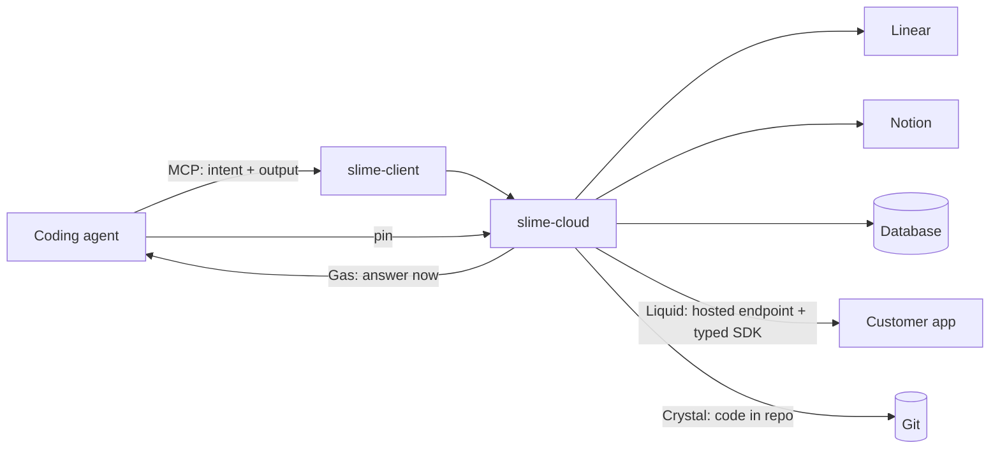

# Slime for coding agents: integrations research

* **Status:** Record (research behind
  [product_frame_v0_2.md](product_frame_v0_2.md), which unifies this track's
  decisions; not a contract)
* **Date:** 2026-11-21
* **Author:** @Tony (with an agent)

## 1. The reframe

Today `main` is a self-building backend for frontends: an app sends
`{intent, input, output}` and `@slime-cloud/core` generates and caches a
read-only SQL handler against one Postgres
([request format](../../core/docs/request-format.md)).

The proposed product changes three things:

* **Client:** the developer's coding agent (Claude Code, Cursor, Codex) talks
  to Slime through **slime-client**, a devtool installed on the developer's
  machine.
* **Sources:** **slime-cloud** connects integrations. The first narrow set is
  Linear, Notion and a database; later anything (Jira, HubSpot, ...).
* **Scope of ownership:** Slime turns what the client sends into an API and
  returns the answer. Slime owns the infrastructure, backend and integrations.

## 2. Decisions taken so far

| # | Question | Decision | Rejected alternatives |
|---|---|---|---|
| D1 | When does the agent use Slime? | **Hybrid explore → pin.** The agent explores data (Gas), pins a good request into a hosted endpoint (Liquid), and can export it into its repo as code (Crystal). | Runtime gateway only (competes head-on with MCP servers, Composio); dev-time API builder only (integrations become just more sources). |
| D2 | How are Linear/Notion queried? | **Live federation.** Every call goes to the source API at request time. | Sync → Postgres (excluded by D3: a replica is stored customer data). |
| D3 | Customer data retention | **No customer data is stored.** Rows and content live in memory for one request only. | Response caching, replicas. |
| D4 | Operations in v0 | **Read-only.** Matches `core` and the current positioning. | Writes; read + one confirmed write. |
| D5 | Where does execution run? | **All in slime-cloud** (tokens and execution in our Lambda). | Execution in slime-client (control/data plane split); explore local + pinned in cloud. |
| D6 | Agent-facing surface | **MCP server + `slime` CLI.** CLI: `login`, `connect`, `pin`. MCP tools: `query`, `catalog`, `pin`. Internally the existing `{intent, input, output}`. | Own protocol + SDK; CLI only. |
| D7 | How does the agent reuse handlers? | **Catalog first** (§4.1). The agent looks up existing handlers before writing a new intent. | Semantic intent matching (risk of serving a handler with a different meaning); both (largest scope). |
| D10 | How does the D9 user connect? (revises D6) | **A remote MCP server added by URL is the main path; the `slime` CLI is optional.** The user pastes the Slime URL into their agent, signs in with OAuth, and connects Linear/Notion on a web page. Tools stay `query`, `catalog`, `pin` (D6, D7). | Keep an installed slime-client as the main path (terminal, Node and JSON configs lose much of the D9 audience); two equal paths (double onboarding and tests). |
| D9 | Who is the user? | **PM, manager or vibecoder: not tech-savvy, needs fast iteration** (§4.7). | Engineer/tech lead; ops analytics across all three sources as the ICP. |
| D8 | Whose credentials read the sources? | **The developer's personal OAuth**, for explore and pinned endpoints alike (§4.2). | One workspace connection per source (needs a workspace admin); personal for explore + workspace app for pinned (two connections, different data in Gas and Liquid). |

The hybrid maps the existing tiers onto user actions:

## 3. Research: live federation

### 3.1 What carries over from `core`

* The model already never sees rows or input values, only the dictionary,
  intent, input key names and `output` ([PLAN.md](../../core/PLAN.md) §4.5).
  "The model sees schema, not data" carries over unchanged and supports D3.
* The QuickJS shaping sandbox in a killable worker (`core/src/sandbox`) can be
  reused for joins and shaping in memory.
* What changes is what the model generates: a plan of source calls instead of
  one SQL query.

### 3.2 Handler shape: free JS vs declarative plan

| | L1. Free JS | **L2. Declarative plan (recommended)** |
|---|---|---|
| Model output | JS that calls `linear.graphql()`, `notion.query()` itself | A list of native source queries (Linear GraphQL, Notion filter JSON, SQL) plus JS that joins and shapes the results in memory |
| Pre-run checks | Nearly impossible: loops and calls happen at runtime | GraphQL validated against Linear's schema, Notion filters against data source properties, call count known up front, read/write visible statically |
| Relation to `core` | A new engine | Generalizes today's `SQL + shapeJs` into `sourceQueries[] + shapeJs` |

L2 keeps what the benchmark proved: generated code is checkable, reviewable
and cacheable ([concepts brief](concepts_brief.md)).

### 3.3 Source API limits (from the official docs, read 2026-11-21)

* **Linear** ([rate limiting](https://linear.app/developers/rate-limiting)):
  * requests: 2,500/hour per user with an API key, 5,000/hour per user for an
    OAuth app, 600/hour per IP unauthenticated;
  * complexity: 3,000,000 points/hour with an API key, 2,000,000 for an OAuth
    app;
  * pagination returns 50 records by default; children multiply complexity;
  * Linear discourages polling and recommends webhooks.
* **Notion** ([request limits](https://developers.notion.com/reference/request-limits)):
  * per connection: 180 requests/minute (600 on Business and Enterprise);
  * querying a data source: about 3 requests/second per connection;
  * a separate per-workspace limit is shared by all connections, so a 429 can
    arrive while one connection is under its own limit.

### 3.4 Consequences

1. **N+1 is the main enemy of cross-source joins.** "50 Linear issues → one
   Notion page each" at 3 rps takes about 17 s. Plans must batch where the
   API allows it: `issues(filter: { id: { in: [...] } })` in Linear, one
   data source query with an `or` filter in Notion when the pages live in a
   database and match on a property. Notion has no batch page retrieval, so
   joins on loose page links stay N calls. The validator rejects calls inside
   loops and caps fan-out.
2. **Liquid is no longer milliseconds.** No model on the request path, but
   every call still hits source APIs: an estimated 0.3–2 s (not measured).
   The benchmark's
   3–8 ms does not transfer; positioning and the demo must say so.
3. **Quota is our problem.** Slime spends the user's Linear quota. Needed: a
   per-handler call budget, 429 handling with `Retry-After`, and call cost in
   `meta`.
4. **Schema drift is cheap to detect.** A source schema fingerprint goes into
   the handler key. A renamed Notion property fails plan validation before any
   call and drops the handler back to Gas.

### 3.5 What "no customer data" means precisely (D3)

Stored:

* handlers (plans and shaping code);
* source schemas (Notion database and property names are customer metadata);
* OAuth tokens, encrypted with KMS;
* logs without payloads.

Never stored, not even as a response cache: rows and content.

### 3.6 Consequences of D5 (all in cloud)

* The customer database must be reachable from the internet: managed Postgres
  (Neon, Supabase, RDS) with an allowlist of our egress IPs. `localhost`
  databases are out of scope for v0.
* Data passes through our Lambda in transit and in memory only: never to disk,
  never to logs.

## 4. Gaps still to design

1. **Handler matching for agents (decided: D7, catalog first).** The cache
   key is the normalized intent text, and agents paraphrase constantly, so
   without help every paraphrase is a new handler, model call and review.
   The design sketch:
   * **`catalog` MCP tool** returns the tenant's reusable handlers: intent,
     input names and types, `output`, tier, sources touched, and call cost.
     It takes optional `source` and `search` (plain substring) filters so the
     list stays small as it grows.
   * **Only reviewed handlers are listed** (Liquid and pinned). Gas handlers
     are not, so an unreviewed guess never spreads.
   * **The MCP server instructions and the `query` tool description** tell the
     agent to call `catalog` first and to send a listed intent verbatim, which
     hits the cache key exactly.
   * **A `query` miss** answers as Gas and adds `meta.hint: "pin to add to the
     catalog"`.
   * **Known limit:** reuse depends on the agent following instructions.
     Semantic matching stays a later option if the measured hit rate is low.
2. **Identity and permissions (decided: D8, personal OAuth).**
   `slime connect <source>` stores the developer's own OAuth token
   (encrypted, §3.5), and every handler of that developer runs with it.
   Consequences to handle:
   * **A pinned endpoint inherits one person's permissions.** The catalog and
     dashboard show the token owner on every handler.
   * **Revoked or narrowed access must fail loudly.** A source 401/403
     returns a dedicated error (e.g. `SOURCE_AUTH_REVOKED`), never an empty or
     partial result that looks valid.
   * **Production traffic spends the developer's personal quota.** Linear
     counts requests per user (2,500/hour with an API key, 5,000/hour with an
     OAuth app, §3.3), shared with that person's own Linear usage. A busy
     pinned endpoint can rate-limit the developer.
   * **Token refresh** runs in slime-cloud; a failed refresh is the same loud
     error.
   * **Later:** transferring a handler to a workspace connection. Out of scope
     for v0.
   * The rule "never take authorization from `input`" (request format) still
     holds: callers of a pinned endpoint authenticate to Slime with an API key
     and cannot pick whose source token is used.
3. **Semantic layer across sources.** Business terms ("customer", "blocked",
   "sprint") need a dictionary (`core`'s startup dictionary, PLAN.md §4.4)
   plus entity mapping across sources (Linear issue ↔ Notion page by link or
   id).
4. **Trust in answers.** The agent cannot verify a plan. Return `assumptions`
   and provenance (which source and fields), and mark Gas answers as
   unreviewed.
5. **Economics and metering.** Generation cost (model) differs from request
   cost (source calls). Needed: a per-tenant generation cap and a visible cost
   of a pin.
6. **DX path.** `slime login` → `slime connect linear` → MCP registered → first
   answer, plus a dashboard of handlers (plan, tier, cost, review state).
7. **ICP (decided: D9) and demo.** The user is a PM, manager or vibecoder:
   not tech-savvy, iterating fast in an AI chat or app builder. This puts
   pressure on earlier decisions:
   * **D6 assumed a developer machine.** A CLI and a locally installed MCP
     server are friction for this user. Resolved by D10: a remote MCP server
     added by URL with OAuth sign-in. Checked on 2026-11-21 in the official
     docs: Claude Code (remote HTTP with OAuth,
     [docs](https://docs.claude.com/en/docs/claude-code/mcp)), Cursor
     (Streamable HTTP with OAuth, [docs](https://cursor.com/docs/context/mcp))
     and the Claude apps (custom connectors,
     [docs](https://modelcontextprotocol.io/docs/develop/connect-remote-servers)).
     ChatGPT and Lovable are not verified.
   * **Trust (gap 4) gets harder.** The user cannot read a plan or SQL, so
     `assumptions` and provenance must be plain language ("counted issues in
     the *Blocked* state of project *Release 2.1*").
   * **Crystal (export to a repo) matters less.** Pin → hosted endpoint is the
     payoff; the user's app builder consumes the URL.
   * **D8 fits.** Personal OAuth needs no workspace admin.
   * **Errors must say what to do** ("reconnect Linear"), not show codes.

   Proposed demo: in an AI chat, the user asks for "issues blocking the
   release with their Notion specs", gets a table, pins it, and asks the app
   builder for a release dashboard on the pinned endpoint.

## 5. Next decision

Semantic layer (gap 3) for the D9 demo: how business terms ("blocked",
"release", "spec") and the Linear issue ↔ Notion page link get defined
without asking a non-technical user to write a dictionary.
