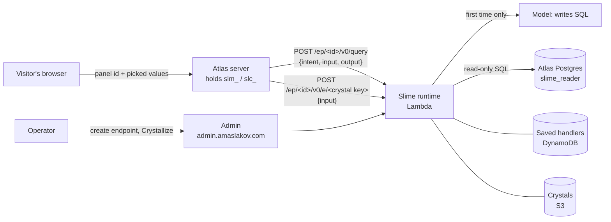
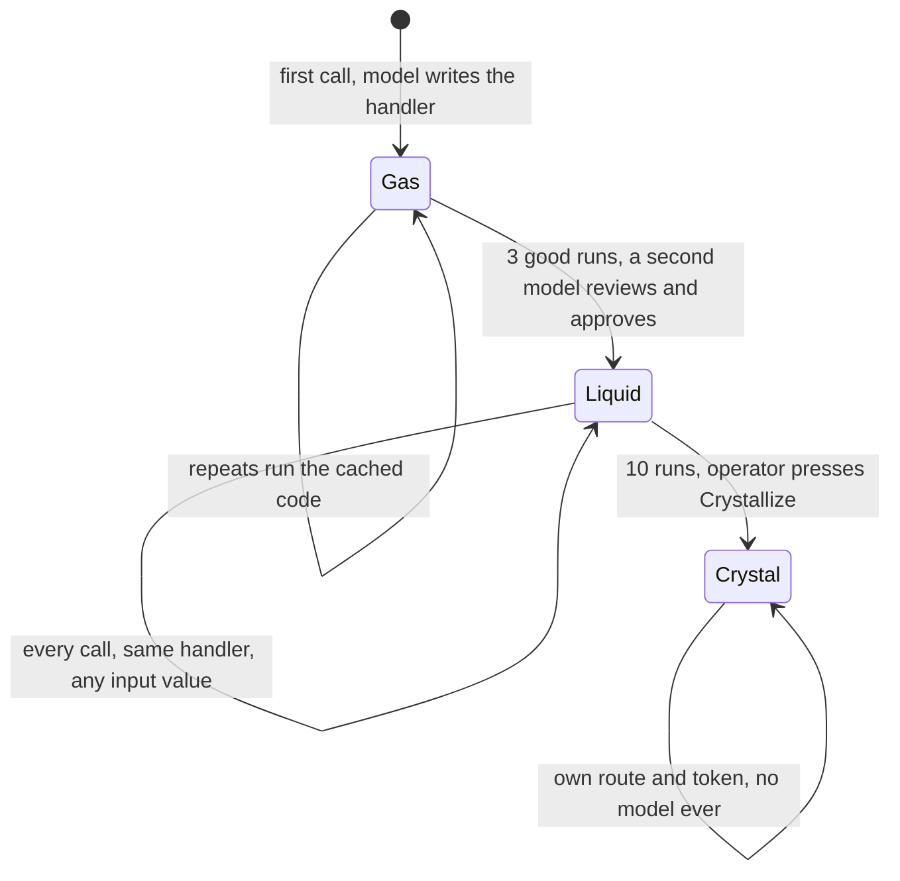
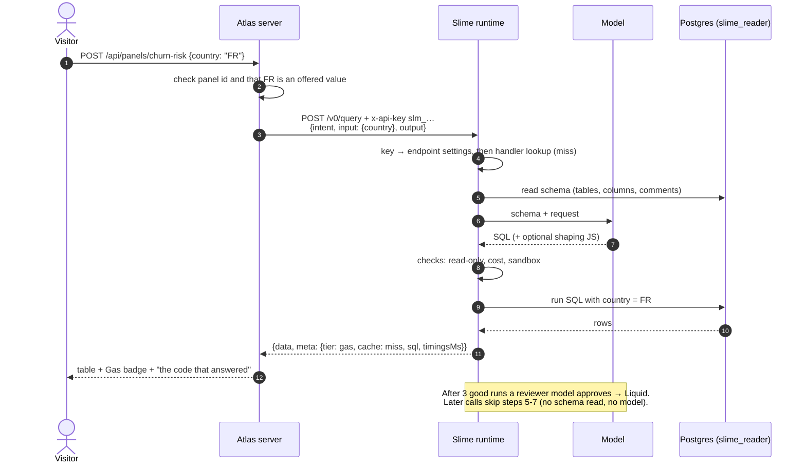

# DEMO cheatsheet: what the customer does, what Slime does

* **Status:** Current (matches `examples/customer-site`, `platform/runtime` and `platform/admin` on main, 2026-11-22).
* **Use it for:** explaining the Atlas demo at the table, and onboarding someone who wants to try Slime on their own database.
* **Try it:** <https://g2a4gnm6afgghto6jah6qdxrpu0ycxbq.lambda-url.eu-central-1.on.aws/> (the Atlas site, live).
* **Context:** [atlas-demo.md](atlas-demo.md) (who Atlas is), [customer-demo-use-cases.md](customer-demo-use-cases.md) (cases, script, measurements), [core/docs/request-format.md](../../core/docs/request-format.md) (the request contract).

## Who is who

| Actor | In the demo | Touches |
|---|---|---|
| **Visitor** | Someone at the hackathon on the Atlas page | Buttons and dropdowns. Never a key, never an intent. |
| **Atlas's agent** | Claude Code in Atlas's repo | Writes `panels.mjs`: one `{intent, input, output}` per panel. No SQL. |
| **Atlas's server** | `examples/customer-site/src/app.mjs`, live on Lambda `slime-atlas` | Holds the `slm_` key, forwards panel id + picked values to Slime. |
| **Operator** | Whoever owns the endpoint in the admin | Creates the endpoint, watches the Lifecycle tab, presses Crystallize. |
| **Slime runtime** | One Lambda (`slime-runtime`) for all endpoints | Generates, checks, runs, reviews and saves handlers. |
| **Atlas's database** | RDS Postgres, role `slime_reader` | Answers read-only SQL; hides `accounts.password_hash`. |

## The big picture



Rows never go to the model. The model sees the schema (tables, columns, comments) and
the request, and writes code. The code runs against the database.

## One request, three lives



| Tier | Where the code lives | Model tokens | Measured engine time (2026-11-22) |
|---|---|---|---|
| **Gas** | Memory of one runtime instance | Once, to generate (5.6 s for Churn risk) | ~7 ms on cached repeats |
| **Liquid** | DynamoDB, survives restarts | None per call (one review, once) | 6-8 ms |
| **Crystal** | S3 module, own URL and `slc_` token | None | 3.5-4 ms |

The cache key is the normalized intent, the input **names** and the output shape. Input
values are not in the key: FR, ES and PL all hit the same handler.

## The first call, step by step



## Onboarding: your own database in 7 steps

| # | You do | You see | Slime does |
|---|---|---|---|
| 1 | Create a read-only role: `CREATE ROLE slime_reader LOGIN PASSWORD '…'`, `GRANT SELECT` on what Slime may read (column grants hide the rest) | Nothing yet | At startup refuses a role that can write, create roles or databases |
| 2 | In the admin, create an endpoint with that database URL | Endpoint URL `https://<runtime host>/ep/<id>/` (with the trailing slash) and an `slm_` key | Stores the settings (SSM), health-checks the endpoint |
| 3 | Let your agent write a request: `intent` in plain English, `input` names, `output` shape | A file like [`panels.mjs`](../../examples/customer-site/src/panels.mjs) | Nothing yet |
| 4 | Send it once from your server (curl below) | Data + `tier: gas`, `cache: miss`, the generated `sql` | Generates, checks and runs the handler |
| 5 | Keep calling it (any input values) | `review: pending`, then `approved`, then `tier: liquid` | Reviews the handler in the background, saves it |
| 6 | After 10 runs, press **Crystallize** on the Lifecycle tab and reveal the Crystal's token | A Crystal card with a key (the Hash column) and an `slc_` token | Freezes the handler into an S3 module after an equivalence check |
| 7 | Point the panel at the Crystal route | `tier: crystal` | Serves it without ever reaching the generator |

### Calls to copy

```bash
# SLIME_URL: the endpoint URL the admin shows (https://<runtime host>/ep/<id>/) without its trailing "/",
# as in examples/customer-site/.env.example; /ep/<id>//v0/query answers 404.
# Step 4-5: any request, with the endpoint key
curl -s "$SLIME_URL/v0/query" -H "x-api-key: $SLIME_API_KEY" -H 'content-type: application/json' -d '{
  "intent": "past-due accounts in a given country with their plan, unpaid invoice total in cents and last activity date, largest unpaid total first",
  "input": { "country": "FR" },
  "output": [{ "name": "string", "plan": "string", "unpaidCents": "integer", "lastActivity": "date|null" }]
}' | jq '{rows: (.data | length), tier: .meta.tier, cache: .meta.cache, review: .meta.review}'

# Step 7: the Crystal, with its own token; only its input names are accepted
curl -s "$SLIME_URL/v0/e/$CRYSTAL_KEY" -H "x-api-key: $CRYSTAL_TOKEN" -H 'content-type: application/json' -d '{"input": {}}'
```

## Keys

| Key | Opens | Where it lives |
|---|---|---|
| `slm_…` (endpoint key) | Every route of one endpoint, including generation | Your server only. Never the browser: it can spend model tokens. |
| `slc_…` (Crystal token) | `POST /v0/e/<that crystal key>` only | Your server; safe to scope to one panel |
| Database URL | The read-only role | Typed once into the admin; the runtime reads it from SSM |

## When something goes wrong

| You see | Means | Do |
|---|---|---|
| `ACCESS_DENIED` (403) | The role may not read that table or column | Correct when the column is meant to be hidden; otherwise grant it |
| `WRITE_REFUSED` (403) | The request asks to change data | Slime is read-only by design |
| `INTENT_UNSATISFIABLE` (422) | The data cannot answer this | Reword the intent or check the schema |
| A wrong answer | The model misread the intent | Reword the intent: a new wording is a new handler. Read `meta.assumptions` first |
| `GENERATION_RATE_LIMITED` (429) | Hourly generation limit | Retry later; Liquid and Crystal calls are not limited by it |
| `UNAUTHORIZED` (401) | Wrong key, or an `slc_` token on another route | Check which key the route needs (table above) |
| Empty `data` | Nothing matches | Often correct: DE has no past-due accounts in the demo data |

## Talking points at the table

1. "The agent wrote three sentences, not a backend." Show [`panels.mjs`](../../examples/customer-site/src/panels.mjs).
2. "First call: the model writes SQL. You can read it." Open "The code that answered".
3. "Change the country: same handler, no tokens." Badge stays Liquid.
4. "Proven code gets frozen." Revenue by plan shows the Crystal badge.
5. "It cannot leak or write." The role hides `password_hash` and cannot write; the page only sends dropdown values.
