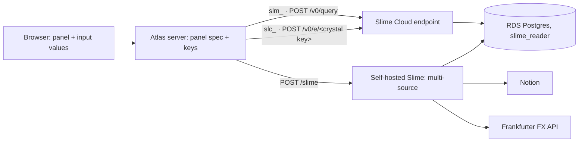

# Customer demo: three use cases from the customer's agent

* **Status:** Current. All three cases run live on 2026-11-22: cases 1 and 2 on Slime Cloud, case 3 on the self-hosted instance with a real model and replayed Notion and FX responses (see [Measured](#measured-2026-11-22)).
* **Code:** [examples/customer-site](../../examples/customer-site/README.md) (the customer's site), [examples/multi-source](../../examples/multi-source/README.md) (the self-hosted case).
* **Vocabulary:** Gas → Liquid → Crystal and Crystallize as in [product_frame_v0_2.md](product_frame_v0_2.md).
* **Positioning:** concrete runs of the "Now" use cases in [the marketing playbook](../brand/slime_marketing_positioning_tone_of_voice_use_cases.md) §3: case 1 is Use Case 1 (a backend for AI-built UIs), case 2 is Use Case 2 (a database-guarded API for agents), case 3 is Use Case 3 (one API over existing systems instead of glue middleware). Its "Claims We Don't Make" apply: only measured numbers, no tenancy claims.

## The setup

**The customer:** "Atlas", a made-up SaaS with a billing database. It has plans,
accounts, subscriptions, invoices in EUR cents and usage events
([init.sql](../../examples/express/db/init.sql); the test RDS `slime-test-db` holds it).
Complaints live in Notion.

**The actor:** Atlas's coding agent (Claude Code in Atlas's repository). It gets the task
"build a customer console for Finance, Customer Success and account managers". It does
not write SQL, endpoints or a data layer. For each panel it writes one request,
`{intent, input, output}`, into [`panels.mjs`](../../examples/customer-site/src/panels.mjs).
A thin server holds the Slime key, and the page calls that server.

**The operator:** whoever owns the Slime endpoint in the admin. The operator creates the
endpoint on a read-only database role, watches the Lifecycle tab, and crystallizes what
has proven itself.

## Use case 1: Revenue by plan (Cloud endpoint, then Crystal)

* **Agent's task:** "Finance wants MRR and active subscriptions per plan on the dashboard."
* **What the agent sends**, once, to `POST /v0/query` with the endpoint's `slm_` key:
  `intent: "monthly recurring revenue in cents and number of active subscriptions per plan, highest revenue first"`,
  `input: {}`, `output: [{ plan, activeSubscriptions, mrrCents }]`.
* **Lifecycle:** the first call generates the handler (Gas, model tokens). Repeats run the
  cached code, the reviewer approves, and the handler turns Liquid by itself. After 10
  runs the operator presses Crystallize. The panel then calls the Crystal endpoint with
  its own `slc_` token and `{"input":{}}`.
* **Customer value:**
  - A working dashboard panel with zero backend code.
  - Model tokens are spent once, at generation and review. Repeats cost none.
  - The Crystal endpoint can never reach the generator: a wrong or extra input name is
    refused, and its own `slc_` token opens only that route.
  - No speed claim. Warm, the Crystal and the Liquid handler both spend 3-8 ms in the
    engine, almost all of it the Postgres query; the network round trip dominates. The
    value is the fixed route, its own token and zero model tokens.
* **Talking point:** "The prototype is the production endpoint. Nobody rewrites it."

## Use case 2: Churn risk by country (Cloud endpoint, Liquid with a parameter)

* **Agent's task:** "Customer Success wants past-due accounts per country, biggest unpaid
  total first."
* **What the agent sends:**
  `intent: "past-due accounts in a given country with their plan, unpaid invoice total in cents and last activity date, largest unpaid total first"`,
  `input: { country }`, `output: [{ name, plan, unpaidCents, lastActivity: "date|null" }]`.
* **Lifecycle:** one generation for the first country. Every later country and every
  repeat hits the same Liquid handler: same normalized intent, same input names, same
  output shape. Only the value changes.
* **Customer value:**
  - One request covers the whole filter. The agent does not write eight endpoints, and
    nobody files a "new filter" ticket.
  - The data stays read-only: Slime connects as `slime_reader`, which cannot see
    `accounts.password_hash`.
  - The page cannot widen the question. The browser sends a country picked from the
    offered list, never an intent.
* **Talking point:** "Your agent describes the data it needs; Slime answers within
  database permissions."

## Use case 3: Customer 360 (self-hosted, three connectors)

* **Agent's task:** "Account managers want each account's paid revenue in their own
  currency next to open negative feedback from Notion."
* **What the agent sends** to the self-hosted instance's `POST /slime`:
  `intent: "accounts on a given plan with their total paid revenue converted into a given currency and their number of open negative feedback items, most open items first"`,
  `input: { plan, currency }`, `output: [{ name, paidRevenue: "number", openNegative }]`.
* **What answers:** one handler with three steps: SQL on Postgres (paid invoices per
  account), a Notion query (open, negative feedback), and `rates.latest` on the
  Frankfurter API (ECB rates). The handler's `shape` joins the rows by account name and
  converts EUR cents.
* **Customer value:**
  - It joins systems without ETL, a warehouse or glue services.
  - A new REST API is about 25 lines of declaration:
    [`rates.mjs`](../../examples/multi-source/src/rates.mjs) uses `defineApiSource`.
  - Only metadata goes to the model, never rows.
* **Why self-hosted:** Slime Cloud endpoints connect Postgres only today
  (`platform/admin/lib/connectors.ts`). Notion and REST sources run in core, so this case
  embeds core in the customer's server. A Notion or REST connector in the admin is
  roadmap.

## Fast value: where a customer feels it first

| Situation | What Slime removes | First visible result |
|---|---|---|
| Internal dashboards and admin pages built by an AI agent | Backend tickets, hand-written SQL endpoints, an ORM layer | A panel answers on the first call |
| Many filters over one dataset (country, plan, period) | One endpoint per filter | A new value is a new `input`; no new code or tokens |
| Data split across a database, Notion and SaaS APIs | ETL jobs and glue services | One request reads all three |
| A prototype that should become production | The rewrite | Crystallize freezes the proven handler into its own endpoint |
| Cost anxiety about LLMs in the request path | Per-request model calls | Tokens only at generation and review; Liquid and Crystal answers run code |

## Demo script (about 7 minutes)

Prerequisites:
- `slime-test-db` is running (database `slime`). It is paused since 2026-11-24: restore it
  from its snapshot first, see
  [platform/infra/README.md](../../platform/infra/README.md).
- The 1Password vault `Slime Hackathon` holds `Slime — Atlas demo endpoint` (URL, `slm_`
  key) and `Slime — Atlas demo Crystal (plan revenue)` (Crystal key, `slc_` token).
- For case 3, the model key: `Slime — Anthropic API key (shared runtime)` in the same
  vault. Without a key the self-hosted instance cannot start; then show the Gas beat on
  the cloud instead, by sending a new intent to `atlas-demo` `POST /v0/query` with the
  `slm_` key (the snippet on the Lifecycle tab).
- Cases 1 and 2 are already warm on `atlas-demo` (Crystal and Liquid; Liquid is saved and
  survives restarts). The Gas beat is case 3: before the demo, delete
  `examples/multi-source/.slime` (its file store) so its handler is generated live.

1. **Admin:** show the `atlas-demo` endpoint and its Lifecycle tab. Say: one database,
   one key, a read-only role.
2. **Self-hosted instance:** in `examples/multi-source`, run
   `op run --env-file=<refs> -- npm start` with `DATABASE_URL` (the reader) and a model
   key. Add `FETCH_FIXTURES=1` to replay the recorded Notion and FX responses. Replay
   matches exact requests: the recorded Notion queries are "no filter" and "Status Open
   and Sentiment negative". A freshly generated handler that filters Notion another way
   fails with `No fixture for …`. That is a gap in the recording, not a Slime error: run
   again after deleting `.slime`, or use real Notion tokens.
3. **Customer site:** in `examples/customer-site`, run
   `op run --env-file=<refs> -- npm start` and open <http://localhost:4000>.
4. **Case 3, the Gas beat:** pick a plan and a currency and press Run. The badge reads
   Gas with "generated in … ms" and three sources, `db + notion + rates`. Open "The code
   that answered" to show the SQL, the Notion and FX steps and the join the model wrote.
   Press "Run ×5": repeats run the cached code at no model tokens, and after the review
   the badge turns Liquid. Switch the currency: no new generation.
5. **Case 2, Liquid:** press Run. It answers from the saved Liquid handler. Change the
   country: still Liquid, same handler, no tokens. DE and IT are empty, which is correct.
6. **Case 1, Crystal:** press Run. The badge reads "Crystal endpoint". Explain the
   operator's Crystallize step in the admin, then show the `slc_` token on the Crystal
   card: it opens this route only.
7. **Close:** go back to the Lifecycle tab. Its Liquid and Crystal rows match what the
   audience just saw.

## Measured (2026-11-22)

Live on Slime Cloud (`admin.amaslakov.com`, endpoint `ep-290cbb5eb4`, provider Claude)
against `slime-test-db`, through the customer site:

| Case | Observed |
|---|---|
| 1 | 13 calls on `/v0/query`: Liquid with review `approved` at about 6 ms engine time. Crystallize in the admin, then `route: crystal`, `tier: crystal`, 4 rows that match the database. Eight direct Crystal calls: 51 ms engine time on the first (a cold database pool, all in `timingsMs.run`), then 3.5-4 ms |
| 2 | First call Gas, generation 5.6 s. Calls 2-3 Gas at about 7 ms (cached code, review pending). From call 4 Liquid, `approved`, 6-8 ms. FR returns 6 rows. DE returns none, which is correct: the data has no past-due accounts in DE |
| 3 | Self-hosted, Claude (`claude-haiku-5-5` generates, `claude-opus-5-5` reviews), Notion and FX replayed (`FETCH_FIXTURES=1`), through the customer site. First call Gas, generation 14.4 s, steps `db + notion + rates`, 48 rows. Calls 2-4 Gas at 90-145 ms, review pending. From call 5 Liquid, `approved`. After a restart it is still Liquid (file store); GBP, CHF and JPY answer without a new generation at 115-180 ms. Spot check: the model's top row equals the hand-written handler's (Lunar Logistics 37, 614,098 paid cents = $6,748.94 at 1.099). `npm run live` with the same key: the other three demo intents reach Liquid; one review was rejected (a null plan returned no rows) and the revision was approved |

## Limits

- **Case 3 is not on Slime Cloud.** In the measured run Notion and the FX API were
  replayed from fixtures; live Notion needs its tokens (`examples/multi-source/.env`).
- **Customer 360 joins Notion to Postgres by account name.** Names are unique in the demo
  data (they end in the account id); real data needs a shared key.
- **A Crystal runs in the runtime's process without the QuickJS sandbox**
  (`core/src/handler/crystal.ts`). The code allowlist and the equivalence check are its
  guard.
- **The page shows SQL and shape code.** That is fine for a demo; a public page would drop
  `meta`.
- **The test RDS is public**, with SSL enforced and a random password, and read through
  the read-only `slime_reader` role.
