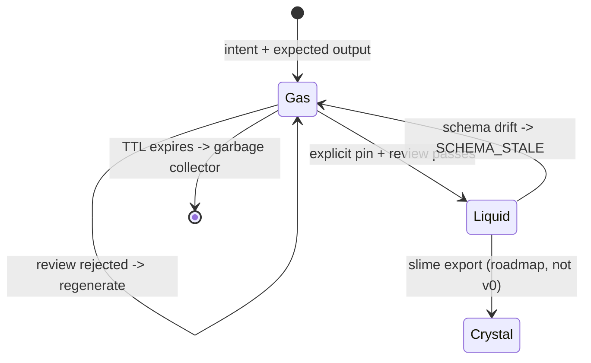

# Slime Incentives (v0 research)

* **Date:** 2026-11-21
* **Status:** Research — input to product decisions, not a resolved frame.
* **Builds on:** Product Frame v0.2 (on branch `research/product-frame-v0.2`,
  pending merge) and Dispatch Protocol v1 (2026-11-20). This branch is off
  `main`, which does not yet carry the frame doc, so the state model is
  restated inline below and nothing links to it relatively.
* **Promotion rule assumed:** the v0.2 frame's — a handler reaches Liquid by an
  **explicit `pin`** plus a **passing background review**. No auto-promotion.
  (Note: `concepts_brief.md` on `main` describes an older rule — *N successful
  runs + review, no explicit pin*. Where the two differ, this doc assumes v0.2.)

## Why an "incentives" doc at all

Slime's whole thesis is a *delegation*: a developer's coding agent sends an
intent and gets back a reviewed, pinned API over real sources, writing no
backend. A delegation only happens when it is in the interest of **every actor
in the chain** to perform it. There are three actors, and they optimize
different things:

| Actor | What it actually optimizes | Scarce resource |
|---|---|---|
| **Dev-Agent** (Claude Code / Cursor / Codex) | Finishing the developer's task, within a budget, without failing | Context window, tokens, tool round-trips, its own success rate |
| **Developer / client** | Shipping the feature; not babysitting backend plumbing | Time-to-value, attention, control over what runs in production |
| **Slime Cloud** | A business that is cheap to run and sticky to leave | Generator/reviewer token spend, hosting cost, retention |

An incentive is **well-designed when a single action is simultaneously good for
all three**. Most of this doc is the hunt for those actions. The headline
finding up front:

> **The Gas → Liquid promotion is the keystone.** Pinning an explored handler
> into a reviewed, hosted endpoint is good for the agent (its next call is
> free and deterministic), good for the developer (a stable dependency they can
> build on), and good for Slime (a Liquid call carries no model-token cost
> **under any billing posture**). Every other mechanism in this doc is judged by
> whether it moves handlers to that transition faster, or keeps them there.
>
> One precision carried through the doc: *reaching* Liquid is posture-
> independent (zero model cost to serve it, whoever paid for the Gas phase).
> What billing *does* change is **how hard Slime itself is pushed to minimize
> Gas dwell** — see "The decision this all hinges on." The keystone holds
> either way; only the identity of the party most motivated to race to it moves.

A second framing runs through the whole doc. Incentives split into three jobs,
and they must not be blurred:

* **Acquisition** — the first-call magic that makes someone try Slime at all.
* **Retention** — the reasons the catalog and the pinned endpoints become
  something you don't want to give up.
* **Margin** — the mechanics that keep a retained user cheap for Slime to serve.

Restated state model (for a reader who only has `main`):

* **Gas** — generated, running, *unreviewed*. Every call spends model tokens.
  Nothing in Gas is listed in the catalog. Expires by TTL.
* **Liquid** — reviewed and pinned behind a hosted endpoint, identified by a
  `contractId`. Zero model tokens per call; a pinned caller sends
  `expect: <contractId>` and **can never reach the generator** (a miss is an
  explicit error, never a silent regeneration).
* **Crystal** — the handler's code exported into the client's own repo.
  Roadmap, not v0. In the current frame (decision 6) this is the *exit* from
  Slime. Section 4 proposes an amendment.

---

## Ask 1 — Why is Slime convenient *and* profitable for a Dev-Agent?

### "Profitable" for a thing with no P&L

An agent has no balance sheet. "Выгодно" for an agent can only mean: **it
improves the agent's objective function** — complete the task, within the
orchestrator's budget, without failing. So "profitable" resolves to four
measurable arbitrages against the agent's scarce resources:

1. **Context arbitrage (likely the largest, though unmeasured).** To write a
   backend read-query itself, an agent must pull the source schema into its own
   context — table/column/relationship detail, re-loaded every session because
   context doesn't persist. Slime holds the schema fingerprint server-side; the
   agent sends *words* and an *output shape* and never loads the schema. This is
   plausibly the largest saving and the hardest for a competitor to replicate,
   because it is structural, not a cost trick — but it is a reasoned claim, not
   a benchmarked one, and worth measuring (schema-tokens avoided per task).

2. **Token arbitrage.** Generation happens **once**, in Slime Cloud, on a
   cheap fast model (benchmark: `gpt-oss-120b` on Groq, ~1 s). The agent does
   not spend *its own premium tokens* reasoning about SQL. The repeat call is
   zero model tokens on either side.

3. **Round-trip arbitrage.** One `query` call replaces the write → run → read
   error → debug → re-run loop. Fewer turns is directly fewer tokens and less
   chance of the agent derailing mid-loop.

4. **Reliability arbitrage.** The background reviewer catches a class of
   plausible-but-wrong SQL. The evidence is from **Slime's own generator**
   (`gpt-oss-120b`) in the benchmark — it grouped by account/plan **name instead
   of id** (two same-named accounts would silently merge) and produced an
   **inverted churn ranking** — not from a Dev-Agent writing a backend. But the
   generalization is fair: a Dev-Agent writing the query itself is no less prone
   to the same class of error, and has no reviewer of its own. So a Dev-Agent
   delegating to Slime plausibly has a *higher task success rate* than one
   writing the query itself. Delegation also offloads blame: a wrong number is a
   reviewed handler's result, not the agent's hallucination.

### "Convenient" — and why convenience must be structural

Convenience features: it is MCP-native (never leaves the agent loop); the
agent already thinks in "intent + output shape"; `meta` returns the generated
SQL and review status so the agent can trust or inspect; pinned endpoints are
deterministic so the agent can hand one to the frontend and know it won't
drift.

But the sharpest product point here is a warning. **An agent takes the locally
cheapest path its harness presents — it does not have preferences, it has
defaults.** So any incentive that depends on the agent *choosing well* is weak.
Score every mechanism on one test:

> **Does this make the right action the default tool call, or does it rely on
> the agent remembering to do the right thing?**

Worked example — reuse:

* **Weak (preferential):** "the agent should call `catalog` first and resend a
  listed intent verbatim." This is in the frame as a known limit — it depends
  on instruction-following, and agents paraphrase.
* **Strong (structural):** `query` itself does a **server-side catalog/cache
  check before it ever calls the generator.** The agent calls one tool; Slime
  decides whether this is a cache hit, a near-duplicate of a reviewed handler,
  or a genuine new generation. The agent cannot *forget* to check, because
  checking is not its job anymore.

This reframing — *move the cleverness server-side so the cheap path is the only
path* — is the most reusable product-decision output in this doc. It applies to
reuse, to pin suggestions, and to warm-up.

---

## Ask 2a — Why is the developer interested in the service?

The developer's pain is **backend toil over sources they don't control**:
OAuth and token rotation, rate limits, pagination, N+1, schema drift, and the
read-API no frontend wants to wait for someone to write. Slime's acquisition
pitch removes the entire surface: *write no backend; your agent gets the data;
Slime owns infra, integrations, and hosting.*

Three incentives, one per job:

* **Acquisition — first-call magic.** The demovertical's first moment: the
  agent asks Linear in words, data comes back in ~1 s, `meta` shows the query
  and review status. No connector written, no schema read. The second identical
  ask returns in milliseconds at zero tokens. "I asked and it just answered"
  is the hook.

* **Retention — the catalog becomes an asset.** Every reviewed handler is a
  reusable, inspectable capability. The more the developer's app leans on
  pinned endpoints, the more each one is a *production dependency* that is
  working, cheap, and already reviewed. Retention here is not a lock mechanism;
  it is accumulated, de-risked capability that is annoying to rebuild
  elsewhere.

* **Control is the adoption unlock, not a footnote.** Developers refuse to
  depend on a black box over their production data. Slime's trust primitives —
  visible SQL in `meta`, the background review, the `contractId` contract, and
  Crystal as a credible way to leave with the code — are what make the
  delegation *psychologically acceptable*. This directly enables Ask 3.

---

## Ask 2b — Interest in "quickly running an endpoint to crystallize"

This phrase hides the single most important incentive in the product, and one
genuine contradiction. Take the contradiction first.

### The unit-economics engine (the real reason to want speed)

Reframe the lifecycle as a cost curve:

* **Gas is the cost center.** Every Gas call spends generator tokens; pinning
  also spends reviewer tokens. Unreviewed, it carries risk.
* **Liquid is the margin.** Zero model tokens per call. (Not literally free —
  see anti-incentives — but the expensive, risky part is behind it.)

The transition that is **good for the developer** (a stable, cheap, reviewed
endpoint to build on) is the **exact same transition that is good for Slime's
unit economics** (stop spending model tokens on this intent). This is the
cleanest incentive alignment in the whole product. The strategic consequence:
**design the product to minimize Gas dwell time.** Concretely —

* `query` does the server-side reuse check above, so a known intent never
  re-enters Gas.
* `slime warm` pre-generates and pins the frontend's known intents at build
  time, collapsing Gas dwell to zero for the predictable surface.
* One-click pin, and a **pin suggestion the moment a Gas handler passes
  review** — surface it as the default next action, don't wait for the agent to
  ask.
* The admin **impact panel** ("tokens saved = each Liquid call × the tokens its
  Gas run cost", latency, cache-hit rate) turns the saving into a visible ROI
  loop — a dopamine signal that pulls behavior toward pinning.

> **But this engine assumes a billing posture that v0 has not decided.** See
> "The decision this all hinges on" below. If the *client* pays per
> generation, the margin motive weakens and the developer polices their own Gas
> dwell instead — the mechanisms still help, but *who* they serve flips.

### The Crystal contradiction

Taken literally, "quickly run an endpoint to crystallize" sits against the
current frame, where **Crystal = the exit from Slime** (decision 6): the client
takes the code into their own repo; it is "the exit from Slime, not a call path
through it." Rushing every user to the exit is churn, not a goal. Two honest
readings resolve it, and they point at a product decision — Section 4.

---

## Ask 3 — Delegating the most annoying parts to the agent

### What "the annoying parts" actually are

When a developer has a real task — *"build a dashboard of Linear issues
blocking the release, each with its Notion spec"* — the gnarly, error-prone,
context-heavy parts are **not** the UI. They are the data plumbing: introspect
two schemas, write and maintain the read queries, reshape the rows, handle the
cross-source join, respect rate limits and pagination, and re-fix all of it
when a schema drifts. These are exactly the parts a developer least wants to do
and least trusts an agent to do unsupervised — because an unsupervised agent
writes *plausible-but-wrong* queries (the group-by-name bug).

### Why Slime makes the delegation safe enough to actually do

Delegation only happens when it is **safe and reversible**. Slime wraps the
agent's delegation in four trust primitives, and each neutralizes a specific
fear:

| Fear | Primitive | Effect |
|---|---|---|
| "The agent will write wrong SQL" | Background **review** | The name-vs-id class of bug is caught before Liquid |
| "I can't see what it's doing" | `meta` exposes **SQL + assumptions** | The developer audits, doesn't trust blindly |
| "It'll silently change under me" | `contractId` + `expect` | Pinned calls are deterministic; drift is an explicit error |
| "I'll be locked in" | **Crystal** (own the code) | A credible exit makes entry safe |

The delegation chain is **Developer → Dev-Agent → Slime**, and Slime is the
layer that converts "the agent did the annoying part" into "the annoying part
is done *safely and reusably*." Without the review+contract layer, delegating
backend data work to an agent is reckless; with it, it is the obvious move.

### Vignette (demo vertical)

1. Developer: "dashboard of release-blocking Linear issues with their Notion
   specs."
2. Agent sends the intent + output shape to `query`. Slime generates the Linear
   read, reviews it, returns data and the SQL in `meta`. The developer glances
   at the query, pins it.
3. Agent asks the same for the Notion specs; the cross-source join is **one
   query with an `or` filter** because the link is a property in a Notion
   database (the frame's hard constraint — loose page-link joins are N calls at
   ~3 rps and not demoable).
4. Both handlers pinned → two hosted endpoints the dashboard calls with
   `expect`. The developer wrote no backend, read no schema, and audited two
   SQL strings instead of writing them.

The annoying part was delegated *down* to the agent and *out* to Slime, and
came back reviewed.

---

## Section 4 — The Crystal question (proposed amendment to decision 6)

Decision 6 is quiz-resolved team state: *Crystal = the handler's code exported
into the client's repo via `slime export`; the exit from Slime.* This section
**recommends an amendment; it does not rewrite the decision.** The team decides.

### Reading A — Crystal as exit (the current frame)

Crystallizing means the client leaves with their code. The incentive to make
this *credible and easy* is **not retention-hostile — it is the adoption
lever.** "You can always take your code and walk" is precisely what makes a
developer willing to depend on a hosted black box over production data in the
first place. The exit is a **trust ceremony**: most users who *can* leave
don't, because the hosted endpoint (live federation, zero-maintenance, review
on drift) keeps being the easier option. Under Reading A, what we incentivize
is *reaching the proven, Crystal-ready state fast* — not actually ejecting.

### Reading B — Crystal as commitment (the proposed amendment)

The `contractId` already binds the exported code and the hosted endpoint: a
test in the client repo can call both and assert the same output shape. That
means Crystal need not be a pure off-ramp. It can be a **graduation with a
tether**: the client owns the reviewed code *and* live data keeps flowing
through Slime's federation, drift still drops the contract to Gas for
re-review, and updates still come from the hosted side. Under Reading B,
"quickly crystallize" becomes coherent as a **value-realization milestone** —
the moment the developer gets a durable, portable, verified artifact — rather
than the moment they leave.

### Recommendation

**Keep Reading A's framing publicly (credible exit = adoption), adopt Reading
B's mechanics as the roadmap default.** Concretely, propose to decision 6:

> Crystal stays *exportable and owned* (A), but the exported artifact is
> **contract-tethered by default**: it carries its `contractId`, ships with the
> equivalence test, and — unless the client explicitly detaches — continues to
> resolve live data through Slime federation. "Crystallize" is positioned as
> *graduation to a verified contract*, not *goodbye*.

This makes "quickly run an endpoint to crystallize" mean "quickly reach a
verified, owned, still-connected contract" — good for the developer (durable
asset + no lock-in fear), good for Slime (the tether preserves the federation
relationship and the margin), and consistent with A's trust story. It is a
**roadmap** amendment; v0 ships no export.

---

## The decision this all hinges on — who pays for Gas tokens?

For a product-decisions doc this is arguably the most consequential open item,
and v0 has left it undetermined (billing is an explicit non-goal). The
incentive geometry **flips** depending on the answer:

| Posture | Who feels Gas cost | Incentive consequence |
|---|---|---|
| **Slime subsidizes generation** (flat/seat pricing, generation bundled) | Slime | Slime is the party desperate to minimize Gas dwell; the keystone alignment holds exactly as written; the whole product is tuned to push users to pin fast. Risk: a user who explores endlessly in Gas is a pure cost sink — need Gas TTL + rate limits as cost control. |
| **Client pays per generation** (usage pricing on Gas calls) | Developer | The *developer* now polices their own Gas dwell; the reuse/warm/pin mechanisms serve the user's wallet, not Slime's margin. Slime's margin motive for pinning weakens — it may even prefer some Gas churn. Risk: per-generation pricing taxes exploration, which is the acquisition magic; could suppress the first-call "just ask" behavior. |
| **Hybrid** (generation metered, pinned calls flat/cheap) | Both, by phase | Aligns cleanly with the frame's phase split (catalog for explore, `expect` for pinned): price the expensive, risky Gas phase; make the Liquid phase cheap and predictable. Likely the right long-run answer, and it keeps the keystone alignment intact for the phase that matters. |

**Recommendation for the doc's purpose:** flag this as the first economics
decision to make after v0, and lean toward the **hybrid** — it is the only
posture under which "minimize Gas dwell" is simultaneously the user's interest
*and* Slime's, which is the entire thesis of this document.

---

## Anti-incentives and failure modes

Incentives have an evil twin. Each of these is a place where a mechanism above,
pushed naively, hurts someone — and most tie back to open questions already in
the frame.

* **Paraphrase cache misses.** The cache key is exact normalized intent text;
  every paraphrase is a new (billable, risky) generation. This is why reuse
  must be *server-side* (Ask 1), and why "the agent should resend verbatim" is
  not a plan. Open frame item; semantic matching is a deferred option with its
  own hazard (silently reusing the wrong handler for "top" vs "bottom").
* **Pin-spam / registry pollution.** Gas has a TTL and a garbage collector;
  **Liquid persists.** A product that rewards pinning will accumulate pinned
  endpoints nobody calls. There is no defined lifecycle for a cold Liquid
  handler. *Decision needed: a Liquid staleness/eviction policy (e.g. demote or
  archive endpoints with no calls in N days).*
* **Drift under a production caller.** Schema drift drops Liquid → Gas
  (`SCHEMA_STALE`). A production app calling with `expect` then gets an explicit
  error, not data. The faster we pushed everyone to depend on pinned endpoints,
  the more this hurts. Ties directly to the frame's open questions *"schema
  drift — what do pinned callers get until regeneration?"* and *"reject after
  serve."* Incentivizing pin velocity raises the stakes on answering these.
* **Reviewer latency gates pin velocity.** Each review is ~5–10 s of model
  time and can reject-and-regenerate; on a shared free tier, live generations
  waited 20–40 s behind reviews. If pinning is the keystone action, review
  throughput is a first-order constraint, not an afterthought (needs a paid
  tier or a separate reviewer key — already a known demo blocker).
* **Zero model tokens ≠ free.** A Liquid call still hits the upstream source
  live at request time: estimated 0.3–2 s for federated SaaS, upstream rate
  limits (429 + `Retry-After`), and Slime's own hosting. The margin story is
  "no *model* cost," not "no cost." The pitch must not claim millisecond
  latency for federated calls.
* **Exploration tax (if client pays per Gas).** See the billing table — usage
  pricing on generation can suppress the very "just ask" behavior that acquires
  users.

---

## Decisions needed (for the team)

1. **Billing posture for Gas** — subsidized / per-generation / hybrid. The
   incentive geometry flips on this; recommend hybrid. *(Most consequential.)*
2. **Server-side reuse in `query`** — adopt the structural reuse check (cache +
   near-duplicate detection before generating) rather than relying on the agent
   to call `catalog`? Recommend yes.
3. **Liquid eviction policy** — define a staleness/archival rule for pinned
   endpoints with no calls, to prevent registry pollution.
4. **Crystal framing (amendment to decision 6)** — adopt "exportable but
   contract-tethered graduation" as the roadmap default, keeping "credible
   exit" as the public story? Recommend yes; roadmap, not v0.
5. **Pin-velocity dependencies** — commit to answering *schema-drift-under-
   production-caller* and *reject-after-serve* before incentivizing pin
   velocity, and to review throughput (paid/separate reviewer key).

## What this doc must not be read as claiming

* That agents "want" anything — they take the default path their harness
  presents; every mechanism here is judged structurally.
* That Liquid calls are free — they are free of *model tokens* only.
* That Crystal exists in v0 — it is roadmap; Section 4 is a proposed amendment,
  not a shipped behavior or a rewrite of decision 6.
* That the billing posture is decided — it is surfaced as the first economics
  decision, not solved.
