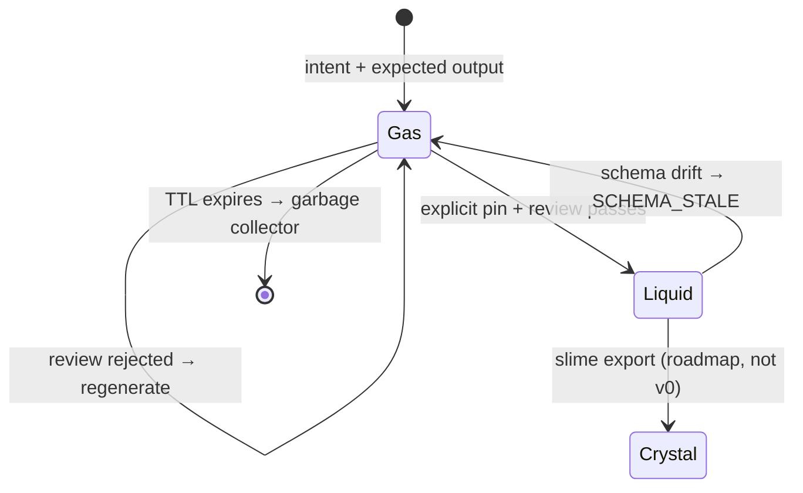

# Slime Product Frame v0.2 (unified)

* **Date:** 2026-11-21 (unified same day from two parallel research tracks;
  team-assembled architecture doc merged back the same evening)
* **Status:** Design — the single frame going forward. Merges this track
  (three-component frame) with
  [2026-11-21-agent-integrations-research.md](2026-11-21-agent-integrations-research.md)
  (D1–D7 and the federation research; now a Record behind this doc).
* **Engine:** `@slime-cloud/core` on `main` stays the base; this reframes how
  it is packaged and sold.
* **Living copy:** the team-edited Claude Doc (same content plus interaction
  diagrams per state) — ask Tony for the link. This file is the source of
  truth; the Claude Doc is the working view.

## Thesis

Slime Cloud gives a client with a coding agent ("Dev-Agent") a Liquid
endpoint: a generated cloud backend API that answers the frontend's request
in the required output shape.

A developer's Dev-Agent sends an intent — Slime generates it into a
reviewed, pinned API handler over the developer's real sources (Linear,
Notion, a database). The first call generates with a background review; a
Liquid call runs deterministic code with zero model tokens and can never
reach the generator. **Intent once → pinned API.** The client writes no
backend; Slime owns the infra, backend, and integrations.

## Context and scope

A Dev Agent needs read APIs over the client's real sources. With Slime the
client writes no backend: Slime Cloud generates, reviews and hosts the
handlers. Scope is the v0 demo: single tenant, read-only. Core: Linear +
Postgres via the universal adapter; Notion as stretch.

**Goals (v0):**

1. An intent from the Dev Agent becomes a working read handler over Linear
   or Postgres.
2. The same intent again costs zero model tokens.
3. One protocol for every source in scope.
4. A pinned endpoint that a customer app calls with `expect`.

**Non-goals (v0):** writes (SaaS writes have no rollback — own design);
multi-tenancy, users and roles, billing; databases on localhost; Crystal
export (roadmap); claims of "works with any integration", "agent-safe
writes", or millisecond latency for federated calls.

## Glossary

| Term | Meaning |
|---|---|
| Intent | What the Dev Agent asks for, in words, plus the expected output. |
| Handler | Generated code that answers one intent over live sources. |
| Gas | Explore state: a handler that runs but is not yet reviewed. Expires by TTL. |
| Liquid | Reviewed and pinned: a handler behind a hosted endpoint, zero model tokens per call. |
| Crystal | Exported state: a handler's code in the client's repo. Roadmap. |
| Pin | Explicit action by the client or its Dev Agent that promotes a Gas handler to Liquid once background review passes. |
| Endpoint | Hosted URL that serves one Liquid handler, called with `expect`/`contractId`. |
| Catalog | List of reviewed handlers, checked before a new intent is written. |
| Cache hit | A listed intent resent verbatim and served without generation. |
| Generator | The model that writes handler code. Spends tokens. |
| Harness | Executes handler code. |
| Review | Background check a handler passes before it is pinned. |
| Universal adapter | Connects sources (Postgres, Linear; Notion stretch) and reads them live. |
| Schema drift | A source's schema changes; the handler drops back to Gas. |
| Garbage collector | Removes expired Gas. |
| Slime Cloud | The hosted side: generates, reviews, caches and serves handlers. |
| Slime Client | The local MCP server and CLI the Dev Agent talks to. |
| Dev Agent | The developer's coding agent (Claude Code, Cursor, Codex). |
| Client | The developer or team that owns the Slime account. |
| Customer app | The client's app that calls a pinned endpoint. |

## The two components

### `slime-client` — the developer's devtool (the only one)

One devtool on the developer's machine; the builder/consumer persona split
is roadmap, not v0. Two faces:

* **`slime` CLI:** `login`, `connect <source>`, `pin`.
* **MCP server** for the agent: tools `query`, `catalog`, `pin`. Internally
  every call is the Dispatch Protocol v1 envelope
  (`{intent, input, output}` + optional `expect`).

The client creates endpoints in Slime Cloud, connects integrations (via the
universal adapter; v0: Postgres and Linear, Notion as stretch), gives the
endpoint to its own Dev Agent, and writes no backend.

### `slime-cloud` — the hosted platform

Runs the core, the integration layer, tokens and execution (all in cloud —
the customer database must be internet-reachable; `localhost` is out of
scope for v0). Holds handlers, source schema fingerprints, encrypted OAuth
tokens, and logs without payloads. **Never stores rows or content — not even
as a response cache** (live federation: every call hits the source API at
request time).

Per source, a schema fingerprint plays the role the Postgres schema hash
plays today — in the cache key and in stale-schema detection, so a renamed
property fails validation before any call. What exactly goes into the
Linear fingerprint (and its invalidation granularity) is decided by the
day-1 spike, not here.

**Admin (Slime Cloud console), minimal core for v0 (single tenant).** The
admin proves impact with one comparison: calls served by Liquid at zero
model tokens versus calls that still spend tokens in Gas.

1. Integrations: connect a source through the universal adapter and see
   whether its token works.
2. Handler registry: every handler with its intent, state (Gas / Liquid;
   Crystal roadmap), review result, `contractId`, and the TTL left for Gas.
3. Endpoint list: each Liquid endpoint, its last call, and `expect` misses
   (a miss is an explicit error, decision 5).
4. Impact panel: calls per state, tokens spent in Gas versus zero in Liquid
   (tokens saved = each Liquid call × the tokens its Gas run cost), cache-hit
   rate from the catalog, and measured latency per endpoint.
5. Health events: schema drift drops back to Gas, rejected reviews, garbage
   collector removals.
6. Call log: payload-free (decision 3): time, handler, state, tokens,
   latency, status.

Out of v0: users and roles, billing, write approvals, multi-tenancy.

## Handler states: Gas → Liquid → Crystal

One state model (quiz-resolved 2026-11-21). "Reviewed" and "pinned" are
properties a handler acquires, not state names.

### Gas — explore

A handler that is generated and running, but not yet trusted.

* Request in: the Dev Agent sends an intent plus the expected output through
  slime-client (MCP) to Slime Cloud.
* Inside: the generator spends model tokens to write handler code; the
  harness executes it; the universal adapter reads live sources; the output
  goes back to the client.
* Iteration: the client or its Dev Agent repeats the call until the output
  is what it wants.
* Exit to Liquid: the client or its Dev Agent pins the handler; the
  background review must pass. No auto-promotion.
* Exit to nothing: Gas has a TTL (team draft: ~30 minutes for a new intent,
  ~one day for generated code — numbers not yet grounded, see open
  questions); then the garbage collector removes it.
* Its point: a backend written on demand. Every call costs tokens, and
  nothing in Gas is listed in the catalog, so an unreviewed guess never
  spreads.

### Liquid — pinned

A reviewed handler, cached behind a hosted endpoint in Slime Cloud.

* Entry: a Gas handler is pinned by the client or its Dev Agent and passes
  background review.
* Request in: a customer app calls the Liquid endpoint with
  `expect`/`contractId`; the handler runs and the universal adapter reads
  live sources.
* Reuse: the Dev Agent checks the catalog and resends a listed intent
  verbatim for a cache hit.
* Exit to Gas: schema drift in a source drops the handler back to Gas for
  regeneration.
* Exit to Crystal: the client exports the code into its own repo (roadmap,
  not v0).
* Its point: deterministic code, zero model tokens per call, and no path to
  the generator. The endpoint outlives the agent session.

### Crystal — exported (roadmap, not v0)

A Liquid handler's code, exported into the client's own repo.

* Entry: from Liquid only. The agent explores in Gas, pins into a hosted
  endpoint, then can export the code.
* Request in: the Dev Agent requests the export from Slime Cloud; the code
  lands in the client's repo.
* Inside Slime: the engine's internal git-tier keeps working, unnamed in
  product language (decision 6).
* Its point: the client owns the code. Crystal is the exit from Slime, not a
  call path through it. The `contractId` is the link: a test in the client
  repo can call the hosted endpoint and the exported code and assert the
  same output shape.
* Open: how Crystal code runs, and whether schema drift reaches it.

## Decisions (merged 2026-11-21, Tony; quiz-resolved where tracks diverged)

| # | Decision | Choice |
|---|---|---|
| 1 | Base architecture | `main` core + build-time pinning; Bun/SQLite spec stays a design record |
| 2 | Usage model | Hybrid **explore → pin**: agent explores (Gas), then an **explicit `pin`** plus a passing background review promotes the handler to a hosted endpoint (Liquid). No auto-promotion |
| 3 | Source access | Live federation; **no customer data stored** (handlers, schemas, tokens, payload-free logs only) |
| 4 | Operations | Read-only v0; writes are roadmap (SaaS writes have no rollback — needs its own design) |
| 5 | Reuse mechanics | **Both, phase-split:** `catalog` for explore; `expect`/`contractId` mandatory on pinned endpoints |
| 6 | State naming (2026-11-21 quiz) | **One state model: Gas → Liquid → Crystal.** Liquid = reviewed, pinned handler behind a hosted endpoint (identified by `contractId`); Crystal = the handler's code exported into the client's repo via `slime export` — roadmap, not v0. The engine's internal git-tier stays unnamed in product language. Static-host consumption: [crystal_static_host.md](crystal_static_host.md) |
| 7 | Integration scope | **Core line: Linear + Postgres. Stretch: Notion** with the cross-source join as the demo finale. Fallback is explicit: Notion is cut first |

Rejected alternatives and the full federation research (rate limits, N+1
math, the precise meaning of "no customer data") live in the
[research record](2026-11-21-agent-integrations-research.md).

## Reuse: how catalog and expect fit together

The cache key is the exact normalized intent text; agents paraphrase, and
every paraphrase would be a new generation. Two mechanisms for two phases:

* **Explore:** the agent calls `catalog` first — it lists only reviewed
  handlers (intent text, input types, output shape, sources, call cost,
  `contractId`) and the agent resends a listed intent verbatim for an exact
  cache hit. Known limit: depends on the agent following instructions;
  semantic matching stays a later option if the measured hit rate is low.
* **Pinned:** a production caller sends `expect: <contractId>`, and such a
  call can never reach the generator — a miss is an explicit error, never a
  silent regeneration. The mechanics (contractId derivation, the error
  split, the build-time pin manifest) are Dispatch Protocol v1; see the
  research record and the 2026-11-20 protocol artifact.

## Cross-cutting concerns

* **Privacy:** no customer data stored; only handlers, schemas, encrypted
  tokens and payload-free logs (decision 3).
* **Security:** open. Sandboxing of generated code in the harness; prompt
  injection from source data into the generator; token storage and rotation.
* **Reliability:** an `expect` miss is an explicit error (decision 5).
  Open: upstream rate limits and per-handler quotas (429 + `Retry-After`).
* **Observability:** the admin call log and impact panel. Open: SLOs.

## Demo vertical (hackathon scope)

Core line (must work):

1. Agent in the editor asks Linear through slime-client → live generation,
   `meta` shows the generated query and review status.
2. The same intent again → cached handler, zero tokens.
3. Same protocol, a Postgres question — "any backend, one protocol", on the
   engine that already passes the benchmark.
4. `pin` → a hosted endpoint a dashboard can call with `expect`.

Stretch finale: "Linear issues blocking the release plus their Notion
specs" — one cross-source join. Hard constraint from review: the
Linear↔Notion link must be a property in a Notion database (one query with
an `or` filter); joins over loose page links are N calls at ~3 rps (~17 s
for 50 issues) and are not demoable.

Single tenant, hardcoded tokens. Say so in the pitch; do not claim
multi-tenant.

## Open questions

Resolved 2026-11-21 (quiz): one state model Gas → Liquid → Crystal; Gas →
Liquid is an explicit pin plus a passing review — no "Expected Hash",
auto-promotion by an output-shape hash stays a later option.

Still open:

* **Handler shape (deferred by decision):** declarative plan
  (`sourceQueries[] + shapeJs`, statically checkable, generalizes today's
  `SQL + shapeJs`) vs per-source single query. The research record
  recommends the declarative plan; decide before the integration spike
  hardens an interface.
* **Blocking — Identity (next decision per the research record):** whose
  token reads Linear/Notion in explore vs in a pinned endpoint; service
  identity, scopes, refresh.
* **Blocking — Reject after serve:** what the first caller sees if
  background review rejects a handler it already used.
* **Blocking — Schema drift:** who detects it, how fast, and what pinned
  callers get until regeneration and review finish.
* **Gas TTL:** define "new intent" versus "generated code" and when each
  TTL starts; the 30 min / 1 day numbers are a team draft, not grounded.
* The Dispatch Protocol v1 open questions (six, from the 2026-11-20
  research run) live with the protocol: research record + internal
  artifact, ask Tony.
* Source addressing in the envelope (v0 routes by intent), quota budgeting
  per handler (429 + `Retry-After`, call cost in `meta`), semantic layer
  across sources, economics/metering, tenancy.
* Alternatives considered: summarize the rejected options inline, one line
  each.

## Primary technical risk — prototype first

The Linear virtual schema and generated source queries are the only unproven
mechanism. Day-1 spike, before any infra: introspect → prune/hash → generate
one read query → validate shape → cache → repeat-call hit → `pin` →
`expect` call.

## What this frame must not claim

Carried from the concepts brief, plus: "works with any integration" (one or
two are built), "multi-tenant", "agent-safe writes", and any millisecond
latency for federated calls — repeat latency against SaaS sources is bounded
by the upstream API round-trip (estimated 0.3–2 s, not measured); 3–8 ms
holds only for the local database path. Honest line: *"Read-only. One
protocol for your database and your SaaS tools. First call generates with a
review; pinned calls are deterministic, token-free, and can never silently
regenerate."*
