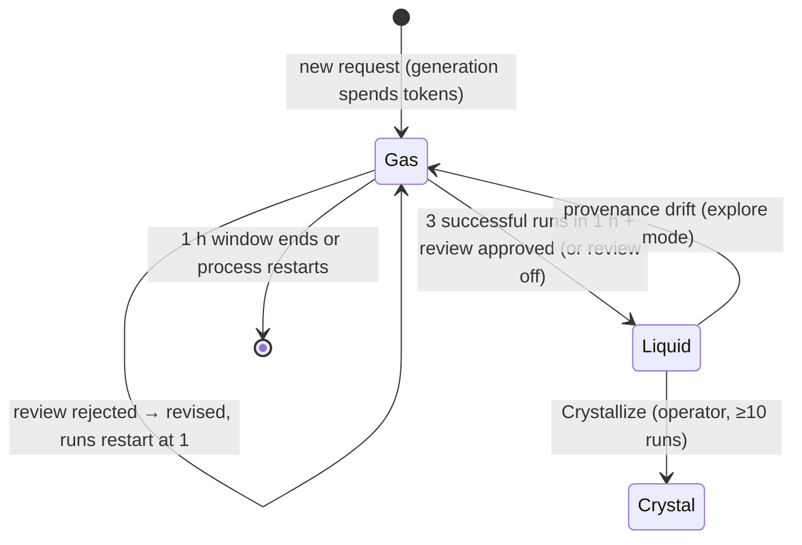

# Slime Product Frame v0.2 (unified)

* **Date:** 2026-11-21 (unified same day from two parallel research tracks;
  team-assembled architecture doc merged back the same evening)
* **Status:** Design — the single frame going forward. Merges this track
  (three-component frame) with
  [2026-11-21-agent-integrations-research.md](2026-11-21-agent-integrations-research.md)
  (D1–D7 and the federation research; now a Record behind this doc).
* **Engine:** `@slime-cloud/core` on `main` stays the base; this reframes how
  it is packaged and sold.
* **Vocabulary:** calibrated 2026-11-21 by Anton — the engine (`core/`) is the
  source of truth; see Glossary.
* **Living copy:** the team-edited Claude Doc (same content plus interaction
  diagrams per state) — ask Tony for the link. This file is the source of
  truth; the Claude Doc is the working view.

## Thesis

Slime Cloud gives a client with a coding agent ("Dev-Agent") a backend it
never writes: a generated cloud API that answers the frontend's request in
the required output shape.

A developer's Dev-Agent sends an intent — Slime generates a handler for it
over the developer's real sources (Linear, Notion, a database). The first
call generates (Gas). Repeats run the same code; after enough successful runs
and a review, the handler turns Liquid automatically and is served at zero
model tokens. **Crystallize** freezes a proven handler into its own Crystal
endpoint that can never reach the generator. The client writes no backend;
Slime owns the infra, backend, and integrations.

## Context and scope

A Dev Agent needs read APIs over the client's real sources. With Slime the
client writes no backend: Slime Cloud generates, reviews and hosts the
handlers. Scope is the v0 demo: single tenant, read-only. Core: Linear +
Postgres via the universal adapter; Notion as stretch.

**Goals (v0):**

1. An intent from the Dev Agent becomes a working read handler over Linear
   or Postgres.
2. The same intent again costs zero model tokens.
3. One protocol for every source in scope.
4. A Crystal endpoint that a customer app calls with `input` only.

**Non-goals (v0):** writes (SaaS writes have no rollback — own design);
multi-tenancy, users and roles, billing; databases on localhost; Crystal
export to the client repo (`slime export`, roadmap); claims of "works with
any integration", "agent-safe writes", or millisecond latency for federated
calls.

## Glossary

| Term | Meaning |
|---|---|
| Intent | What the Dev Agent asks for, in words, plus the expected output. |
| Handler | Generated code that answers one intent over live sources. |
| Gas | A handler generated on demand for a new request. Held in memory, per process, for one window (`gasWindowMs` = 1 h from generation, not extended by calls); a restart or another Lambda instance does not see it. Unreviewed. Tokens are spent on generation, review and revision, not on repeat runs (repeat Gas calls run cached code). |
| Liquid | A handler that passed review (or review is off) and is saved to the store; survives restarts. Served on the dispatch endpoint `POST /v0/query` when a request has the same normalized intent (case, whitespace, trailing punctuation), the same input names and the same output shape. Listed in `catalog` (planned). No own URL. |
| Crystallize | The only explicit step, the same word everywhere: admin UI, CLI `slime crystallize`, MCP tool `crystallize`, runtime `POST /v0/crystallize`, core `crystallize()`. Today the operator runs it in the admin; later the Dev Agent through slime-client. Only for Liquid handlers with at least 10 runs (`CRYSTAL_MIN_RUNS`) and current provenance. Removal verb `slime uncrystallize <crystal key>` is planned, not built; today a Crystal is removed only by deleting its Endpoint. |
| Crystal | Frozen plain code: one module per key plus `manifest.json` and `index.mjs` in the endpoint's Crystal folder, checked on recorded fixtures, hosted by Slime and loaded at startup. Has its own Crystal endpoint `POST /v0/e/<crystal key>` with its own `slc_` token; the body is `{"input":{…}}`. Also answers on `/v0/query` for callers holding the endpoint's `slm_` key. Runs without the QuickJS sandbox. Local-only in v0. `slime export` to the client repo is its later form. |
| Crystal key | The core handler key of a Crystal: a hash of `KEY_VERSION`, the normalized intent, the sorted input names and the output shape. Stable across migrations; changes when the key version, the input names or the output shape change. |
| Endpoint | Any URL. The admin object (one runtime, one source connection, one `slm_` key, many handlers) is an Endpoint; its URL is the dispatch endpoint `POST /v0/query`. A Crystal endpoint is `POST /v0/e/<crystal key>`. |
| Catalog | Planned slime-client tool listing Liquid and Crystal intents so the agent can resend one for a cache hit. Not built. |
| Cache hit | A request served without generation: same normalized intent, same input names, same output shape as a Liquid or Crystal handler (or a Gas handler still in its window). |
| Generator | The model that writes handler code. Spends tokens. |
| Harness | Executes handler code. |
| Review | Optional. A reviewer model checks the code against the schema dictionary, intent and output in the background once a Gas handler has 3 runs. `SLIME_REVIEW=off` turns it off. Gas answers are served before review by design; the caller is not told. |
| Universal adapter | Connects sources (Postgres, Linear; Notion stretch) and reads them live. |
| Provenance drift | The schema, dictionary, prompt or model changed since a handler was saved. In `explore` mode the saved Liquid handler is unusable and the next request regenerates it as Gas; in `locked` mode it is served as is. Crystals are served as is; the runtime warns at startup. |
| Garbage collector | Removes Gas whose window ended. |
| Slime Cloud | The hosted side: generates, reviews, caches and serves handlers. |
| Slime Client | The local MCP server and CLI the Dev Agent talks to. Planned. |
| Dev Agent | The developer's coding agent (Claude Code, Cursor, Codex). |
| Client | The developer or team that owns the Slime account. |
| Customer app | The client's app that calls a Crystal endpoint. |

## The two components

### `slime-client` — the developer's devtool (the only one)

One devtool on the developer's machine; the builder/consumer persona split
is roadmap, not v0. Two faces:

* **`slime` CLI:** `login`, `connect <source>`, `crystallize`.
* **MCP server** for the agent: tools `query`, `catalog`, `crystallize`.
  Internally every call is the Dispatch Protocol v1 envelope
  (`{intent, input, output}`).

Planned; the v0 flow is admin-driven (see Demo vertical).

The client creates endpoints in Slime Cloud, connects integrations (via the
universal adapter; v0: Postgres and Linear, Notion as stretch), gives the
endpoint to its own Dev Agent, and writes no backend.

### `slime-cloud` — the hosted platform

Runs the core, the integration layer, tokens and execution (all in cloud —
the customer database must be internet-reachable; `localhost` is out of
scope for v0). Holds handlers, source schema fingerprints, encrypted OAuth
tokens, and logs without payloads. **Never stores rows or content — not even
as a response cache** (live federation: every call hits the source API at
request time).

Per source, a schema fingerprint plays the role the Postgres schema hash
plays today — in handler provenance and in stale-schema detection, so a
renamed property fails validation before any call. What exactly goes into
the Linear fingerprint (and its invalidation granularity) is decided by the
day-1 spike, not here.

**Admin (Slime Cloud console), minimal core for v0 (single tenant).** The
admin proves impact with one comparison: calls served by Liquid and Crystal
at zero model tokens versus calls that still spend tokens in Gas.

1. Integrations: connect a source through the universal adapter and see
   whether its token works.
2. Handler registry: every handler with its intent, state (Gas / Liquid /
   Crystal), review result, Crystal key, and the window left for Gas.
3. Endpoint list: the dispatch endpoint and its Crystal endpoints, last call
   each.
4. Impact panel: calls per state; tokens are spent on generation, review and
   revision, repeat calls spend none (tokens saved = each repeat call × the
   tokens its generation cost); cache-hit rate; measured latency per
   endpoint.
5. Health events: provenance drift regenerates a saved handler as Gas,
   rejected reviews, garbage collector removals, startup warnings.
6. Call log: payload-free (decision 3): time, handler, state, tokens,
   latency, status.

Out of v0: users and roles, billing, write approvals, multi-tenancy.

## Handler states: Gas → Liquid → Crystal

One state model, as the engine defines it (calibrated 2026-11-21).

### Gas — generated on demand

A handler that is generated and running, but not yet reviewed.

* Request in: the Dev Agent sends `{intent, input, output}` to the dispatch
  endpoint `POST /v0/query` with the Endpoint's `slm_` key.
* Inside: the generator spends model tokens to write handler code; the
  harness executes it; the universal adapter reads live sources; the output
  goes back to the caller. The answer is served before any review, and the
  caller is not told.
* Repeats: the same normalized intent, input names and output shape run the
  cached code — no generation tokens.
* Exit to Liquid — automatic, no explicit step: 3 successful runs
  (`gasToLiquidRuns`) inside the window, then the background review approves
  it. With `SLIME_REVIEW=off` the runs alone are enough.
* Rejection: the code is revised with the reviewer's notes and `runs` resets
  to 1. The revised code is reviewed at once, so an approved revision turns
  Liquid after 1 run. Up to 2 reviews (`maxReviews`); after that the handler
  is `rejected` and stays Gas.
* Exit to nothing: Gas lives in memory, per process, for one window
  (`gasWindowMs` = 1 h from generation, not extended by calls). A restart or
  another Lambda instance does not see it.
* Tokens: spent only on generation, review and revision.

### Liquid — reviewed and saved

A handler that passed review (or review is off), saved to the store.

* Entry: automatic from Gas (see above).
* Request in: the dispatch endpoint `POST /v0/query`, when a request has the
  same normalized intent (case, whitespace, trailing punctuation), the same
  input names and the same output shape. No own URL.
* Reuse: survives restarts; listed in `catalog` (planned) so the agent can
  resend a known intent.
* Exit to Gas: provenance drift. A change in schema, dictionary, prompt or
  model makes the saved handler unusable in `explore` mode, so the next
  request regenerates it as Gas. In `locked` mode it is served as is.
* Exit to Crystal: Crystallize (operator, at least 10 runs, current
  provenance).
* Its point: deterministic code, zero model tokens per call.

### Crystal — frozen code with its own endpoint

A Liquid handler frozen into plain code and hosted by Slime.

* Entry: Crystallize, the only explicit step. Today the operator runs it in
  the admin; later the Dev Agent through slime-client. Only for Liquid
  handlers with at least 10 runs (`CRYSTAL_MIN_RUNS`) and current
  provenance; the code is checked on recorded fixtures before it is frozen.
  With review off a Crystal can ship unreviewed.
* Request in: its own Crystal endpoint `POST /v0/e/<crystal key>` with its
  own `slc_` token and body `{"input":{…}}`. The route refuses missing and
  unknown input names, so a call can never reach the generator. A Crystal
  also answers on `/v0/query` to callers holding the Endpoint's `slm_` key,
  because the engine checks Crystals first.
* Runtime: one module per key plus `manifest.json` and `index.mjs`, loaded
  at startup. Runs without the QuickJS sandbox: guarded by the code
  allowlist and the equivalence test only. Crystallize is local-only in v0
  (`SLIME_LOCAL=1`).
* Schema drift: a Crystal is served as is after a schema change. The runtime
  logs a startup warning and shows it in the Lifecycle tab; the operator
  re-crystallizes after a migration (the Crystal key stays the same). A
  breaking migration gives a database error at call time; a semantic one
  gives a silently wrong answer — a stated limit.
* Removal: `slime uncrystallize <crystal key>` is planned, not built. Today a
  Crystal is removed only by deleting its Endpoint, and `slc_` tokens cannot
  be revoked one by one.
* Later form: `slime export` puts the same Crystal as code into the client's
  repo (roadmap).

## Decisions (merged 2026-11-21, Tony; quiz-resolved where tracks diverged)

| # | Decision | Choice |
|---|---|---|
| 1 | Base architecture | `main` core + Crystals frozen at build time; Bun/SQLite spec stays a design record |
| 2 | Usage model | **Automatic Gas → Liquid** (3 runs + optional review); **Crystallize** is the one explicit step (operator now, agent later) |
| 3 | Source access | Live federation; **no customer data stored** (handlers, schemas, tokens, payload-free logs only) |
| 4 | Operations | Read-only v0; writes are roadmap (SaaS writes have no rollback — needs its own design) |
| 5 | Reuse mechanics | `catalog` (planned) for resend; the Crystal endpoint path guarantees no generation; the Dispatch Protocol v1 contract field and contract ID are dropped (2026-11-21 calibration) |
| 6 | State naming | **Gas → Liquid → Crystal** as the engine defines them; Crystal = frozen code hosted with its own endpoint and `slc_` token; `slime export` is its later form. Static-host consumption: [crystal_static_host.md](crystal_static_host.md) |
| 7 | Integration scope | **Core line: Linear + Postgres. Stretch: Notion** with the cross-source join as the demo finale. Fallback is explicit: Notion is cut first |
| 8 | Vocabulary source (2026-11-21, Anton) | The engine is the source of truth; terms in the Glossary |

Rejected alternatives and the full federation research (rate limits, N+1
math, the precise meaning of "no customer data") live in the
[research record](2026-11-21-agent-integrations-research.md).

## Reuse: catalog and the Crystal endpoint

A request is a cache hit when it has the same normalized intent (case,
whitespace, trailing punctuation), the same input names and the same output
shape as a known handler. Agents paraphrase, and every paraphrase is a new
generation. Two mechanisms:

* **Resend:** the agent calls `catalog` (planned) — it lists Liquid and
  Crystal intents (intent text, input names and types, output shape,
  sources, call cost) and the agent resends a listed intent verbatim for a
  cache hit. Known limit: depends on the agent following instructions;
  semantic matching stays a later option if the measured hit rate is low.
* **Never reaches the generator:** a production caller uses a Crystal
  endpoint. The route rejects unknown and missing input names and serves
  only the Crystal, so a call there can never generate.

## Cross-cutting concerns

* **Privacy:** no customer data stored; only handlers, schemas, encrypted
  tokens and payload-free logs (decision 3).
* **Security:** open. Sandboxing of generated code in the harness; prompt
  injection from source data into the generator; token storage and rotation.
  Crystal code runs without the QuickJS sandbox; guarded by the code
  allowlist and the equivalence test only.
* **Reliability:** Crystals are served as is after a migration; the runtime
  warns at startup. Open: upstream rate limits and per-handler quotas (429 +
  `Retry-After`).
* **Observability:** the admin call log and impact panel. Open: SLOs.

## Demo vertical (hackathon scope)

v0 main flow (admin-driven): create an Endpoint in the admin (dispatch URL +
`slm_` key) → paste the Lifecycle snippet into the Dev Agent, which sends
`{intent, input, output}` to `/v0/query` (new intent → Gas) → repeats and
review turn it Liquid automatically → the operator crystallizes a Liquid
handler with at least 10 runs (Crystal endpoint + `slc_` token) → a customer
app or static page calls the Crystal endpoint with `input` only.

Core line (must work):

1. Agent in the editor asks Linear through slime-client → live generation,
   `meta` shows the generated query and review status.
2. The same intent again → cached handler, zero tokens.
3. Same protocol, a Postgres question — "any backend, one protocol", on the
   engine that already passes the benchmark.
4. Crystallize → a Crystal endpoint a dashboard calls with `input`.

Stretch finale: "Linear issues blocking the release plus their Notion
specs" — one cross-source join. Hard constraint from review: the
Linear↔Notion link must be a property in a Notion database (one query with
an `or` filter); joins over loose page links are N calls at ~3 rps (~17 s
for 50 issues) and are not demoable.

Single tenant, hardcoded tokens. Say so in the pitch; do not claim
multi-tenant.

## Open questions

Resolved 2026-11-21 (calibration): see Glossary and decision #8.

Still open:

* **Handler shape (deferred by decision):** declarative plan
  (`sourceQueries[] + shapeJs`, statically checkable, generalizes today's
  `SQL + shapeJs`) vs per-source single query. The research record
  recommends the declarative plan; decide before the integration spike
  hardens an interface.
* **Blocking — Identity (next decision per the research record):** whose
  token reads Linear/Notion in Gas vs behind a Crystal endpoint; service
  identity, scopes, refresh.
* Crystal runtime stale-schema error, origin allowlist / publishable keys,
  CORS for browser calls: later.
* The Dispatch Protocol v1 open questions (six, from the 2026-11-20
  research run) live with the protocol: research record + internal
  artifact, ask Tony.
* Source addressing in the envelope (v0 routes by intent), quota budgeting
  per handler (429 + `Retry-After`, call cost in `meta`), semantic layer
  across sources, economics/metering, tenancy.
* Alternatives considered: summarize the rejected options inline, one line
  each.

## Primary technical risk — prototype first

The Linear virtual schema and generated source queries are the only unproven
mechanism. Day-1 spike, before any infra: introspect → prune/hash → generate
one read query → validate shape → cache → repeat-call hit → Liquid →
Crystallize → Crystal endpoint call.

## What this frame must not claim

Carried from the concepts brief, plus: "works with any integration" (one or
two are built), "multi-tenant", "agent-safe writes", and any millisecond
latency for federated calls — repeat latency against SaaS sources is bounded
by the upstream API round-trip (estimated 0.3–2 s, not measured); 3–8 ms
holds only for the local database path. Honest line: *"Read-only. One
protocol for your database and your SaaS tools. First call generates; repeat
calls run reviewed code at zero model tokens; a Crystal endpoint can never
reach the generator."*
