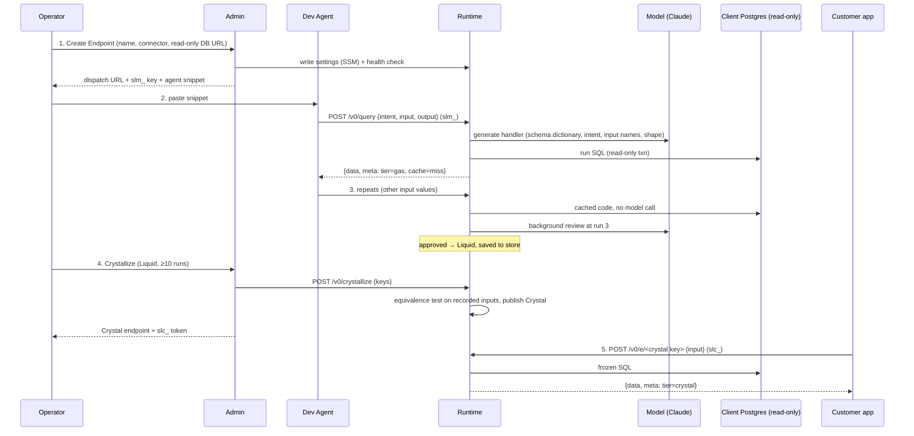
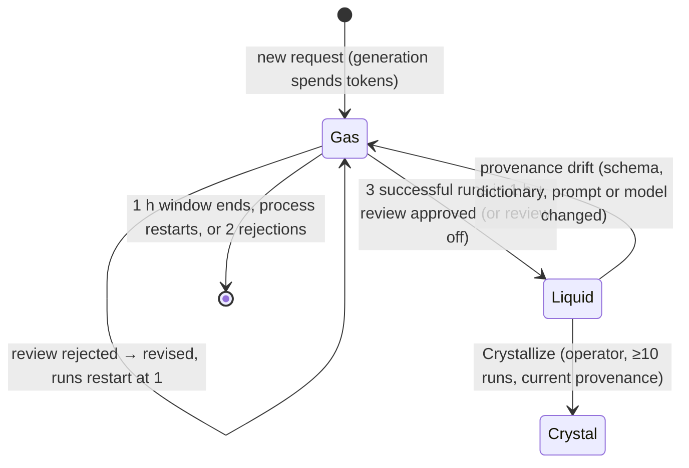
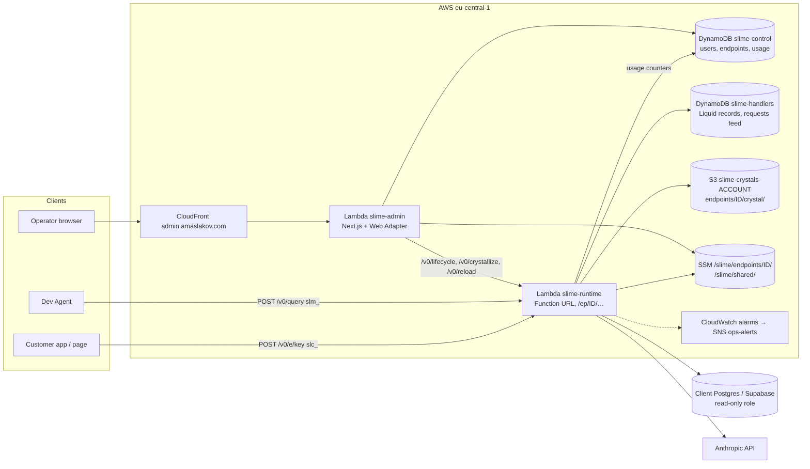
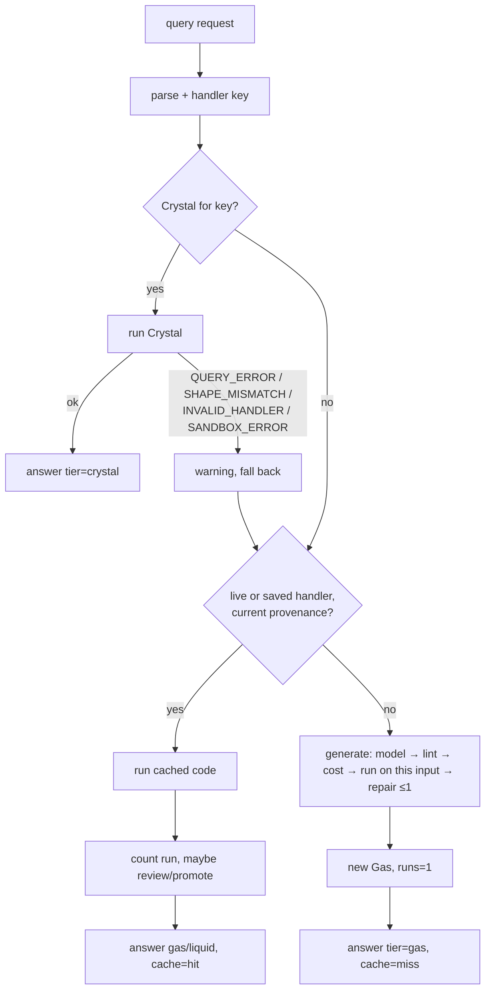

# Slime: product and technical spec

* **Status:** Current. Describes `main` as of 2026-11-25 (PR #74, `0eb3aed`).
* **Scope:** what Slime is, how it works end to end, and what runs under the hood, in one
  place. Deeper, code-local detail is linked from each section.
* **Source of truth:** the code. Vocabulary follows the engine (`core/`), as calibrated on
  2026-11-21 ([product_frame_v0_2.md](product/product_frame_v0_2.md), decision 8). Where
  another doc disagrees with this one, check the code; §12 lists the drift found while
  writing this spec.
* **Markers:** **[built]** is on `main`; **[planned]** is designed or agreed but not built;
  **[roadmap]** is an idea with no design yet.

## Contents

1. [Product](#1-product)
2. [Vocabulary](#2-vocabulary)
3. [Main flow (v0)](#3-main-flow-v0)
4. [Product surfaces](#4-product-surfaces)
5. [Architecture](#5-architecture)
6. [The engine (`@slime-cloud/core`)](#6-the-engine-slime-cloudcore)
7. [Crystallize and Crystal (`@slime-cloud/crystal`)](#7-crystallize-and-crystal-slime-cloudcrystal)
8. [Runtime (`@slime-cloud/runtime`)](#8-runtime-slime-cloudruntime)
9. [Admin (Slime Cloud console)](#9-admin-slime-cloud-console)
10. [Infrastructure, delivery and cost](#10-infrastructure-delivery-and-cost)
11. [Security and privacy model](#11-security-and-privacy-model)
12. [Status, limits and doc drift](#12-status-limits-and-doc-drift)
13. [Where to read more](#13-where-to-read-more)

---

## 1. Product

### Problem

Frontends and agents are now generated in minutes; backends are still written one route
at a time. Every new screen or agent question needs a ticket, a route, a DTO, a review and
a deploy. The backend is where AI-built products slow down.

### Thesis

**The backend that builds itself.** A client (a coding agent, an app, a page) asks for data
in plain words plus the exact JSON shape it wants. Slime writes a read-only handler for that
request, runs it, keeps it, and serves every repeat from cached code:

* the first request generates a handler (**Gas**, about a second of model time);
* repeats run the same code at zero model tokens; after 3 runs and a review it is saved
  (**Liquid**) automatically;
* an operator **Crystallizes** a proven handler into frozen plain code with its own URL and
  token (**Crystal**) that a customer app calls with `input` only.

The database's own permissions, not the model, decide what Slime can read.

Positioning and messaging:
[slime_marketing_positioning_tone_of_voice_use_cases.md](brand/slime_marketing_positioning_tone_of_voice_use_cases.md).

### Who uses it

| Actor | What they do | Credential |
|---|---|---|
| **Operator** (developer on the client's team) | Creates an Endpoint in the admin, connects a read-only database, watches the Lifecycle tab, presses Crystallize. | Admin login (invite-only) |
| **Dev Agent** (Claude Code, Cursor, …) | Sends `{intent, input, output}` to the Endpoint's dispatch URL while it builds the client's app. | Endpoint key `slm_…` |
| **Customer app / static page** | Calls a Crystal endpoint with `{input}`; never sends an intent. | Crystal token `slc_…` |

### Value

* **No backend code** for read APIs: the agent asks, the handler appears.
* **Pay for thinking once:** model tokens go to generation, review and revision, never to
  repeat calls.
* **Proven code hardens:** what is used becomes Liquid, then a Crystal with its own
  endpoint and a token scoped to that one route.
* **Read-only by construction:** a refused-write database role, a read-only transaction,
  SQL lint, a sandbox for generated JS (§11).

### Non-goals and claims Slime must not make

* No writes (decision 4 of the frame): read-only in v0.
* No semantic matching: a reworded intent is a new handler (§6.2).
* No speed claims below what is measured (§10.5). Crystal is not faster than Liquid; both
  are dominated by the Postgres query.
* Not "works with any integration": the hosted product connects Postgres and Supabase;
  Notion and REST sources exist in the library only (§6.6).

---

## 2. Vocabulary

Normative. UI copy and docs use these words.

| Term | Meaning |
|---|---|
| **Request** | `{intent, input?, output}`: what is wanted in words, named input values, and the output shape (§6.1). |
| **Handler** | Code that answers one kind of request: one or more read steps (SQL or API) plus an optional JS `shape` function. |
| **Handler key** | `requestKey(parseRequest(request))`: SHA-256 of `KEY_VERSION` (1), the normalized intent, the sorted input **names** and the output shape. Input values are not part of it. |
| **Gas** | A handler generated on demand for a new request. In memory, per process, for one window `gasWindowMs` (1 h) from generation, not extended by calls. Unreviewed. A restart or another Lambda instance does not see it. |
| **Liquid** | A handler that passed review (or review is off) and is saved to the store. Survives restarts. Served on `POST /v0/query` for requests with the same handler key. |
| **Review** | Optional background check by a reviewer model once a Gas handler reaches 3 runs. Rejection revises the code. `SLIME_REVIEW=off` turns it off. |
| **Provenance** | What a handler was made with: `schemaHash`, `dictionaryHash`, `promptHash`, `model` (and per-API-source hashes). A saved handler whose provenance differs from the engine's current one is **stale**: it is regenerated as Gas on the next request and cannot be crystallized. |
| **Crystallize** | The only explicit step. Freezes a Liquid handler with ≥ `CRYSTAL_MIN_RUNS` (10) runs and current provenance into a Crystal. Same word in UI, runtime route and code. |
| **Crystal** | Frozen plain code: one `.mjs` module per handler key plus `manifest.json` and `index.mjs`. Checked on recorded inputs before it is written. Has its own **Crystal endpoint** and its own token. |
| **Crystal key** | The handler key of a Crystal. Stable across migrations; changes only with `KEY_VERSION`, the input names or the output shape. The admin column is labelled "Hash". |
| **Endpoint** | The admin object: one runtime config, one source connection, one `slm_` key, many handlers. Its URL serves the **dispatch endpoint** `POST /v0/query`; each Crystal adds a **Crystal endpoint** `POST /v0/e/<crystal key>`. |
| **`slm_` key** | Endpoint key. Opens every route of the Endpoint, including generation. |
| **`slc_` token** | Crystal token. Opens only `POST /v0/e/<its crystal key>`. |
| **`catalog`** | **[planned]** slime-client tool listing Liquid and Crystal intents so an agent resends exact wording. |
| **`expect` / `contractId` / pin** | Dropped (2026-11-21 calibration). Do not use. |

---

## 3. Main flow (v0)

Admin-first. slime-client (CLI/MCP) is a later wrapper over the same steps.



1. **Create an Endpoint.** The operator picks Postgres or Supabase, pastes a read-only
   connection URL, presses Test connection, then Create. The admin stores the settings and
   waits for the runtime's health check (`provisioning → ready` in the cloud, `pending →
   ready` locally, or `failed` with the database error).
2. **Connect the agent.** The Lifecycle tab shows the dispatch URL, the `slm_` key and a
   snippet for the agent. Every new intent is a Gas generation (tokens spent).
3. **Use it.** Repeats with any input values run the cached code. At 3 successful runs
   inside the hour, the reviewer checks it; approved → Liquid, saved.
4. **Crystallize.** At ≥10 runs a Liquid row gets a checkbox; Crystallize freezes it and
   issues an `slc_` token. The Crystal card shows the route, the token (masked, revealable)
   and a ready `curl`.
5. **Ship.** The customer app or a static page calls the Crystal endpoint with `{input}`.

Lifecycle per handler:



---

## 4. Product surfaces

| Surface | What it is | Status |
|---|---|---|
| **Slime Cloud admin** | Next.js console at `admin.amaslakov.com` (invite-only); also runs locally. Endpoints, Lifecycle with Crystallize, Requests log with trace drawer, Settings, Usage, Billing estimate (§9). | [built] |
| **Runtime HTTP API** | `/ep/<id>/v0/…` on one shared Lambda (cloud) or `http://localhost:87xx/v0/…` (local) (§8). | [built] |
| **`@slime-cloud/core`** | The engine as a library for self-hosting: `createSlime(config)`, `slime.query(request)` (§6). | [built] |
| **`@slime-cloud/crystal`** | Build-time Crystallize job, `slime-crystal` CLI (`check`, `pin`, `verify`), typed `services.mjs` (§7). | [built] |
| **Crystal agent loop** | Writer + three reviewer agents optimize Crystals and open a PR (`.github/workflows/crystal-agents.yml`, weekly/manual). | [built], off until the `ANTHROPIC_API_KEY` secret exists |
| **Agent API v1** | Headless lifecycle for coding agents: account/endpoint bootstrap, per-handler crystallize, richer `meta` hints ([agent_api_v1.md](product/agent_api_v1.md)). | [planned] beyond the shipped `/v0` routes |
| **slime-client** | CLI `login`, `connect <source>`, `crystallize`; MCP tools `query`, `catalog`, `crystallize`. | [planned] |
| **Landing** | Static page at `amaslakov.com` with an animated (not live) demo. | [built] |

Demos (all measured 2026-11-22, details in their docs):

* **Atlas** ([atlas-demo.md](product/atlas-demo.md)): a made-up SaaS customer with no
  backend; its public site's panels are answered by a Slime Cloud endpoint (Revenue by plan
  as a Crystal, Churn risk as Liquid) and a self-hosted multi-source instance (Customer 360:
  Postgres + Notion + FX API).
* **Shop** ([examples/shop](../examples/shop/README.md)): 12-table online-shop database,
  10 use cases including a PII refusal; 10/10 passed.
* **Express / Hono / multi-source / customer-site** examples under [`examples/`](../examples/).

---

## 5. Architecture

### Packages

| Package | Path | Role | Depends on |
|---|---|---|---|
| `@slime-cloud/core` | `core/` | Engine: request → handler → answer; generation, review, sandbox, sources, stores. | nothing in the repo; never imports `platform/` or the AWS SDK (CI enforces) |
| `@slime-cloud/crystal` | `crystal/` | Crystallize job, module format, allowlist, verify, CLI. | core via `@slime-cloud/core/tooling` |
| `@slime-cloud/runtime` | `platform/runtime/` | HTTP around the engine: Lambda (multi-tenant) and local entries, DynamoDB store, S3 Crystal store, requests feed, auth. | core, crystal |
| admin | `platform/admin/` | Next.js console, endpoint provisioning, tokens, local runner. | talks to the runtime over HTTP |
| infra | `platform/infra/` | Terraform stacks `bootstrap`, `platform`, `landing`, `atlas`. | — |

### Cloud topology



Locally the same pieces run as: admin on `:3100`, one runtime process per endpoint on
`:87xx` started by the admin's runner, DynamoDB Local on `:8000`, demo Postgres on
`:54329`, Crystals in a folder, secrets in `platform/admin/.data/secrets.json`.

---

## 6. The engine (`@slime-cloud/core`)

Code map: [core/README.md](../core/README.md) and `core/src/*/README.md`. The core reads no
environment variables; the host passes everything in `SlimeConfig`.

### 6.1 Request contract

Full spec: [core/docs/request-format.md](../core/docs/request-format.md).

```json
{
  "intent": "top N accounts by total paid amount",
  "input": { "limit": 5 },
  "output": [{ "account": "string", "paidCents": "integer" }]
}
```

* `intent`: non-empty, ≤ 500 chars. Values belong in `input`, not in the text (a literal in
  the intent yields a `meta.warnings` note).
* `input`: ≤ 20 names matching `^[A-Za-z_][A-Za-z0-9_]{0,63}$`; values are scalars or
  lists of scalars. `null` means "not given". A name's type is fixed by its first non-null
  value. `limit`/`offset` are reserved for paging.
* `output`: shape notation. Leaves `string | number | integer | boolean | date | datetime`,
  each optionally `|null`; lists `[X]`; objects `{…}`; ≤ 6 deep, ≤ 50 fields. The answer must
  match exactly (no missing or extra keys, right types), else `SHAPE_MISMATCH`.

Response: `{ data, meta }`. `meta` carries `handlerKey`, `tier` (`gas | liquid | crystal`),
`cache` (`hit | miss | coalesced`), `review`, `truncated`, `warnings[]`, `timingsMs`
(`total`, `lookup`, `queue`, `generate`, `providerWait`, `checks`, `run`, `sandboxWait`,
`shape`), `attempts`, the code that ran (`sql`, `shapeJs`, `steps`, `assumptions`) and
`trace` (§6.8).

### 6.2 Matching: the handler key

`normalizeIntent` applies Unicode NFKC, lower-case, whitespace collapse, trim, and strips
trailing `.!?;:,`. No stemming, no synonyms, no embeddings. Then
`requestKey = sha256({v: 1, intent, input: sorted names, output})`
(`core/src/request/key.ts`).

Consequences:

* `{limit: 5}` and `{limit: 50}` share a handler; adding an input name or changing the
  output shape makes a new one.
* Paraphrases miss. Reuse depends on the client resending the exact intent
  (`catalog` **[planned]** addresses this).
* Concurrent identical misses are coalesced: one generation, the others wait
  (`cache: "coalesced"`).

### 6.3 Answering a request



Order matters: a Crystal answers first, also on `/v0/query`. A Crystal that fails with a
drift-type error falls back to Liquid or a new generation, with a one-time `warning` event
and a `meta.warnings` note (`core/src/engine/slime-engine.ts`, `CRYSTAL_DRIFT_CODES`).

### 6.4 Generation

Inputs to the model (`core/src/engine/generation/generate.ts`, prompts in
`core/src/models/prompts.ts`):

* the **schema dictionary**: tables and columns the read-only role can see
  (`information_schema` filtered by `has_column_privilege`), types, nullability, column
  comments, enum values, primary and foreign keys; API source operations; the app's
  optional `glossary` and `rules`;
* the intent, the input **names and types** (never values), the output shape;
* on a repair or revision, the previous artifact and the error or reviewer notes.

The model returns an **artifact** (v2, `core/src/artifact/artifact.ts`):

```ts
{ version: 2,
  unsatisfiable: null | "one-sentence reason",   // e.g. a write, or data the sources lack
  steps: [ { name, source, sql, params } | { name, source, operation, args } ],  // ≤ 4, run in parallel
  shapeJs: null | "function shape(data, input) { … }",
  assumptions: ["how vague terms were read", …] }
```

Checks before the first answer is returned:

1. **Lint** (`core/src/artifact/checks/sql.ts`): read-only SQL only (no
   `INSERT/UPDATE/DELETE/MERGE/DROP/ALTER/CREATE/GRANT/REVOKE/TRUNCATE/COPY/VACUUM`, no
   `set_config`, `pg_sleep`, `lo_import`, `dblink`); one statement; every `$n` maps to an
   input name; no input value copied into the code; API args take either an input or a
   constant.
2. **Cost**: `EXPLAIN` each SQL step; refuse above `maxQueryCost` (1,000,000 planner units).
3. **Run** on the request's input, shape in the sandbox, validate against `output`.
4. On failure, **repair** with the error fed back (`maxRepairs` 1), all inside
   `generationBudgetMs` (25 s).

The new record is Gas with `runs = 1` and the input recorded as its first fixture.
Generation is capped at `maxConcurrentGenerations` (2) and `maxGenerationsPerHour` (200)
per instance; over the cap → `GENERATION_RATE_LIMITED`.

Models (runtime defaults, `platform/runtime/src/config.ts`):

| Role | Provider `claude` (default) | Provider `groq` |
|---|---|---|
| Generator | `claude-sonnet-5-5`, effort `low` (`SLIME_MODEL`, `SLIME_EFFORT`) | `openai/gpt-oss-120b` |
| Reviewer | `claude-sonnet-5-5`, effort `low` (`SLIME_REVIEW_MODEL`, `SLIME_REVIEW_EFFORT`) | `openai/gpt-oss-120b` |

The hosted console offers Claude only (PR #72); Groq remains in the library and runtime.
Claude calls use structured output (Zod schema) with retries; an `offline` canned generator
serves hand-written artifacts in tests and CI.

### 6.5 Review, revision and promotion

`core/src/engine/promotion.ts`, `core/src/engine/generation/review-loop.ts`.

* Every successful run increments `runs` and records the input as a fixture if new (up to
  `fixturesPerHandler`, 5).
* At `runs ≥ gasToLiquidRuns` (3) inside the Gas window: with a reviewer, `review =
  pending` and the review runs in the background (`reviewTimeoutMs` 60 s); without one, the
  handler is promoted at once.
* The reviewer checks source accuracy, filters and constants against the intent, readings
  of vague terms, join columns and row multiplication, null handling, the exact output
  shape, and the glossary and rules. Verdict `approve` or `reject` with concrete problems.
* **Approved** → `tier = liquid`, saved to the store, kept in memory for good.
* **Rejected** → the code is revised with the reviewer's notes on the first fixture,
  `runs` restarts at 1, and the revision is reviewed at once. An approved revision
  therefore turns Liquid after 1 run. After `maxReviews` (2) rejections the handler stays
  Gas with `review = rejected` and expires with its window.
* Gas answers are served before review, by design; `meta.review` tells the caller the
  state.
* At `crystalReadyRuns` (10) with review `approved` or `none`, the engine emits
  `crystalReady` once per handler and instance.

### 6.6 Sources

One SQL source plus any number of API sources per instance (`core/src/sources/`).

**Postgres** (`core/src/sources/sql/postgres/`), the only source the hosted product
connects:

* **Startup safety check** (`safety.ts`): refuses superusers, roles that can create roles
  or databases, and roles with `INSERT/UPDATE/DELETE/TRUNCATE` on any table. `createSlime`
  fails before serving.
* Every query runs in `BEGIN READ ONLY`, with `statement_timeout` (`statementTimeoutMs`,
  2 s), over the extended protocol (no statement stacking), wrapped as a sub-query with
  `LIMIT rowCap + 1` (`rowCap` 1000; `truncated` reports the cut).
* `int8`/`numeric` are parsed as JS numbers.

**Supabase** is Postgres through the admin's connector preset
(`platform/admin/lib/connectors.ts`): a role-creation SQL template (SELECT on `public`,
`BYPASSRLS`), pooler host only (`*.pooler.supabase.com`), TLS forced with
`sslmode=require&uselibpqcompat=true`, and a Test connection warning when readable tables
return no rows (an RLS symptom).

**API sources** **[built, library only]**: `ApiSource` (`describe`, `call`, `safetyCheck`)
with Notion (API `2025-09-03`, data sources by alias, ≤ 2 requests in flight) and
`defineApiSource` for REST. Rows must be plain JSON; secrets are redacted from every
message and event. A multi-step handler joins steps in `shapeJs`; a truncated step is
`QUERY_TOO_LARGE`. Guide: [core/docs/multi-source.md](../core/docs/multi-source.md).

### 6.7 Sandbox

Generated `shapeJs` runs in QuickJS (`core/src/sandbox/quickjs/`):

* a pool of up to 4 worker threads; a fresh QuickJS runtime per call;
* `shapeTimeoutMs` 200 ms interrupt (plus ~100 ms grace, then the worker is killed and
  replaced) and `shapeMemoryBytes` 32 MiB heap;
* no I/O, timers, `fetch`, `require`/`import`, `eval`; no credentials; only rows and input
  go in, and only JSON comes out.

Crystal shapes additionally pass a static **allowlist** (§7.3).

### 6.8 Events, trace and errors

**Events** (`onEvent`, observational only): `generated` (code, tokens, ms), `reviewed`
(verdict, notes, tokens), `promoted`, `crystalReady`, `warning` (e.g. Crystals made against
another schema at startup, a Crystal that fell back), `error`.

**Trace**: every answer and every refusal carries layer spans `{layer, status, ms?, note?,
attempt?}` over `edge → key → route → limits → generate → lint → cost → execute → shape →
output → cache → review`, status `pass | skip | stop | pending`. Notes carry counts, names
and limits, never input values or rows. The admin's trace drawer renders them
([request-trace-drawer-design.md](architecture/2026-11-22-request-trace-drawer-design.md)).

**Errors**: always `{error: {code, message, retryable}}`.

| Code | HTTP | When |
|---|---|---|
| `INVALID_REQUEST` | 400 | Bad envelope, types, reserved names, shape; body > 16 KB (413); Crystal route missing/unknown input |
| `UNAUTHORIZED` | 401 | Missing or wrong `x-api-key` (runtime) |
| `WRITE_REFUSED` / `ACCESS_DENIED` | 403 | A write was asked for / the role cannot read it |
| `HANDLER_NOT_FOUND` / `ENDPOINT_NOT_FOUND` / `NOT_FOUND` | 404 | Unknown Crystal key / unknown endpoint id (Lambda) / unknown path |
| `INTENT_UNSATISFIABLE` / `QUERY_TOO_LARGE` | 422 | The sources cannot answer / a multi-step step was truncated |
| `GENERATION_RATE_LIMITED` | 429 | Hourly cap or provider throttling (retryable) |
| `SHAPE_MISMATCH`, `SANDBOX_ERROR`, `QUERY_ERROR`, `QUERY_TOO_EXPENSIVE`, `INVALID_HANDLER` | 500 | Handler or query failed |
| `GENERATION_FAILED`, `SOURCE_ERROR` | 502 | Model call or API source failed |
| `NOT_READY` | 503 | Engine cannot start (database down, settings incomplete) |
| `GENERATION_TIMEOUT`, `EXECUTION_TIMEOUT` | 504 | Budget or statement/shape timeout (retryable) |

### 6.9 Storage

`SlimeStore` is a namespaced key-value interface (`get`, `put`, `list`, `delete`).
Implementations: `memoryStore` (tests), `fileStore` (`<dir>/<ns>/<key>.json`, atomic
rename; library default), `DynamoSlimeStore` (runtime).

A saved **handler record** (`core/src/handler/record.ts`): `key`, `intent`, `output`,
`artifact`, `paramTypes`, `provenance`, `tier`, `review`, `runs`, `fixtures` (up to 5
recorded inputs **with their values**), `createdAt`. Gas lives in memory only. Saved
records are re-checked against current provenance on load; a mismatch is a miss.

### 6.10 Defaults

| Option | Default | Runtime env var |
|---|---|---|
| `gasToLiquidRuns` | 3 | `GAS_TO_LIQUID_HITS` |
| `gasWindowMs` | 3,600,000 (1 h) | `GAS_WINDOW_MS` |
| `maxReviews` | 2 | `MAX_REVIEWS` |
| `fixturesPerHandler` | 5 | `FIXTURES_PER_HANDLER` |
| `crystalReadyRuns` (= Crystallize minimum) | 10 | `CRYSTAL_MIN_RUNS` |
| `maxRepairs` | 1 | `MAX_REPAIRS` |
| `generationBudgetMs` | 25,000 | `GENERATION_BUDGET_MS` |
| `reviewTimeoutMs` | 60,000 | `REVIEW_TIMEOUT_MS` |
| `maxConcurrentGenerations` | 2 | `MAX_CONCURRENT_GENERATIONS` |
| `maxGenerationsPerHour` | 200 | `MAX_GENERATIONS_PER_HOUR` |
| `statementTimeoutMs` | 2,000 | `STATEMENT_TIMEOUT_MS` |
| `rowCap` | 1,000 | `ROW_CAP` |
| `maxQueryCost` | 1,000,000 | `MAX_QUERY_COST` |
| `shapeTimeoutMs` | 200 | `SHAPE_TIMEOUT_MS` |
| `shapeMemoryBytes` | 32 MiB | `SHAPE_MEMORY_MB` |
| `maxSteps` | 4 | — |
| `apiTimeoutMs` | 10,000 | — |

---

## 7. Crystallize and Crystal (`@slime-cloud/crystal`)

Code map: [crystal/README.md](../crystal/README.md).

### 7.1 Readiness

A handler is crystallized only when (`readinessProblem` in `crystal/src/crystallize.ts`):

* `tier = liquid`;
* `review` is `approved`, or `none` when no reviewer is configured;
* `runs ≥ minRuns` (`CRYSTAL_MIN_RUNS`, 10), counting live runs (the runtime syncs
  in-memory counts to the store first, `platform/runtime/src/live-runs.ts`);
* at least one recorded fixture;
* its provenance equals the engine's current one (else `not-ready`: "made with another
  schemaHash, …");
* it is not already in the manifest (else `already`).

Report outcomes: `crystallized | already | not-ready | skipped` (unsatisfiable) `| failed`.

### 7.2 The equivalence test

Candidates: for a single-query handler, an optimizer's rewrite first (if an optimizer is
configured), then the unchanged Liquid code; for a multi-step handler, the unchanged code.
The first candidate that passes is written. A candidate passes when its shape passes the
allowlist, its params are inputs of the request, its module passes the read-only lint and
imports cleanly, and on **every** recorded input it returns the same output as the Liquid
handler (floats to 9 significant digits, list order included), with at least one input
compared. Candidate shapes run as source in the same sandbox and limits as Liquid.

### 7.3 What a Crystal is

A folder per endpoint:

| File | Content |
|---|---|
| `<key>.mjs` | Query module (`export const sql`, `params`, `function shape(rows, input)` or `shape = null`) or steps module (`export const steps = […]`, `function shape(data, input)`). |
| `<key>.cases.json` | The reference: the Liquid code and its recorded inputs; pinned by SHA-256. |
| `manifest.json` | v1: per key `file`, `sha256`, `intent`, `output`, `paramTypes`, `schemaHash`, `review`, `isOptimized`, `provenance`, `service`, `sources`, `createdAt`, … |
| `index.mjs`, `index.d.mts` | Registry the engine loads (`config.crystal`). |
| `services.mjs`, `services.d.mts` | One typed function per Crystal named from its intent, callable without a Slime instance. |

The **allowlist** for shapes (`crystal/src/allowlist*.ts`): only listed globals and
members; no `this`, classes, async, generators, `while`/`for(;;)`/`for…in`, labels, `with`,
dynamic `import()`; no `constructor`, `prototype`, `__proto__`; computed keys only as
literals; no writes to globals.

### 7.4 Where a Crystal runs

| Host | Storage | How the shape runs |
|---|---|---|
| **Slime Cloud** | `s3://slime-crystals-<account>/endpoints/<id>/crystal/` | Modules are **data**: SHA-256 checked against the manifest, parsed by `parseModule` (structure + allowlist), shape run as source text **in QuickJS**. Nothing from S3 is `import()`ed (`platform/runtime/src/crystal-store.ts`). A bad module is dropped with a warning. |
| **Local runtime** | `SLIME_CRYSTAL_DIR` | `index.mjs` is imported (operator's own code): function shapes run **in-process, without the sandbox**, guarded by the allowlist and the equivalence test. |
| **Self-hosted app** | the app's repo | Same as local; or `services.mjs` called directly. |

### 7.5 Serving

* **Crystal endpoint** `POST /v0/e/<crystal key>` (cloud: `/ep/<id>/v0/e/<crystal key>`),
  header `x-api-key: slc_…` (or the endpoint's `slm_`), body `{"input": {…}}`.
* The route refuses a missing **or** unknown input name with `INVALID_REQUEST` ("This
  endpoint takes input: … Missing/Unknown: …"), so the request always hashes to the
  Crystal's key. Unknown key → `HANDLER_NOT_FOUND`.
* The route then calls the engine with the Crystal's own intent and output; the engine
  answers from the Crystal (`tier: crystal`, `cache: hit`, no model call).
* The Crystal also answers on `/v0/query` to `slm_` callers that send the same request.

### 7.6 Schema changes

* At startup the engine warns when loaded Crystals were made against another schema; the
  runtime logs it and the Lifecycle tab shows it.
* A **breaking** change (the Crystal now fails with `QUERY_ERROR`, `SHAPE_MISMATCH`,
  `INVALID_HANDLER` or `SANDBOX_ERROR`) makes the engine **fall back** to the saved Liquid
  handler or, since that one is stale after the schema change, to a **new generation**.
  This also happens on the Crystal endpoint. See §12.3.
* A **semantic** change (same columns, different meaning) gives a silently wrong answer: a
  stated limit.
* Re-crystallizing in place is not built: `crystallize` answers `already` for a key in
  the manifest. `prune()` removes the Liquid fallback once a Crystal is 14 days old (library
  only).

### 7.7 Crystallize in the product

* Admin Lifecycle tab → `POST /v0/crystallize {keys}` on the runtime → reports per key.
* **Cloud:** the job runs synchronously on the Lambda instance, publishes modules then the
  manifest to S3 (`If-Match` on the old ETag; a conflict is `failed`), swaps the engine on
  that instance, and other warm instances pick it up within the 30 s settings TTL. The
  admin then issues `slc_` tokens into `CRYSTAL_TOKENS` and calls `/v0/reload`.
* **Local:** the job writes `SLIME_CRYSTAL_DIR`; the runner restarts the endpoint process.
* **Removal:** only by deleting the Endpoint. `slime uncrystallize` and per-token revocation
  are **[planned]**.

### 7.8 Agent loop

`crystal/scripts/agent-loop.mjs`: a **writer** agent (Sonnet via the `claude` CLI) rewrites
freshly crystallized modules toward no shape and a cheaper plan, using only `slime-crystal
pin`/`verify`; a **gate** reverts anything outside those modules and re-verifies
(`verify`: same output on every case, plan cost ≤ 1.1× the reference); **correctness,
security and performance reviewers** return schema-checked verdicts (2 rounds); a **merge
gate** lets a PR merge without a person only if it touches nothing outside the Crystal
folder, `verify` passes, and all reviewers approved.

---

## 8. Runtime (`@slime-cloud/runtime`)

Code map: [platform/runtime/README.md](../platform/runtime/README.md).

### 8.1 Two entries, one app

`app.ts` builds the routes for one endpoint (Hono). Two hosts wrap it:

| | Lambda (`lambda.ts`, `tenants.ts`) | Local (`local.ts`) |
|---|---|---|
| Tenancy | One function serves every endpoint under `/ep/<id>/…`; `id` must match `^ep-[0-9a-f]{10}$` | One process per endpoint on `PORT` (8700+) |
| Settings | Lambda env → SSM `/slime/shared/` (model key) → SSM `/slime/endpoints/<id>/` (`DATABASE_URL`, `SLIME_API_KEY`, `SLIME_PROVIDER`, `CRYSTAL_TOKENS`, …) | Process env from the admin's runner |
| Engine cache | Up to 8 endpoints per warm instance (LRU), settings re-read every 30 s; key/token changes swap in place, engine-affecting changes (DB URL, provider, model, limits, Crystal manifest ETag) rebuild; unknown ids cached as missing | One engine |
| Handler store | DynamoDB `slime-handlers` (`tenantId` = endpoint id, `artifactKey` = `handlers#<key>`) | DynamoDB Local, same table |
| Crystals | S3, run in QuickJS | Folder, imported |
| Requests feed | 500 newest in the endpoint's store, shared by all instances | 50 in memory |
| Flush | Before each response (≤ 5 s): store writes, reviews, usage | Before each non-GET response; on SIGTERM saves live run counts |
| `POST /v0/reload` | Forget this endpoint's settings and engine | 204 no-op (runner restarts) |

Gas handlers and the hourly generation counter are **per instance**: two Lambda instances
can each generate the same Gas handler.

### 8.2 Routes

All routes take `x-api-key`. The endpoint key `slm_` opens every route; an `slc_` token
opens only `POST /v0/e/<its key>`. Keys are compared in constant time (SHA-256 then
`timingSafeEqual`). Bodies are capped at 16 KB.

| Route | Purpose |
|---|---|
| `POST /v0/query` | Dispatch: `{intent, input?, output}` → `{data, meta}` (Gas / Liquid / Crystal). |
| `POST /v0/e/<crystal key>` | Crystal endpoint: `{input}` with exactly the Crystal's input names (§7.5). |
| `GET /healthz` | Database safety check + handler counts; 503 when the check fails. Lambda: `?fresh=1` re-reads settings first. |
| `GET /v0/handlers`, `DELETE /v0/handlers/<key>` | List live handlers; evict one from memory and store. |
| `GET /v0/handlers/<key>/code` | Handler code for the trace drawer (Crystal, live, or store). |
| `GET /v0/lifecycle` | Merged live, saved and Crystal rows (`key`, `intent`, `tier`, `runs`, `review`, `fixtures`, `inputs`, `stale`), `stats`, `thresholds {liquidRuns, crystalRuns}`, `warnings[]`, `instance` (Lambda). |
| `GET /v0/events?limit=&before=` (or `after=`) | Requests feed, newest first, cursor-paged (≤ 100 per page). Served from the store without the engine, so it works while the database is down. |
| `POST /v0/crystallize {keys?}` | Crystallize job; returns `{reports: [{key, intent, outcome, reasons}]}`. Mounted on Lambda always, locally with `SLIME_CRYSTAL_DIR`. |
| `POST /v0/reload` | See §8.1. |

`/v0/lifecycle` merge rule: highest tier wins; runs never go backwards; a **stale** saved
row ranks below live Gas, so new code replaces it with its own run count.

### 8.3 Requests feed

One entry per request, including refusals: `at`, `handlerKey`, `tier`, `cache`, `ms`,
`status`, `code`, `stopAt` (the layer that refused), `intent` (first 200 chars), input
**names** (never values), `trace`, and the generated code on a miss. Unauthenticated
requests are not recorded.

### 8.4 Warnings

Collected per endpoint and returned by `/v0/lifecycle`: missing provider key (saved and
Crystal handlers still serve; new requests fail), Crystal dropped on load, Crystals made
against another schema, a Crystal that fell back, engine start failures, Crystallize
failures. Also logged as JSON lines (CloudWatch on Lambda, with `endpointId`).

---

## 9. Admin (Slime Cloud console)

Code map: [platform/admin/README.md](../platform/admin/README.md).

### 9.1 Access

* Email + password; scrypt hashes; HMAC-signed session cookie `slime_session`, 7 days.
* **Invite-only:** sign-up works only for `ADMIN_ALLOWED_EMAILS` (SSM
  `/slime/admin/ADMIN_ALLOWED_EMAILS`, read at cold start); others see "This email is not
  invited" and nothing is written.
* CloudFront adds a secret `x-slime-origin` header; the admin refuses requests without it,
  so its public Function URL is useless directly.
* Local only: `ADMIN_DEV_USER` signs every visitor in.

### 9.2 Screens

| Screen | What it does |
|---|---|
| **Endpoints** | List with status (cloud `provisioning`, local `pending` → `ready` or `failed`; `updating`, `deleting`), URL, last request. |
| **New endpoint** | Name, connector (Postgres / Supabase), read-only URL, Test connection (safety check + "readable tables with no rows" warning). Provider: Claude only. |
| **Lifecycle** | Dispatch URL, `slm_` key, agent snippet; interactive Gas → Liquid → Crystal diagram with a side panel; handler board (intent, Hash, runs/progress, review label from the engine, stale rows "stale · regenerates on next request"); Crystallize on Liquid rows with ≥ 10 runs and current provenance; Crystal cards (route, masked `slc_` with Reveal / Issue token, `curl`); warnings. |
| **Requests** | The runtime feed, cursor-paged over the newest 500; trace drawer with Layers, Route map and Waterfall; refusals show code and layer. |
| **Settings / Connector** | Rename, change connector URL (masked; tested server-side), retry the health check. |
| **Usage / Billing** | Daily and monthly requests, generations and tokens per tier; estimated bill and crystallization savings (§10.4). |

### 9.3 Provisioning (cloud)

* **Create:** write SSM `/slime/endpoints/<id>/` (`DATABASE_URL`, `SLIME_API_KEY = slm_…`,
  `SLIME_PROVIDER`) and the endpoint item (`slime-control`, `ENDPOINT#<id>`, status
  `provisioning`), then poll the runtime's `/healthz` (5xx and network errors retried
  within a window) → `ready` or `failed` with the runtime's reason.
* **Change settings:** rewrite SSM, then `GET /healthz?fresh=1`.
* **Crystallize:** `POST /v0/crystallize`, issue `slc_` tokens into `CRYSTAL_TOKENS`
  (`slc_` + 24 random bytes, base64url), `POST /v0/reload`.
* **Delete:** SSM path first (the endpoint stops at once), then its handler partition, its
  S3 prefix, and the item. Usage rows are kept as history.

Locally the admin's runner starts and stops one runtime process per endpoint and keeps
secrets in a file.

---

## 10. Infrastructure, delivery and cost

Details: [platform/infra/README.md](../platform/infra/README.md),
[FINOPS.md](../platform/infra/FINOPS.md).

### 10.1 AWS (eu-central-1)

| Resource | Notes |
|---|---|
| Lambda `slime-runtime` | Node 22, arm64, 1024 MB, 60 s; public Function URL (the app checks keys). |
| Lambda `slime-admin` | Next standalone + Lambda Web Adapter behind CloudFront `admin.amaslakov.com`. |
| Lambda landing / atlas | `amaslakov.com` landing; Atlas customer site on a public Function URL. |
| DynamoDB `slime-control` | `USER#<email>/PROFILE`, `USER#<email>/ENDPOINT#<id>`, `USAGE#<id>/<YYYY-MM-DD>`; on-demand, PITR, deletion protection. The runtime may update `USAGE#*` items only. |
| DynamoDB `slime-handlers` | Liquid records and the requests feed per endpoint; on-demand, PITR. |
| S3 `slime-crystals-<account>` | Private, SSE-S3, TLS-only, versioned (non-current versions expire after 30 days). |
| SSM SecureString | `/slime/admin/*`, `/slime/shared/ANTHROPIC_API_KEY` (set by hand, not in Terraform state), `/slime/endpoints/<id>/*`. |
| IAM | `slime-workload-boundary` on every CI-created role: `slime-*` resources and `/slime/*` parameters only, no IAM writes. |
| Alarms | CloudWatch alarms (runtime errors, 5xx, flush failures, p99 duration; admin 5xx/p99; atlas 5xx; account concurrency and throttles) → SNS `ops-alerts` (Telegram + email). |
| Test database | RDS `slime-test-db` (not in Terraform), databases `slime` and `shop`; **paused since 2026-11-24** (snapshot). A Supabase test project holds the Atlas data (PR #74). |

### 10.2 CI/CD

* `ci.yml` on every push and PR: pre-commit; core, crystal, examples, runtime and admin
  tests against real Postgres and DynamoDB Local; admin Playwright E2E on the local stack
  with canned handlers; Lambda bundle build.
* `terraform.yml`: fmt/validate; plan on PRs (OIDC role `slime-gha-plan`, read-only); apply
  on `main` (OIDC role `slime-gha-apply`, main-only), serialized, refuses pure deletes
  unless allowed; post-deploy checks (runtime 401, admin 200, tables and bucket exist);
  cloud Playwright smoke when its secrets exist — the full Gas → Liquid → Crystal lifecycle
  when `SMOKE_DB_URL` is set.
* `terraform-quality.yml`: tflint, trivy.
* `crystal-agents.yml`: the Crystal agent loop (§7.8).

### 10.3 Local development

`npm run local` in `platform/admin` after building core and crystal, starting the demo
Postgres (`examples/express`, `:54329`) and DynamoDB Local (`npm run infra:up`, `npm run
tables`). Admin on `:3100`; endpoints on `:87xx`. Steps:
[platform/admin/README.md](../platform/admin/README.md).

### 10.4 Economics

* **Tokens** are spent on generation (first attempt + repairs), review (≤ 2) and
  revision. Repeat calls and Crystals spend none.
* **Illustrative prices** in the admin estimate (`platform/admin/lib/pricing.ts`; no payment
  integration): Gas $2.00, Liquid $0.50, Crystal $0.10 per 1,000 requests, plus $0.02 per
  generation. "Crystallization savings" compares with all traffic billed as Gas.
* **AWS guard rails:** budget `slime-monthly` $30 (alerts at $21/$30; at 100 % an action
  attaches a freeze policy that blocks new paid resources), `slime-account-monthly` $50,
  Cost Anomaly Detection. Baseline ~$2/month (Route 53).

### 10.5 Measured performance

Measured only; no claims below these numbers.

| What | Number | Source |
|---|---|---|
| New request (Gas), simple queries | 0.9–1.5 s, model 80–95 % of it; complex 3.5 s | [concepts_brief.md](product/concepts_brief.md) |
| New request, shop cases (older Haiku run) | 5.7–11.3 s | [examples/shop](../examples/shop/README.md) |
| Generator choice | Sonnet low effort ≈ 3.9 s vs Haiku 8.3 s per handler (shop bench) | `platform/runtime/src/config.ts` |
| Cached (Liquid / Crystal), engine time | 3–8 ms, dominated by the Postgres query | concepts brief, [atlas-demo.md](product/atlas-demo.md) |
| Public URL, warm round trip | 28–93 ms (Crystal 4.9–5.8 ms, Liquid 5.7–7.9 ms in the engine) | atlas-demo.md |
| Multi-source first generation / cached | 14.4 s / 115–180 ms (Notion and FX replayed) | atlas-demo.md |

Not measured: throughput, cold starts at scale, real hit rate of agent traffic.

---

## 11. Security and privacy model

Layers between a request and the client's data:

1. **Credentials:** `slm_` opens the endpoint; `slc_` opens one Crystal route. Constant-time
   checks. No expiry or rotation API; rotation is an SSM write plus reload.
2. **The database role:** the safety check refuses roles that can write or administer.
   This is the real boundary; everything below is defence in depth.
3. **Read-only execution:** `BEGIN READ ONLY`, extended protocol, statement timeout, row
   cap, planner cost cap.
4. **SQL lint:** write keywords and dangerous functions refused; single statement; all
   placeholders bound (multi-statement bypass closed in PR #47).
5. **Model isolation from data:** the model sees schema, names and types, never input
   values or rows.
6. **Sandbox:** generated JS runs in QuickJS without I/O, with time and memory caps.
7. **Review:** a second model checks meaning before a handler is saved (optional).
8. **Crystals:** allowlist + equivalence test; QuickJS in the cloud; in-process when
   self-hosted.
9. **Tenant isolation (cloud):** per-endpoint SSM paths, DynamoDB partition, S3 prefix; the
   Lambda strips `/ep/<id>` before auth so a token is never checked against another
   endpoint. One shared runtime role reads all endpoints' parameters (no per-endpoint IAM).

**What Slime stores:** handler code and schema-derived metadata; endpoint settings and
tokens (SSM SecureString); usage counters; a payload-free requests feed (intent text,
input names, codes, timings, generated code). **Exception:** each handler keeps up to 5
recorded inputs **with values** as fixtures (handler store), and a Crystal's
`<key>.cases.json` keeps them in S3; they feed the equivalence test. Result rows are never
stored.

Open: prompt injection from source data or schema comments into the generator; per-token
rate limits; CORS and publishable keys for browser calls.

---

## 12. Status, limits and doc drift

### 12.1 Built vs not built

| Built on `main` | Planned / roadmap |
|---|---|
| Engine: Gas → Liquid → Crystal, review and revision, provenance, trace, timings | `catalog`; semantic intent matching [roadmap] |
| Postgres connector; Supabase preset in the admin | Notion / REST connectors in the hosted admin |
| Notion and REST sources in the library (multi-source; live Notion run pending) | Writes [roadmap] |
| Crystallize (local and cloud), Crystal endpoint, `slc_` tokens | `slime uncrystallize`, re-crystallize in place, per-token revoke |
| Multi-tenant runtime Lambda, DynamoDB store, S3 Crystals | Durable Gas across instances; durable quotas |
| Admin: invite-only, endpoints, Lifecycle, Requests + trace, Usage, Billing estimate | Payments; per-endpoint IAM |
| CI/CD with plan/apply, alarms, budgets, cloud smoke | slime-client CLI / MCP, `/mcp` route |
| Crystal agent loop (workflow off until its secret exists) | Agent API v1 bootstrap and per-handler routes |
| | CORS, origin allowlist, publishable `pk_` keys, short-lived tokens |
| | `slime export` (Crystal into the client's repo via PR) |

### 12.2 Known limits

* **Reuse needs exact wording.** Paraphrased intents generate new handlers.
* **Gas is per instance and per hour.** A restart or a new Lambda instance regenerates it;
  the hourly generation cap is per instance too.
* **Gas answers are unreviewed.** `meta.review` is the only signal.
* **An approved revision turns Liquid after 1 run.**
* **Review off** (`SLIME_REVIEW=off`) lets a Crystal ship unreviewed.
* **Semantic migrations** give Crystals silently wrong answers; re-crystallizing in place
  is not built.
* **Self-hosted Crystals run without the sandbox.**
* **The test RDS is paused**; cloud smoke without `SMOKE_DB_URL` only proves sign-in,
  `failed`, 401 and delete.

### 12.3 Doc drift found while writing this spec

Code wins; these docs need a follow-up edit.

| Claim | Where | What the code does |
|---|---|---|
| "A Crystal endpoint can never reach the generator." | [product_frame_v0_2.md](product/product_frame_v0_2.md) (thesis, Crystal section, must-not-claim list), [crystal_static_host.md](product/crystal_static_host.md) (security 3), [customer-demo-use-cases.md](product/customer-demo-use-cases.md) | True for wrong input names: they are refused before the engine. But `/v0/e/<key>` calls `slime.query`, and a Crystal failing with `QUERY_ERROR`, `SHAPE_MISMATCH`, `INVALID_HANDLER` or `SANDBOX_ERROR` falls back to Liquid or a **new generation** (`slime-engine.ts`, `CRYSTAL_DRIFT_CODES`). After a breaking migration an `slc_` holder can trigger a generation of that one intent. |
| "A breaking migration gives a database error at call time." | product_frame_v0_2.md, [endpoint-lifecycle-tab-design.md](architecture/2026-11-21-endpoint-lifecycle-tab-design.md) §8 | The engine falls back and answers, with a `meta.warnings` note and a one-time `warning` event. |
| "A Crystal runs in the runtime's process without the QuickJS sandbox." | customer-demo-use-cases.md (Limits) | True locally and self-hosted; in Slime Cloud the shape runs in QuickJS (`crystal-store.ts`). |
| "No customer data stored." | product_frame_v0_2.md decision 3 | Rows are never stored, but up to 5 recorded input values per handler are (fixtures, Crystal cases). |
| Reviewer default `claude-opus-5-5`. | Older demo and bench notes | Runtime default is `claude-sonnet-5-5` at low effort for both generator and reviewer (PRs #49, #52, #53). |
| `slime_runtime_master_spec.md`: 150–300 ms Gas, Wasm/AOT, Redis. | [slime_runtime_master_spec.md](product/slime_runtime_master_spec.md) | Vision only. Measured Gas is about a second or more; plain JS on Node and Postgres. |

---

## 13. Where to read more

| Topic | Doc |
|---|---|
| Product frame, decisions, open questions | [product/product_frame_v0_2.md](product/product_frame_v0_2.md) |
| Agent-facing API plan | [product/agent_api_v1.md](product/agent_api_v1.md) |
| Crystal from a static page | [product/crystal_static_host.md](product/crystal_static_host.md) |
| Demos | [product/atlas-demo.md](product/atlas-demo.md), [product/atlas-demo-cheatsheet.md](product/atlas-demo-cheatsheet.md), [product/customer-demo-use-cases.md](product/customer-demo-use-cases.md) |
| Engine decisions and milestones | [../core/PLAN.md](../core/PLAN.md), [../core/README.md](../core/README.md) |
| Request format | [../core/docs/request-format.md](../core/docs/request-format.md) |
| Extending the engine | [../core/docs/extending.md](../core/docs/extending.md) |
| Multi-source | [../core/docs/multi-source.md](../core/docs/multi-source.md) |
| Crystal package | [../crystal/README.md](../crystal/README.md) |
| Runtime | [../platform/runtime/README.md](../platform/runtime/README.md) |
| Admin | [../platform/admin/README.md](../platform/admin/README.md) |
| Cloud MVP design (dated) | [architecture/2026-11-21-cloud-mvp-design.md](architecture/2026-11-21-cloud-mvp-design.md) |
| Lifecycle tab design (dated) | [architecture/2026-11-21-endpoint-lifecycle-tab-design.md](architecture/2026-11-21-endpoint-lifecycle-tab-design.md) |
| Trace drawer design (dated) | [architecture/2026-11-22-request-trace-drawer-design.md](architecture/2026-11-22-request-trace-drawer-design.md) |
| Infra and cost | [../platform/infra/README.md](../platform/infra/README.md), [../platform/infra/FINOPS.md](../platform/infra/FINOPS.md) |
| Brand and messaging | [brand/](brand/) |
