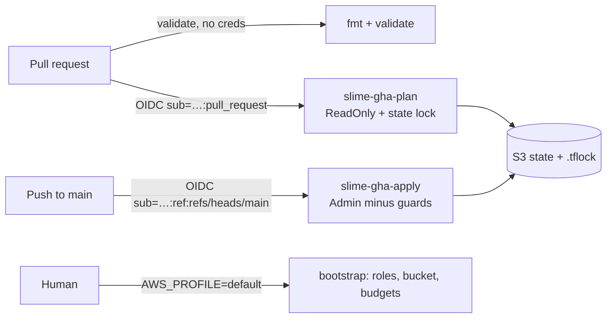

# AWS infrastructure (slime)

Account `025772230981`, home region `eu-central-1`. All state lives in
`s3://slime-tfstate-025772230981` with native S3 locking (`use_lockfile`).

| Stack | State key | Applied by |
|---|---|---|
| [`bootstrap/`](bootstrap/README.md) | `bootstrap/terraform.tfstate` | A human, `default` (admin) profile |
| [`platform/`](#platform-slime-runtime) | `platform/terraform.tfstate` | GitHub Actions on merge to `main` |
| `landing/` (PR #11) | `landing/terraform.tfstate` | GitHub Actions on merge to `main` |

[`terraform.yml`](../../.github/workflows/terraform.yml) picks up every
directory here except `bootstrap/`: a new stack is deployed by adding it. A
stack with a `build.sh` gets it run before plan/apply (platform builds the
runtime bundle). Apply refuses plans with pure deletes; replacements pass.
Run it by hand with `allow_destroy` when a delete is intended.

Once a stack is applied by CI, do not apply it from a branch: the next push to
`main` would plan your branch-only resources away (the delete guard stops it).



## Platform: Slime runtime

[`platform/runtime.tf`](platform/runtime.tf): Lambda `slime-runtime` (Function
URL, arm64, Node 22) built from [`platform/runtime`](../runtime/README.md)
by `npm run build` (it bundles the built `@slime-cloud/core` from
`core/`), and DynamoDB table `slime-handlers` for reviewed Liquid
handlers (partition key `tenantId`, sort key `artifactKey`, which holds
`handlers#<request key>`). Post-deploy CI checks that `/healthz`
answers 401 without a key.

Settings are SSM parameters under `/slime/runtime/`, loaded as env vars at cold
start. Terraform never manages them, so secrets stay out of state. Set them once
(and after any change, force a cold start by redeploying or updating the
function configuration):

```sh
export AWS_PROFILE=slime
put() { aws ssm put-parameter --name "/slime/runtime/$1" --type SecureString --overwrite --value "$2" >/dev/null; }
put SLIME_API_KEY "$(openssl rand -hex 24)"   # clients send it as x-api-key
put DATABASE_URL 'postgres://<read-only user>:<pw>@<host>:5432/<db>'
put SLIME_PROVIDER claude                       # or groq / offline
put ANTHROPIC_API_KEY '<key>'                   # GROQ_API_KEY for groq
```

Any other variable the runtime's
[`src/config.ts`](../runtime/src/config.ts) reads (`SLIME_MODE`,
`MAX_GENERATIONS_PER_HOUR`, ...) can be set the same way. Until `DATABASE_URL` points at a reachable read-only
Postgres, authenticated requests get `503 NOT_READY`.

```sh
URL=$(terraform -chdir=platform/infra/platform output -raw runtime_url)
curl -s "${URL}healthz" -H "x-api-key: $KEY" | jq
```

## Platform: Slime Cloud endpoints

Design: [`docs/architecture/slime-cloud.html`](../../docs/architecture/slime-cloud.html).

- [`platform/control.tf`](platform/control.tf): DynamoDB `slime-control`
  (users, endpoints, usage) with a `NEW_IMAGE` stream, used by
  [`platform/admin`](../admin).
- [`platform/gas-layer.tf`](platform/gas-layer.tf): layer `slime-gas`, the
  runtime bundle under `/opt/slime/` (`platform/runtime/dist/layer`).
- [`platform/provisioner.tf`](platform/provisioner.tf): Lambda
  `slime-provisioner` ([`platform/provisioner`](../provisioner/README.md)),
  triggered by endpoint items that turn `pending`, `updating` or `deleting`. It
  creates, reconfigures and deletes `slime-ep-<id>` functions, roles (bounded by
  `slime-endpoint-boundary`), Function URLs and log groups at runtime; those are
  not in Terraform state.

Model keys for every endpoint are shared SSM parameters, set once by hand:

```sh
aws ssm put-parameter --name /slime/shared/ANTHROPIC_API_KEY --type SecureString --value '<key>'
aws ssm put-parameter --name /slime/shared/GROQ_API_KEY --type SecureString --value '<key>'   # if used
```

Each endpoint's own `DATABASE_URL` and `SLIME_API_KEY` live under
`/slime/endpoints/<id>/`, written by the admin.

## Rules for `platform/`

The CI roles deny anything outside these names, so follow them:

- IAM roles, policies, instance profiles: `slime-*`
- S3 buckets: `slime-*`; Secrets Manager: `slime-*`; SSM parameters: `/slime/*`
- Lambda functions and EventBridge rules: `slime-*`; log groups contain `slime-`
- DynamoDB tables, SQS queues, Kinesis streams, ECR repositories: `slime-*`
  (their data is unreadable to CI otherwise)
- ACM certificates must carry `Project=slime` (provider `default_tags` does it)
- Regional services only in `eu-central-1`
- No changes to `slime-deployer`, `slime-gha-*`, OIDC providers, the state
  bucket's configuration, or budgets: those belong to `bootstrap/`

Local run: `AWS_PROFILE=slime terraform -chdir=platform/infra/platform plan`.

## Known trust gap

The repository is private on GitHub Free: no branch protection and no
environment reviewers. Any collaborator with write access can push to `main`
(and so run apply) or open a PR (and so run plan with read-only access to the
account). The deny fences above keep both roles off non-slime IAM, S3,
secrets, Lambda, EventBridge, ACM, other regions, and budgets, but read-only
metadata elsewhere (e.g. Route 53, Cost Explorer) stays visible to the plan
role. Closing the gap needs GitHub Pro/Team (protected `main` + an `aws`
environment with required reviewers) or a separate AWS account.

A stale lock (job killed mid-run) shows as `<key>.tflock` in the bucket; clear
it with `terraform force-unlock <id>` only after confirming no run is active.

## Option: AWS CodeBuild as the GitHub Actions runner

CodeBuild can host GitHub Actions jobs: a CodeBuild project linked to the repo
receives `WORKFLOW_JOB_QUEUED` webhooks and starts an ephemeral runner, and a job
selects it with
`runs-on: codebuild-<project>-${{ github.run_id }}-${{ github.run_attempt }}`.

**What it adds**

- Jobs run inside AWS: the project's service role supplies credentials (no
  OIDC step), and the runner can sit in a VPC to reach private resources (RDS,
  internal endpoints) that a GitHub-hosted runner cannot.
- Larger, ARM, or GPU machines; no GitHub Actions minutes consumed.
- Price in eu-central-1 (AWS Pricing API, on-demand per build minute):
  Linux `general1.small` $0.005, `general1.medium` $0.010, ARM small $0.00385.

**What it costs in trust and setup**

- One-time manual step: a CodeConnections (GitHub App) connection must be
  authorized in the AWS console; Terraform can only create it in `PENDING`.
- The credential boundary moves from the OIDC `sub` claim to the webhook
  filter and the project's role. Any workflow in the repo that names the
  runner gets that role, including PR workflows, unless the filter restricts
  events and branches. Safe shape: two projects, a read-only one for PRs and a
  write one filtered to `refs/heads/main` pushes.
- Cold start (provisioning) adds tens of seconds per job versus GitHub-hosted.

**Recommendation for now:** keep GitHub-hosted runners + OIDC for Terraform.
The project has no private-network resources yet and Terraform jobs are short.
Switch the jobs that need VPC access or heavy machines to CodeBuild later; the
roles and state layout here stay valid.
