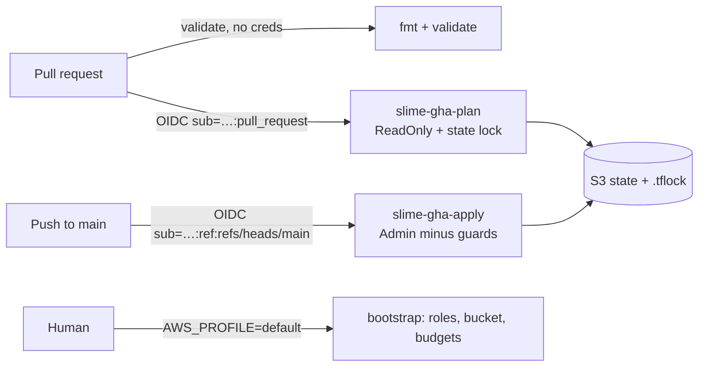
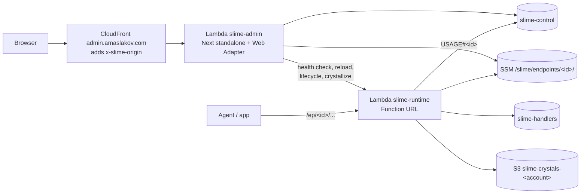

# AWS infrastructure (slime)

Account `025772230981`, home region `eu-central-1`. All state lives in
`s3://slime-tfstate-025772230981` with native S3 locking (`use_lockfile`).

| Stack | State key | Applied by |
|---|---|---|
| [`bootstrap/`](bootstrap/README.md) | `bootstrap/terraform.tfstate` | A human, `default` (admin) profile |
| [`platform/`](#platform-slime-cloud) | `platform/terraform.tfstate` | GitHub Actions on merge to `main` |
| `landing/` (PR #11) | `landing/terraform.tfstate` | GitHub Actions on merge to `main` |
| [`atlas/`](atlas/README.md) | `atlas/terraform.tfstate` | GitHub Actions on merge to `main` (first apply by hand from the branch, 2026-11-22) |

[`terraform.yml`](../../.github/workflows/terraform.yml) picks up every
directory here except `bootstrap/`: a new stack is deployed by adding it. A
stack with a `build.sh` gets it run before plan/apply (platform builds the
runtime bundle and the admin; atlas bundles `examples/customer-site`). Apply refuses plans with pure deletes; replacements pass.
Run it by hand with `allow_destroy` when a delete is intended.

A push to `main` deploys when it touches any input of a deployed artifact:
`platform/**`, `core/**`, `crystal/**`, the root `package.json` or
`package-lock.json`, or the workflow itself. Docs- and examples-only merges do
not deploy. Before apply, a run checks that `main` has not changed those inputs
since its own commit; if it has, the run skips apply (a notice says so) and
leaves it to the newer run. So a **Re-run** of an old run never rolls prod
back. To redeploy the current `main`, use **Run workflow**.

Once a stack is applied by CI, change it only through a pull request:

- do not `terraform apply` it from a laptop or a branch: the next push to
  `main` would plan your branch-only resources away (the delete guard stops it);
- do not edit its resources with `aws` CLI or the console (for example
  `aws lambda update-function-configuration`): the next apply reverts managed
  attributes, and until then prod differs from `main`.

The one planned exception was the cloud MVP cutover below, applied from its
branch so that the CI apply after merge shows no changes. Resources that are
deliberately outside Terraform are listed where they are used: the SSM secrets
(below) and the temporary test database.



## Platform: Slime Cloud

Design: [`docs/architecture/2026-11-21-cloud-mvp-design.md`](../../docs/architecture/2026-11-21-cloud-mvp-design.md).
No AWS resource is created per endpoint: an endpoint is an SSM path, a control
item, a handler partition and an S3 prefix.



- [`platform/runtime.tf`](platform/runtime.tf): Lambda `slime-runtime`
  (Function URL, auth in the app, arm64, Node 22, 60 s) built from
  [`platform/runtime`](../runtime/README.md) by `npm run build` (it bundles the
  built `@slime-cloud/core` from `core/`). One function serves every endpoint
  under `/ep/<id>/`; it reads `/slime/endpoints/<id>/` and `/slime/shared/`
  per endpoint, caches up to 8 endpoint engines per instance and re-reads
  their settings every 30 s. DynamoDB `slime-handlers` holds reviewed Liquid
  handlers (partition key `tenantId` = endpoint id, sort key `artifactKey`,
  which holds `handlers#<request key>`). The role may update only `USAGE#*`
  items on `slime-control`, and only the usage attributes. One role reads every
  endpoint: per-endpoint IAM isolation is out of scope for the MVP.
- [`platform/admin.tf`](platform/admin.tf): Lambda `slime-admin`
  ([`platform/admin`](../admin/README.md) as a Next standalone build on the AWS
  Lambda Web Adapter layer), its Function URL, and CloudFront at
  `https://admin.amaslakov.com/` (ACM certificate in us-east-1, Route 53
  records in the existing `amaslakov.com` zone). CloudFront adds a random
  `x-slime-origin` header that the admin's `proxy.ts` requires; OAC is not used
  because it breaks browser POSTs (server actions). The admin writes endpoint
  settings to SSM, health-checks endpoints through the runtime URL and tears
  them down (handlers, Crystal prefix, control item, settings).
- [`platform/crystals.tf`](platform/crystals.tf): bucket
  `slime-crystals-<account>` for Crystal modules
  (`endpoints/<id>/crystal/manifest.json` and `<crystal key>.mjs`): private,
  SSE-S3, TLS only, versioned (noncurrent versions expire after 30 days).
- [`platform/control.tf`](platform/control.tf): DynamoDB `slime-control`
  (users, endpoints, usage), written by the admin and (usage only) the runtime.
  No stream.
- [`platform/alerting.tf`](platform/alerting.tf): nine CloudWatch alarms
  publishing to `ops-alerts`, the account-wide topic that ex-infra owns and
  forwards to Telegram (exo-bot) and email. Runtime: Errors (timeouts),
  handled 500s and `Flush failed` (log metric filters), p99 Duration > 50 s.
  Admin: Function URL 5xx and p99 Duration. Atlas: Function URL 5xx. Account:
  claimed concurrency >= `account_concurrency_alarm` (800) and Throttles.
  Post-deploy CI warns while the topic has no confirmed subscription. The
  landing has no alarms (cached static page).

Post-deploy CI checks: runtime `/healthz` → 401, unknown endpoint → 404, admin
`/login` → 200 through CloudFront, a POST through CloudFront is neither 403 nor
5xx, the landing links to the admin, the bucket and tables exist, and the
alerts topic has a confirmed subscription (a warning, not a failure); then the
Playwright cloud smoke (`npm run e2e:cloud` in `platform/admin`) when the
`SMOKE_EMAIL` / `SMOKE_PASSWORD` repository secrets are set.

The per-endpoint provisioner (`slime-provisioner`, the `slime-gas` layer, the
`slime-endpoint-boundary` policy and the control-table stream trigger) was
removed by the cloud MVP; git history keeps it.

### One-time SSM parameters

Terraform never manages these, so secrets stay out of state. Set them by hand
before the first apply (values are never printed):

```sh
export AWS_PROFILE=slime
put() { aws ssm put-parameter --name "$1" --type SecureString --overwrite --value "$2" >/dev/null; }
put /slime/admin/SESSION_SECRET "$(openssl rand -base64 36)"
put /slime/admin/ADMIN_ALLOWED_EMAILS 'you@example.com,smoke@example.com'   # comma-separated, invite-only sign-up
put /slime/shared/ANTHROPIC_API_KEY '<key>'                                  # only if endpoints use claude
put /slime/shared/GROQ_API_KEY '<key>'                                       # only if endpoints use groq
```

Alarm delivery (Telegram forwarder, email subscription, the bot token in
SSM `/ex-infra/alerts/`) is set up in ex-infra: `infra/terraform/aws/README.md`
("Ops alerting"). This repository only publishes to the topic.

The admin loads `/slime/admin/*` at cold start: after changing one, force a
cold start (update the function configuration or redeploy). The runtime
re-reads `/slime/shared/*` within 30 s. Each endpoint's `DATABASE_URL`,
`SLIME_API_KEY`, `CRYSTAL_TOKENS` and `SLIME_PROVIDER` live under
`/slime/endpoints/<id>/`, written only by the admin.

```sh
URL=$(terraform -chdir=platform/infra/platform output -raw runtime_url)
curl -s "${URL}ep/<id>/healthz" -H "x-api-key: <slm_ key>" | jq
```

### Cutover apply order (cloud MVP, ran from the branch on 2026-11-21)

Done once; kept as the record of how the provisioner was retired. Steps 1–6 ran
from `feat/cloud-mvp`; step 7 runs on merge.

1. Check that no `slime-ep-*` functions or roles exist and that `slime-control`
   holds no endpoint items.
2. Set the one-time SSM parameters above.
3. `bash platform/infra/platform/build.sh`, then
   `terraform -chdir=platform/infra/platform plan -out=tfplan`. Expect only
   the provisioner, layer, boundary and event-source-mapping deletes, and the
   bucket, admin and CloudFront creates. Then `terraform apply tfplan`.
4. `aws_lambda_layer_version.gas` had `skip_destroy`, so its versions stay in
   AWS: delete each with `aws lambda delete-layer-version --layer-name slime-gas
   --version-number <n>` until `aws lambda list-layer-versions --layer-name
   slime-gas` returns an empty list.
5. Run the post-deploy checks and the cloud smoke.
6. Remove the `aws.untagged` provider alias from `versions.tf` (it existed only
   to delete the event-source mapping) and apply again: "No changes".
7. After merge, the first CI apply on `main` re-uploads `slime-runtime` once:
   the bundle built on macOS and on CI's Linux differs byte-wise for the same
   code. The next CI plan shows no changes. Build branch applies in Linux
   (`node:22`) to avoid it; admin (input-hash trigger) and landing already match.

### Test and demo database (`slime-test-db`, not in Terraform)

An RDS created by hand on 2026-11-22: PostgreSQL 16, `db.t4g.micro`, 20 GB gp3,
one AZ, no backups, encrypted, public (the runtime Lambda has no VPC and no
fixed IPs; security group `slime-test-db` opens 5432, SSL is forced, passwords
are random). It holds two databases:

- `slime`: the SaaS demo schema from `examples/express/db/init.sql`, used by the
  cloud smoke. Read-only `slime_reader`: SSM `/slime/test-db/READER_URL`.
- `shop`: the demo online shop from `examples/shop/db/shop.sql`
  ([examples/shop](../../examples/shop/README.md)). Read-only `shop_reader`:
  SSM `/slime/test-db/SHOP_READER_URL`. Reload with
  `examples/shop/scripts/load-rds.sh` (drops and recreates `shop` and rotates
  the reader password).

Access and lifecycle:

- URLs: the two reader URLs above (use these for endpoints) and
  `/slime/test-db/MASTER_URL`. All end in
  `?sslmode=require&uselibpqcompat=true`: `pg` 8.x treats plain `sslmode=require`
  as verify-full, and the RDS CA is not in Node's trust store.
- Full cloud lifecycle: `SMOKE_DB_URL=$(aws ssm get-parameter --with-decryption
  --name /slime/test-db/READER_URL --query Parameter.Value --output text) npm run
  e2e:cloud` in `platform/admin` (with `SMOKE_EMAIL`/`SMOKE_PASSWORD`).
- **Paused since 2026-11-24**: deleted with the final snapshot
  `slime-test-db-pause-2026-11-24` (≈ $0 while paused; running it costs
  ≈ $0.65/day, ≈ $20/month incl. its public IPv4). The security group and
  `/slime/test-db/*` were kept. Restore (≈ 10 min; the same identifier gives the
  same hostname, and the snapshot keeps the passwords, so the SSM URLs stay
  valid; `AWS_PROFILE=default`):

  ```sh
  aws rds restore-db-instance-from-db-snapshot --region eu-central-1 \
    --db-instance-identifier slime-test-db \
    --db-snapshot-identifier slime-test-db-pause-2026-11-24 \
    --db-instance-class db.t4g.micro --storage-type gp3 \
    --db-subnet-group-name default --vpc-security-group-ids sg-025c001b096625ec1 \
    --publicly-accessible --no-multi-az \
    --tags Key=Project,Value=slime Key=Purpose,Value='cloud E2E test and demo shop database'
  aws rds wait db-instance-available --region eu-central-1 --db-instance-identifier slime-test-db
  ```

  Before the pause it ran permanently from 2026-11-22 (the stop schedule and
  its role are deleted; RDS restarts a stopped instance after 7 days anyway);
  budget `slime-monthly` was raised to $30 for it
  (`bootstrap/variables.tf`). Remove it for good with
  `aws rds delete-db-instance --db-instance-identifier slime-test-db
  --skip-final-snapshot`, then delete the security group and `/slime/test-db/*`
  (three parameters).

## Rules for `platform/`

The CI roles deny anything outside these names, so follow them:

- IAM roles, policies, instance profiles: `slime-*`
- Every IAM role sets `permissions_boundary` to
  `arn:aws:iam::<account>:policy/slime-workload-boundary`: the apply role
  refuses to create a role, or change a role's policies, without it, and the
  boundary caps the role at the same fences (no foreign data, no IAM writes,
  no role switching). See [`bootstrap/boundary.tf`](bootstrap/boundary.tf).
- S3 buckets: `slime-*`; Secrets Manager: `slime-*`; SSM parameters: `/slime/*`
- Lambda functions and EventBridge rules: `slime-*`; log groups contain `slime-`
- DynamoDB tables, SQS queues, Kinesis streams, ECR repositories: `slime-*`
  (their data is unreadable to CI otherwise)
- ACM certificates must carry `Project=slime` (provider `default_tags` does it)
- Regional services only in `eu-central-1`
- No changes to `slime-deployer`, `slime-gha-*`, `slime-budgets-action`, the
  `slime-budget-freeze` and `slime-workload-boundary` policies, OIDC providers,
  the state bucket's configuration, or budgets: those belong to `bootstrap/`
- Foreign resources stay read-only to CI: no writes to SSM parameters outside
  `/slime/*`, no subscription filters or exports on foreign log groups, no
  changes to foreign SNS topics (publishing and listing subscriptions are
  allowed, e.g. on ex-infra's `ops-alerts`)

Local run: `AWS_PROFILE=slime terraform -chdir=platform/infra/platform plan`.

## Known trust gap

The repository is private on GitHub Free: no branch protection and no
environment reviewers. Any collaborator with write access can push to `main`
(and so run apply) or open a PR (and so run plan with read-only access to the
account). The deny fences above keep both roles off non-slime IAM, S3,
secrets, Lambda, EventBridge, ACM, other regions, and budgets, and the
workload boundary keeps every role CI creates inside the same fences (before
it, a commit on `main` could create an unfenced role and read any SSM
parameter in the account through a Lambda), but read-only
metadata elsewhere (e.g. Route 53, Cost Explorer) stays visible to the plan
role. Closing the gap needs GitHub Pro/Team (protected `main` + an `aws`
environment with required reviewers) or a separate AWS account.

A stale lock (job killed mid-run) shows as `<key>.tflock` in the bucket; clear
it with `terraform force-unlock <id>` only after confirming no run is active.

## Option: AWS CodeBuild as the GitHub Actions runner

CodeBuild can host GitHub Actions jobs: a CodeBuild project linked to the repo
receives `WORKFLOW_JOB_QUEUED` webhooks and starts an ephemeral runner, and a job
selects it with
`runs-on: codebuild-<project>-${{ github.run_id }}-${{ github.run_attempt }}`.

**What it adds**

- Jobs run inside AWS: the project's service role supplies credentials (no
  OIDC step), and the runner can sit in a VPC to reach private resources (RDS,
  internal endpoints) that a GitHub-hosted runner cannot.
- Larger, ARM, or GPU machines; no GitHub Actions minutes consumed.
- Price in eu-central-1 (AWS Pricing API, on-demand per build minute):
  Linux `general1.small` $0.005, `general1.medium` $0.010, ARM small $0.00385.

**What it costs in trust and setup**

- One-time manual step: a CodeConnections (GitHub App) connection must be
  authorized in the AWS console; Terraform can only create it in `PENDING`.
- The credential boundary moves from the OIDC `sub` claim to the webhook
  filter and the project's role. Any workflow in the repo that names the
  runner gets that role, including PR workflows, unless the filter restricts
  events and branches. Safe shape: two projects, a read-only one for PRs and a
  write one filtered to `refs/heads/main` pushes.
- Cold start (provisioning) adds tens of seconds per job versus GitHub-hosted.

**Recommendation for now:** keep GitHub-hosted runners + OIDC for Terraform.
The project has no private-network resources yet and Terraform jobs are short.
Switch the jobs that need VPC access or heavy machines to CodeBuild later; the
roles and state layout here stay valid.
